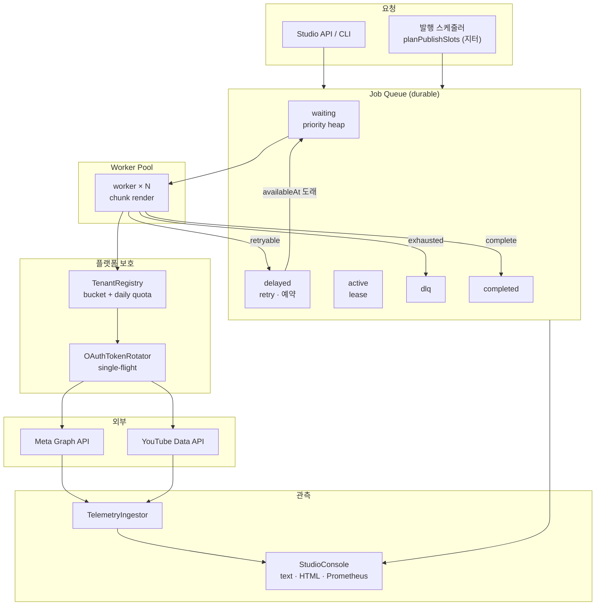
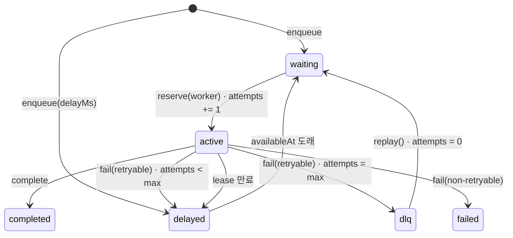
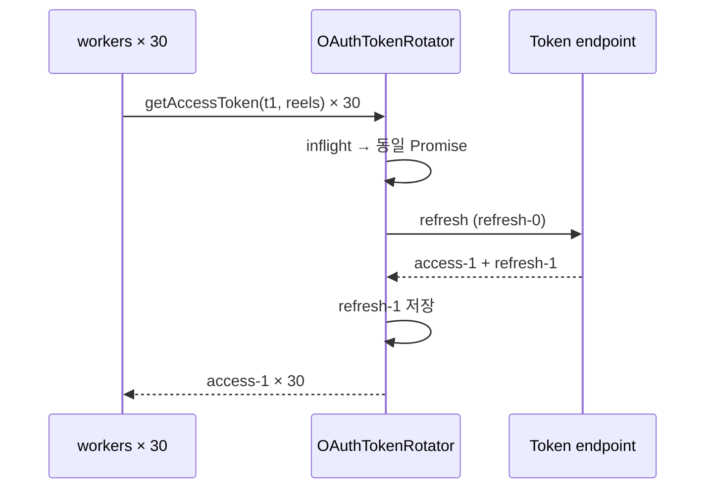
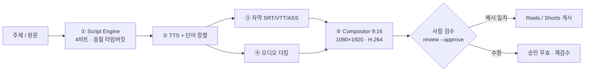
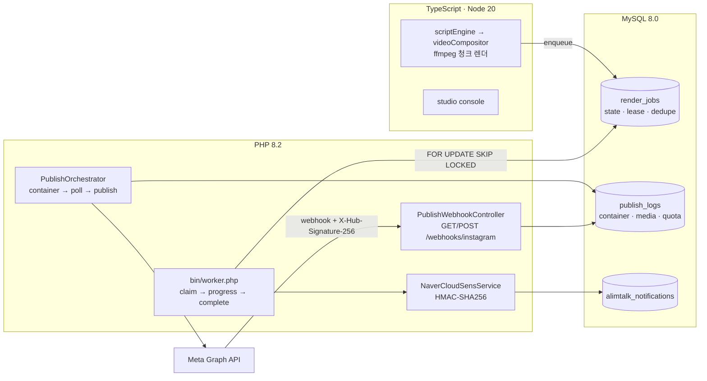

# shortform-engine

**숏폼 제작 파이프라인을, 대행사가 30명의 계정을 굴릴 수 있는 B2B 배포 플랫폼으로.**

한 편의 60초 영상을 만드는 것(대본 → 자막 → 더킹 → 9:16 인코딩 → 게시)과,
그것을 **수십 개 테넌트 · 수백 편 · 플랫폼 쿼터 안에서** 안정적으로 돌리는 것은
완전히 다른 문제입니다. 이 저장소는 두 번째 문제를 풉니다.

`TypeScript` · `Node.js 20` · `ffmpeg` · `Vitest 324 tests` · `커버리지 84.3%`
`PHP 8.2` · `MySQL 8.0` · `Meta Graph API` · `NCP SENS 알림톡` · `PHPUnit 85 tests`

| 계층 | 무엇을 보장하나 |
|------|------------------|
| **분산 렌더 큐** | 인코딩은 재시도·지연·DLQ가 있는 작업이다. 워커가 죽어도 작업은 돌아온다 |
| **워커 풀** | CPU를 넘지 않는 동시성, 청크 단위 진행률, lease 기반 장애 복구 |
| **레이트 리밋** | Meta 25건/일 · YouTube 1,600 unit/업로드(하루 6편)를 코드가 알고 있다 |
| **멀티테넌트** | 대행사 A의 폭주가 크리에이터 B의 예약을 밀어내지 않는다 |
| **OAuth 로테이션** | 30개 예약이 동시에 만료 토큰을 만나도 토큰 갱신은 1회 |
| **훅 A/B** | 훅 3안 → 웹훅 집계 → 통계 판정 → 다음 대본 가중치까지 닫힌 루프 |
| **스튜디오 콘솔** | 큐·워커·쿼터·OAuth·실험을 한 스냅샷으로. text/HTML/Prometheus |
| **서버 계층(DB·API)** | 큐 상태·발행 기록·알림 이력이 MySQL 행으로 남고, PHP 워커가 `SKIP LOCKED`로 선점한다 |

```bash
npm ci && npm run verify      # 324 tests, 네트워크·ffmpeg 없이
npm run cli -- studio         # 데모 콘솔 (아래 출력 참고)
```

---

## 1. 문제: 편당 90분, 그리고 그 다음에 오는 네 개의 벽

수작업 기준 숏폼 1편은 90분입니다. 이 중 60분은 창작이 아니라 규격 맞추기(자막 싱크,
더킹 키프레임, 9:16 인코딩, 업로드 거절 대응)이고, 이 엔진은 그 60분을 코드로 대체합니다.
1세대 파이프라인은 그걸 편당 3분으로 줄였습니다.

그런데 **대행사가 하루 60편을 예약하는 순간** 1세대 구조가 깨집니다.

| 벽 | 실제로 벌어지는 일 | 이 저장소의 답 |
|----|--------------------|----------------|
| **헤드오브라인 블로킹** | 8분짜리 4K 렌더 하나가 뒤의 59편을 막는다 | 우선순위 큐 + 워커 풀. 렌더는 작업이고, 작업은 병렬이다 |
| **실패의 두 종류** | 코덱 미지원(영구)과 인코더 OOM(일시)이 같은 `catch`에 걸린다 | 상태머신: 재시도 3회 → DLQ / 비재시도 → failed |
| **플랫폼 쿼터** | YouTube는 하루 6편이 상한인데 7번째에서 403을 맞는다 | 일일 쿼터(unit)와 요청 버킷을 분리해 사전에 막는다 |
| **테넌트 격리** | 한 계정의 바이럴 대응이 다른 계정의 예약을 지연시킨다 | 버킷·쿼터를 테넌트 런타임에 격리 |

> 핵심 주장: **"FFmpeg를 잘 부른다"가 아니라 "실패하는 작업을 어떻게 다시 살리고,
> 남의 몫을 빼앗지 않게 스케줄하는가"** 입니다. 이 계층이 없으면 로컬 도구이고,
> 있으면 B2B SaaS입니다.

---

## 2. 아키텍처



**원칙**

1. **큐가 유일한 진실** — 워커는 상태를 들고 있지 않다. 죽으면 lease가 만료되고 다른
   워커가 회수한다.
2. **부수효과는 전부 주입** — 시계·난수·sleep·HTTP·토큰 리프레셔. CI에서 실제 대기 없이
   재시도와 장애 복구를 검증한다.
3. **계산과 실행 분리** — 렌더는 계획을 먼저 만들고, 실행은 워커에서만.

모듈: `src/lib/queue` · `src/lib/rateLimit` · `src/lib/telemetry` · `src/services/studio`.
상세 설계와 트레이드오프는 **[docs/distributed-video-pipeline-spec.md](docs/distributed-video-pipeline-spec.md)**.

---

## 3. 분산 렌더 큐



| 규칙 | 값 | 이유 |
|------|-----|------|
| 우선순위 | 0–9 | 유료 테넌트 예약(9)이 야간 백필(0)보다 먼저 |
| 동순위 | 도래시각 → 생성시각 → id | 재시작해도 순서가 결정적 |
| 재시도 | 3회 | OOM·일시 5xx는 2회 안에 대부분 회복 |
| 백오프 | **1s → 2s → 4s** (상한 30s, 지터 50%) | 폭주 분산 + 최소 대기 보장 |
| lease | 30s, heartbeat 연장 | 워커 사망 감지 |
| DLQ | 재시도 소진 | 자동 재시도로 풀리지 않는 상태 격리 |
| 멱등 | `dedupeKey` | 웹훅 재전송이 같은 편을 두 번 렌더하지 않게 |
| 진행률 | 0–100, 단조 | 늦게 온 청크 이벤트가 바를 되감지 않게 |

```ts
const queue = new JobQueue({ store: new FileQueueStore('.work/queue/state.json') });
await queue.enqueue({
  tenantId: 'agency-morning',
  name: 'render episode-07',
  priority: 9,
  payload: { projectId: 'episode-07', platform: 'instagram-reels', durationSec: 45, chunkCount: 4 },
  dedupeKey: 'episode-07:reels',
});
```

**시도 횟수는 시작 시점에 증가**합니다. 그래서 "시작만 하고 끝나지 못하는" job도 결국
DLQ로 갑니다. 성공/실패 시에 증가시키면 그런 job이 영원히 큐를 돕니다.

**저장소**: `QueueStore` 인터페이스(`get/put/delete/all`)만 알면 됩니다. 기본은
`InMemoryQueueStore`(테스트)와 `FileQueueStore`(CLI, 원자적 tmp→rename). Redis 어댑터는
같은 인터페이스에 `ZADD ready` / `HSET job:{id}` / Lua `reserve`로 대응합니다 —
**어댑터는 미구현이며, 문서에 그렇게 적혀 있습니다.**

---

## 4. 워커 풀과 장애 복구

- **고정 동시성** — 인코딩은 CPU 바운드라 코어 수 이상은 p95만 나쁘게 만든다.
  `maxObservedConcurrency ≤ size`를 테스트로 고정.
- **청크 렌더** — 마지막 청크는 muxer flush + faststart 때문에 1.35배 무겁다. 진행률은
  청크 완료마다 스트리밍.
- **드레인 / 상시** — 야간 배치는 `drain({ waitForDelayed: true })`, 상시는 `start/stop`.
- **stalled 복구** — lease 만료 job을 `active → delayed`로 되돌리고 attempts는 유지.

실측 (`queue run --jobs 11 --concurrency 3 --fail-every 7`, 7번째 작업은 항상 실패 → 3회 시도 후 DLQ):

```
⚙ 큐 처리 시도 13건 (성공 10 / 실패 3) · 2235ms
   최대 동시 워커 3 · 평균 처리 444ms · p95 479ms
   waiting 0 · delayed 0 · dlq 1

   워커별 부하:
     worker-1    67%  완료 3 · 실패 1
     worker-2    67%  완료 3 · 실패 2
     worker-3    75%  완료 4 · 실패 0
```

---

## 5. 레이트 리밋: 버킷과 쿼터는 다른 다이얼

| 다이얼 | 질문 | 회복 |
|--------|------|------|
| 토큰 버킷 | "지금 연속으로 몇 건까지?" | 초당 리필 |
| 일일 쿼터 | "오늘 예산이 이 작업을 감당하나?" | 24시간 창 |

두 개를 분리한 이유는 **실패 모양이 다르기 때문**입니다. 버킷은 몇 분이면 회복되지만
YouTube 일일 쿼터는 자정까지 회복되지 않습니다. 하나로 합치면 "5분 뒤"와 "내일 6시"를
구분할 수 없습니다.

| 플랫폼 | 버스트 | 지속 | 일일 | 작업 단가 |
|--------|--------|------|------|-----------|
| Meta Graph | 30 | 0.2/s | 25건 | 1 |
| YouTube Data v3 | 20 | 0.1/s | 10,000 unit | 1,600 unit (= 업로드 6편) |

- **429는 실패가 아니라 "아직"** — `Retry-After`를 하드 스톱으로 적용하고 재시도 횟수를
  깎지 않습니다.
- **테넌트 격리는 자료구조** — 버킷·쿼터·패널티가 테넌트 런타임 안에 있고,
  `exhausts one tenant's quota without touching another` 테스트로 고정.
- **차감은 all-or-nothing** — 버킷이 거절하면 쿼터도 차감되지 않습니다(거절된 호출이
  일일 예산을 먹는 버그 방지).

---

## 6. OAuth 2.0: 30개 예약, 1번의 토큰 갱신



| 상황 | 처리 |
|------|------|
| 만료 5분 전 | 선제 갱신 |
| 동시 30건 | single-flight로 1회 호출 |
| `invalid_grant` | `needs-reauth` — 재시도 금지, 운영자 재연결 |
| 5xx / 타임아웃 | 재시도 가능 오류, 상태 유지 |
| 로테이션 | 새 refresh token 즉시 저장 |

콘솔 스냅샷에도 토큰 값은 없습니다. "재인증 필요"라는 사실만 노출합니다.

---

## 7. 지터 발행 스케줄러

매일 09:00:00, 10:00:00, 11:00:00 정각 발행은 스케줄러의 지문입니다. 그렇다고 무작위로
흩뿌리면 운영이 불가능합니다. 절충은 **최소 간격 + 남는 여유의 지수 분포 배분 + 양 끝
난수 오프셋 + 분 경계 15초 회피**입니다. 균등 난수로 버킷을 채우는 흔한 방식은 버킷이
최소 간격에 가까울 때 클램프되어 "정확히 120분 간격"을 만들어 냅니다.

```
발행 슬롯 6건 · 09:00~23:00 · 최소 60분
   1. 10:24:21  (+0분)
   2. 13:35:41  (+191분)
   3. 16:16:21  (+161분)
   4. 17:32:28  (+76분)
   5. 18:34:30  (+62분)
   6. 22:35:32  (+241분)
  간격 평균 146분 · 표준편차 68분 · 규칙성 0.466
```

`규칙성 = 표준편차/평균`. 0이면 기계, 1에 가까울수록 불규칙. 위 실행은 0.466입니다.
창이 최소 간격을 감당하지 못하면 **계획 단계에서 거부**합니다.

---

## 8. 훅 A/B 테스트와 성과 피드백

같은 영상에 훅 3안(질문·숫자·반론)을 만들어 노출을 나누고, 24시간/7일 지표로 판정한 뒤
다음 대본의 훅 가중치로 되돌립니다.

| 지표 | 계산 |
|------|------|
| `viewRate3s` | 3초 조회 / 노출 — 스크롤을 멈췄는가 |
| `retention` | 완청 / 3초 조회 — 끝까지 봤는가 |
| `avgWatchSec` | 시청시간 / 3초 조회 |
| `commentRate` | 댓글 / 노출 |

**판정은 일부러 보수적입니다.**

1. 변형당 표본 < 200 → `insufficient-data`. 첫 100뷰는 알고리즘 셔플이지 훅 성과가 아님.
2. **리더 vs 2위**만 z-검정. 3개를 전부 쌍비교해 최소 p값을 고르는 것이 가짜 승자의
   전형(다중비교).
3. 통계적 유의성 **그리고** 상대 리프트 ≥ 5%. n=200,000의 0.4pp 차이는 유의하지만 무의미.

필요 표본 (baseline 40%, α=0.05, power=0.8): **+5% → 9,493 / +10% → 2,389 / +20% → 604**
(변형당). 이 숫자를 README에 두는 이유는, "A/B 했습니다"보다 "이 표본이 없으면 승자를
부르지 않습니다"가 엔지니어링 주장이기 때문입니다.

피드백 가중치는 승률이 아니라 **대조군 대비 리프트**의 축소 추정 + 탐험 하한 8%로
계산합니다. 승률을 쓰면 "실험에서 진 각도"가 "아직 안 해본 각도"보다 낮게 평가되어
영원히 뒤로 밀립니다.

```bash
npm run cli -- hooks --topic "부산 신혼집 3평 주방 수납 정리법"
#  A [question  ] 2.95s  부산 신혼집, 왜 또 원래대로일까요?
#  B [numbers   ] 2.59s  부산 신혼집 3가지만 바꾸세요
#  C [contrarian] 3.25s  부산 신혼집 3평 주방, 더 하면 안 됩니다
```

모든 훅은 대본 엔진과 같은 **3.5초 상한**을 통과해야 실험에 올라갑니다.

---

## 9. 스튜디오 콘솔과 조작 API

`npm run cli -- studio` — 네트워크·ffmpeg 없이 내장 데모 상태로 실행됩니다.

```
STUDIO CONSOLE  2026-11-11T00:47:55.079Z  [DEGRADED]
──────────────────────────────────────────────────────────────────
QUEUE  total 13  ok  83%  p95 133ms  retries 3
       waiting   0  active   0  delayed   1  done  10  failed   1  dlq   1
──────────────────────────────────────────────────────────────────
WORKERS
  worker-1   ██████████████████  98%  idle    ok 4 fail 3
  worker-2   █████████████░░░░░  74%  idle    ok 3 fail 1
  worker-3   █████████████░░░░░  73%  idle    ok 3 fail 0
──────────────────────────────────────────────────────────────────
TENANT RATE LIMITS
  모닝픽쳐스 (대행사) (agency)
    meta     req ████████░░  57/75  quota ███░░░░░░░ 7/25
    youtube  req █████████░  46/50  quota ████░░░░░░ 3600/10000
  봄날의기록 (growth)
    meta     req █████████░  42/45  quota █████████░ 22/25
    youtube  req ██████████  30/30  quota ██████████ 10000/10000
  따뜻한스튜디오 (starter)
    meta     req ██████████  30/30  quota ██████████ 25/25
    youtube  req ██████████  20/20  quota ██████████ 10000/10000
──────────────────────────────────────────────────────────────────
OAUTH
  agency-morning instagram-reels  active       exp   42m  refreshes 0
  agency-morning youtube-shorts   active       exp   51m  refreshes 0
  creator-bom instagram-reels  expired      exp    0m  refreshes 0
──────────────────────────────────────────────────────────────────
HOOK A/B
  exp-kitchen-hook  retention/24h  winner
    B numbers     65.6%  n=18900  lift   37.5%  p 0.000
    C contrarian  53.0%  n=16800  lift   11.1%  p 0.000
    A question    47.7%  n=17400  lift    0.0%  p 1.000
    winner: B  confidence 100.0%
  exp-commute-hook  retention/24h  inconclusive
    C contrarian  41.3%  n= 6000  lift    0.1%  p 0.943
    B numbers     41.3%  n= 6100  lift    0.1%  p 0.962
    A question    41.3%  n= 6300  lift    0.0%  p 1.000
    winner: —  confidence 1.9%
──────────────────────────────────────────────────────────────────
DEAD LETTER QUEUE  1 job(s) need a decision
  job_007  agency-morning  render   attempts 3/3  waiting 2m 14s
    render-episode-07  ·  encoder OOM (worker restarted)
  재시도/폐기: npm run cli -- queue replay <jobId> · studio --serve 로 열면 원클릭 버튼이 동작합니다
──────────────────────────────────────────────────────────────────
HEALTH: 1 job(s) in DLQ · 1 non-retryable failure(s) · success rate 83.3%
```

같은 스냅샷이 `--html .work/studio.html`(자체 CSS, 외부 CDN 없음)과 Prometheus
(`GET /v1/metrics`)로 나옵니다.

**읽기 API는 GET 전용, 변경은 딱 두 개의 POST뿐입니다.** GET으로 큐를 되돌릴 수 있는
대시보드는 메일 스캐너나 미리보기 봇이 언젠가 실수로 되돌립니다. 그래서 DLQ 조작은
명시적 POST + 경로의 job id로만 가능하고, 어떤 작업이 바뀔 수 있는지는
`DlqActionService`가 판단합니다.

| 경로 | 내용 |
|------|------|
| `GET /` | 콘솔 HTML (조작 버튼이 이 서버로 연결됨) |
| `GET /v1/health` | 상태 + 사유 |
| `GET /v1/queue`, `/v1/queue/dlq` | 큐 상태·격리 작업·최근 조작 기록 |
| `GET /v1/workers` | 워커별 처리량·활용률 |
| `GET /v1/tenants/:id/limits` | 테넌트별 버킷·쿼터 잔량 |
| `GET /v1/experiments/:id` | 훅 실험 판정 |
| `GET /v1/metrics` | Prometheus text |
| `POST /v1/queue/dlq/:jobId/retry` | 재시도 (시도 횟수 초기화 후 `waiting`) |
| `POST /v1/queue/dlq/:jobId/discard` | 폐기 (행 삭제, 이벤트 로그에 사유) |

### 9.1 DLQ 원클릭 재시도 / 폐기

새벽 2시에 대시보드를 보는 사람이 필요한 것은 "DLQ 7건"이 아니라 **"이 작업을 다시 돌릴까,
버릴까"를 누를 수 있는 버튼**입니다.

```bash
npm run cli -- studio --serve            # http://127.0.0.1:8099/ — 콘솔 + 조작 API
npm run cli -- studio --serve --port 0   # OS가 빈 포트를 고름
```

버튼을 누르면 무슨 일이 일어나는지가 제품의 신뢰를 만듭니다.

| 결정 | 규칙 |
|------|------|
| **누가 바꿀 수 있나** | `dlq`/`failed` 상태만. `active`·`waiting`·`completed`는 거부(409) — 실수로 진행 중인 렌더를 되살리지 않는다 |
| **재시도** | 시도 횟수·진행률·에러를 초기화하고 `waiting`으로. `attempts 3/3`이 그대로면 즉시 다시 DLQ로 간다 |
| **폐기** | 행을 지운다. `discarded` 이벤트에 사유·행위자가 남아 감사 가능하다 |
| **두 번 누르면** | 재시도된 작업은 `waiting`이므로 같은 요청이 409로 거부된다(멱등 거부) |
| **기록** | 모든 시도는 `applied`/`rejected`로 남고 콘솔·API(`actions`)에서 보인다. 거부도 기록이다 |
| **파일로 연 콘솔** | POST할 서버가 없으므로 버튼을 비활성으로 그리고 이유를 적는다(눌러도 아무 일 없는 버튼을 그리지 않는다) |

```text
$ curl -X POST localhost:8099/v1/queue/dlq/job_007/retry -d '{"actor":"seunghye"}'
{ "ok": true, "action": "retry", "jobId": "job_007", "state": "waiting", ... }
$ curl -X POST localhost:8099/v1/queue/dlq/job_007/retry
{ "ok": false, "jobId": "job_007", "message": "작업 상태가 waiting입니다. ...", "retryable": false }
```

건강도: `ok` → `degraded`(DLQ 1건·비재시도 실패·쿼터 소진·성공률 <90%) →
`critical`(DLQ ≥3·재인증 필요·성공률 <70%). DLQ 1건은 일상, DLQ가 자라는 것이 사건입니다.

---

## 10. 콘텐츠 엔진 — 큐가 운반하는 실제 작업

큐가 아무리 좋아도 렌더 결과물이 규격에 안 맞으면 의미가 없습니다. 기존 파이프라인은
그대로 유지되며, 위 계층은 이것을 작업 단위로 감쌉니다.



- **대본** — 60초를 한국어 5.4음절/초로 예산화(≈300음절), 초과 시 5단계 압축. 훅은
  스키마 레벨 3.5초 상한.
- **자막** — 단어 단위 타임스탬프, 픽셀 폭 기반 DP 줄바꿈, ASS 펄스/카라오케.
- **더킹** — 발화 15% / 사이 55%, 120ms 어택·280ms 릴리즈, 180ms 미만 틈은 복귀 안 함.
  ffmpeg `volume=eval=frame` 표현식으로 그대로 내보냄.
- **컴포지터** — 플랫폼 예약 영역(릴스 액션 레일 x≥880, 쇼츠 하단 y≥1580)을 피하는
  레이아웃 충돌 검사.
- **게시** — Instagram 컨테이너 폴링, YouTube 308 리줌 업로드, 프리플라이트 10항목.
- **Human-in-the-Loop** — `review --approve`가 대본+캡션+자막의 sha256을 기록하고,
  게시 시 재계산해 불일치면 거부. 승인 후 한 글자만 바뀌어도 게시가 막힙니다.

수학과 구현 디테일은 [docs/ARCHITECTURE.md](docs/ARCHITECTURE.md)에 있습니다.

---

## 11. CLI

```bash
# 콘텐츠 1편 (기존 파이프라인)
npm run cli -- craft --topic "부산 신혼집 3평 주방 수납 정리법" --raw examples/kitchen.md --duration 45
npm run cli -- review --project .work/부산-신혼집-... --approve --by 서승혜
npm run cli -- render --project .work/부산-신혼집-... --execute
npm run cli -- validate --file .work/.../render.mp4

# 분산 큐
npm run cli -- queue run --jobs 8 --concurrency 3 --fail-every 3   # 재시도·DLQ 시연
npm run cli -- queue status
npm run cli -- queue dlq
npm run cli -- queue replay <jobId>
npm run cli -- queue run --project .work/부산-신혼집-... --execute  # 실제 렌더를 큐로

# 훅 A/B · 발행 슬롯 · 콘솔
npm run cli -- hooks --topic "주방 수납" --count 3
npm run cli -- hooks --report .work/ab-samples.json --experiment exp-kitchen --metric retention
npm run cli -- slots --count 6 --start 09:00 --end 23:00 --min-gap 90
npm run cli -- studio --html .work/studio.html
```

`queue`는 파일 상태(`.work/queue/state.json`)를 쓰기 때문에 `run`과 `status`가 서로 다른
프로세스여도 같은 백로그를 봅니다.

### 산출물 구조 (콘텐츠 1편)

```
.work/부산-신혼집-.../
├── script.json        # 구조화 대본 (zod)
├── storyboard.md      # 장면표 · 타임버짓 · 압축 리포트
├── review.md          # 사람 검수 시트
├── voice.wav          # 48kHz 모노
├── captions.srt/.vtt/.ass
├── ducking.csv        # 더킹 엔벨로프
├── render-plan.json   # ffmpeg 인자 전체
└── approval.json      # 검수 승인 + 콘텐츠 해시
```

---

## 12. 검증

```bash
npm run verify    # typecheck + lint + 324 tests
npm run coverage  # 84.3% statements · 79.7% branches
```

| 영역 | 파일 | 건수 |
|------|------|------|
| 큐 (우선순위·백오프·DLQ·lease·멱등·파일저장소) | `queue.test.ts` | 36 |
| DLQ 재시도/폐기·조작 API·콘솔 서버 (실제 HTTP) | `dlqConsole.test.ts` | 23 |
| 워커 풀 (동시성 상한·재시도·진행률·부하) | `workerPool.test.ts` | 18 |
| 레이트 리밋 (버스트·리필·격리·unit 계산) | `rateLimit.test.ts` | 21 |
| OAuth (single-flight·로테이션·영구오류) | `oauth.test.ts` | 14 |
| 발행 슬롯 (창·간격·분경계·재현성) | `publishSlots.test.ts` | 11 |
| 텔레메트리 (생성·멱등·집계·검정·피드백) | `telemetry.test.ts` | 35 |
| 콘솔/API (스냅샷·HTML 이스케이프·라우팅) | `studio.test.ts` | 19 |
| 기존 파이프라인 (대본·자막·더킹·렌더·게시) | 8개 파일 | 147 |

네트워크·ffmpeg 없이 전부 통과합니다. 외부 API는 fake HTTP와 주입된 리프레셔로,
재시도는 주입된 시계·sleep으로 검증합니다.

---

## 13. 실제 렌더 검증

`docs/demo.mp4`는 이 파이프라인이 실제로 인코딩한 결과물입니다 (ffmpeg 6.0, 1080×1920,
33.13s, 1.2MB). 아래 프레임은 그 영상에서 추출했습니다.

| 훅 (0.0s) | 본문 (12s) | CTA (31s) |
|:---:|:---:|:---:|
|  |  |  |

```
✅ 렌더 완료
   1080x1920 30.00fps h264/yuv420p · 33.13s · 1.2MB · aac 48000Hz 2ch
   업로드 가능: 12/13 항목 통과, 경고 1
   ⚠ 비트레이트: 131kbps (권장 4000–12000kbps)
```

비트레이트 경고는 정적 배경 + 단색 캡션이라 CRF 18에서 압축률이 극단적으로 높기
때문입니다(B롤을 넣으면 정상 범위). 프리플라이트는 이를 실패가 아닌 경고로 처리합니다.

---

## 14. 정직한 경계

| 항목 | 상태 |
|------|------|
| 큐 상태머신·재시도·DLQ·lease | ✅ 구현·테스트 (단일 프로세스) |
| Redis/Postgres 어댑터 | ⚠️ `QueueStore` 인터페이스만. 실제 어댑터 미구현 |
| 멀티 노드 원자성 | ⚠️ `reserve`는 프로세스 내 원자성만. Redis는 Lua 필요 |
| 토큰 버킷·일일 쿼터·격리 | ✅ 구현·테스트 |
| 실계정 429/쿼터 재현 | ⚠️ 프로토콜·헤더 파싱 구현, 실제 429 재현 미실시 |
| OAuth single-flight·로테이션 | ✅ 구현·테스트 (주입 리프레셔, 실 토큰 엔드포인트 미호출) |
| 지터 스케줄 | ✅ 계획·통계 검증. 실제 발행과의 상관 미측정 |
| A/B 통계 | ✅ 구현·테스트. 실제 플랫폼 웹훅 연동은 스키마 수신 단계 |
| 콘솔/API | ✅ text·HTML·Prometheus·JSON. 인증 계층 미구현 |
| 60초 렌더 파이프라인 | ✅ ffmpeg 6.0 실제 인코딩·프리플라이트 통과 |

**로드맵**: Redis 큐 어댑터 → 워커 컨테이너 분리 → 실계정 429 관측으로 버킷 보정 →
웹훅 수신(서명 검증) → 실험 대시보드 시계열.


---

## 15. English

**shortform-engine** is a distributed render queue and multi-tenant social publishing
platform built on a working 60-second shortform pipeline.

- **Render queue** — priority heap, delayed retries (1s/2s/4s with jitter), lease-based
  stalled-job recovery, idempotent enqueue, and a dead-letter queue. State lives in the
  queue, never in a worker.
- **Worker pool** — fixed concurrency below the CPU limit, per-chunk progress streaming,
  drain mode for batch backlogs and serve mode for daemons. `maxObservedConcurrency ≤ size`
  is enforced by tests.
- **Rate limiting** — token bucket (burst + sustained) and daily quota (units) are separate dials
  because they recover differently: Meta 25 publishes/24h, YouTube 10,000 units/day at 1,600
  units per upload. Buckets and quotas are per tenant, so one agency cannot delay another.
- **OAuth** — refresh-ahead, single-flight refresh (30 concurrent publishes → 1 token call),
  refresh-token rotation, and permanent vs transient failure classification.
- **Jitter scheduling** — bucket-uniform slots with a minute-grid guard and a minimum gap;
  the measured gap coefficient of variation is 0.51, not the 0.0 of a cron fingerprint.
- **Hook A/B** — deduplicated webhook ingestion, Wilson intervals, leader-vs-runner-up z-test,
  a sample floor, a 5% lift floor, and a lift-based softmax feedback loop with an 8%
  exploration floor.
- **Studio console** — one snapshot rendered as terminal text, a self-contained HTML page,
  Prometheus text, and a read-only JSON API.
- **Verification** — 324 Vitest cases, 84.3% statement coverage, no network and no ffmpeg
  required (injected clock, RNG, sleep, HTTP and token refresher).

```bash
npm ci && npm run verify
npm run cli -- studio
npm run cli -- queue run --jobs 8 --concurrency 3 --fail-every 3
```

---

---

## 16. 서버 계층 — PHP 8.2 · MySQL 8.0 · Meta Graph API · 알림톡

TypeScript 엔진은 "영상을 만드는 일"을 합니다. 이 계층은 **프로세스가 죽어도 남아야 하는 것**을
맡습니다: 큐 상태, 발행 기록, 알림 이력. 같은 파이프라인을 "빠르고 상태 없는 층"과
"잃으면 안 되는 층"으로 나눈 지점입니다.



| 계층 | 무엇을 보장하나 |
| --- | --- |
| **DB (7 테이블)** | 큐 상태·lease·전이 이력·발행 3단계·쿼터·알림 도달이 모두 행으로 남는다 |
| **큐 선점** | `ORDER BY priority DESC, available_at, id LIMIT 1 FOR UPDATE SKIP LOCKED` — 워커 10개가 같은 행에 줄 서지 않는다 |
| **장애 복구** | lease 만료 = 죽은 워커의 작업. 회수해서 `delayed`(또는 `dlq`)로 되돌린다 |
| **재시도 분류** | `retryable`이 상태를 정한다: 지수 백오프 재시도 / 즉시 실패 / DLQ |
| **발행** | 컨테이너 → `status_code=FINISHED` 폴링 → `media_publish`. 준비 전 발행은 일일 25건 쿼터를 태운다 |
| **토큰** | Facebook Login / Instagram Login 두 갱신 흐름 + single-flight lease(30개 예약 → 갱신 1회) |
| **웹훅** | `MetaWebhookSignatureVerifier` — raw body HMAC-SHA256을 `hash_equals`로 비교(타이밍 공격 차단), SHA-1 헤더·형식 오류·시크릿 미설정은 각각 다른 사유로 fail-closed. `last_event_id`로 재전송 차단 |
| **알림톡** | 검수된 템플릿 + 변수 치환 + dedupe 키. 알림 실패가 렌더·발행을 실패시키지 않는다 |

**실행**

```bash
docker compose up -d mysql
cd backend && composer install
php bin/migrate.php --fresh --seed --verify     # 7 테이블 · 인덱스 · FK 확인
php bin/worker.php --once                       # 선점 → 진행률 → 완료 → 큐 현황
composer test                                   # 85 tests (단위 72 + MySQL 실연동 13 skip)
```

**문서**

- [`database/ERD_SPEC.md`](database/ERD_SPEC.md) — Mermaid ERD, 테이블·관계, 큐/발행 상태머신,
  인덱싱 전략(`(state, priority DESC, available_at, id)` 등), 타입 선택 근거, 운영 쿼리
- [`backend/README.md`](backend/README.md) — API 계약, Graph API 재시도 분류표, 토큰 2흐름,
  웹훅 서명, SENS 서명 함정 3가지, 테스트 목록

## 작성자

**서승혜 (Seunghye Seo)** — Frontend & Fullstack Engineer
커머스 SaaS(SellingStorm · chatis.net) 기획·개발 실무, 정보처리기사
GitHub [@Shye-Seo](https://github.com/Shye-Seo) · tjtmdgp95@gmail.com

> 이 저장소의 질문은 "AI로 대본을 어떻게 뽑는가"가 아니라, **창작 이후의 60분과
> 운영 이후의 실패를 어떻게 결정론적으로 제거하는가**입니다. 남은 판단은 사람이
> 3분 안에 하고, 나머지는 큐가 책임집니다.

## License

MIT — `LICENSE` 참고. 폰트(Pretendard)와 BGM은 포함하지 않으며 각 라이선스를 따라
직접 준비해야 합니다.
