<p align="center">
  <a href="https://github.com/Shye-Seo/sns-shortform-automation/actions/workflows/ci.yml"></a>
  
  
</p>

# shortform-engine

**숏폼 콘텐츠 제작부터 멀티 플랫폼(Meta·YouTube) 예약 발행까지 자동화하는 엔터프라이즈 B2B 배포 파이프라인**

한 편의 60초 영상을 만드는 것(대본 → 자막 → 더킹 → 9:16 인코딩 → 게시)과,
그것을 **수십 개 테넌트 · 수백 편 · 플랫폼 쿼터 안에서** 안정적으로 운영하는 것은
완전히 다른 문제입니다. 이 저장소는 대규모 배포 환경의 안정성과 확장성 문제를 풉니다.

`TypeScript` · `Node.js 20` · `ffmpeg` · `Vitest 565 tests` · `커버리지 89.7%`
`PHP 8.2` · `MySQL 8.0` · `Meta Graph API` · `NCP SENS 알림톡` · `PHPUnit 185 tests`

| 계층 | 무엇을 보장하나 |
|------|------------------|
| **분산 렌더 큐** | 작업 상태머신(대기/지연/활성/DLQ) 기반 렌더링 파이프라인. 워커 프로세스 장애 시 Lease 만료 감지 및 자동 복구 |
| **워커 풀** | CPU 코어 수 기반 동시성 제어, 청크 단위 인코딩 진행률 추적 및 장애 복구 |
| **레이트 리밋** | Meta Graph API(25건/24시간) 및 YouTube Data API(1,600 unit/업로드) 플랫폼별 일일 쿼터 사전 계산 및 초과 차단 |
| **멀티테넌트** | 테넌트별 토큰 버킷 쿼터 격리를 통해 특정 고객사의 대량 요청 시에도 타 고객사 작업 지연 방지 |
| **OAuth 로테이션** | Single-Flight 패턴 적용으로 다중 동시 예약 작업 시 토큰 만료가 발생해도 갱신 API 중복 호출 1회로 병합 |
| **훅 A/B** | 3안 훅 A/B 테스트 발행 후 웹훅 성과 데이터를 집계하여 최적 훅 가중치 자동 반영 |
| **스튜디오 콘솔** | 큐 처리량, 실패율, API 쿼터 현황 실시간 모니터링 및 Prometheus 메트릭 연동 대시보드 |
| **서버 계층(DB·API)** | MySQL 8.0 기반 작업 원장 보존 및 PHP 백엔드 워커의 `SKIP LOCKED` 기반 동시성 경합 없는 작업 선점 |

```bash
npm ci && npm run verify      # 565 tests, 네트워크·ffmpeg 없이
npm run cli -- studio         # 터미널 데모 콘솔
npm run dev:web               # 브라우저 콘솔 → http://127.0.0.1:4173
```

**웹 데모**: <https://shye-seo.github.io/sns-shortform-automation/> — `main` / `/docs` 소스로 배포되어
있습니다. 9:16 스튜디오, 게시물별 댓글 쿠폰 규칙(팔로워 전용·발송 간격 포함), 발행 전 규제·안전영역 점검,
편집 패키지 내려받기, 예약 발행 한도, 훅 A/B 비교를 설치 없이 씁니다(18장, 22장).
화면에는 엔진 상태값(`dlq`, `failed`)이나 영문 오류 로그를 그대로 그리지 않고, 그 뜻과 다음 할 일을
한국어로 옮겨 보여 줍니다(`web/model/labels.ts`).

---

## 1. 프로젝트 배경 및 해결 과제

수작업 기준 숏폼 1편은 약 90분이 소요됩니다. 이 중 60분은 자막 싱크 조정,
오디오 더킹, 9:16 인코딩, 플랫폼 규격 검증 등 반복적인 수작업이며, 이 엔진은 그 과정을 코드로 자동화합니다.
1세대 파이프라인을 통해 이를 편당 3분 수준으로 단축했습니다.

하지만 **다수 고객사의 대량 예약 작업이 동시에 인입되는 환경**에서는 다음과 같은 시스템적 병목과 확장성 한계가 발생했습니다.

| 해결 과제 | 발생 가능한 문제 현상 | 엔지니어링 해결 방식 |
|----|--------------------|----------------|
| **헤드오브라인 블로킹** | 대용량 렌더링 작업이 전체 작업 대기열을 점유하는 현상 | 우선순위 힙 큐와 워커 풀을 통한 비동기 병렬 렌더링 처리 |
| **실패 유형 미분리** | 일시적 시스템 오류(OOM, 네트워크)와 영구적 규격 오류의 미분리 | 상태머신: 지수 백오프 기반 최대 3회 재시도 후 DLQ 격리, 영구 오류는 즉시 실패 처리 |
| **플랫폼 쿼터 제한** | 플랫폼별 일일 API 할당량 초과로 인한 발행 거부(403) | 일일 쿼터(unit)와 요청 버킷을 분리하여 사전 한도 초과 차단 |
| **테넌트 간 간섭** | 특정 계정의 대량 트래픽이 타 계정의 발행 일정에 영향 | 테넌트별 런타임 쿼터 독립 할당 및 공용 자원 점유 방지 |

> **엔지니어링 핵심**: 단순한 FFmpeg 래핑을 넘어, 분산 환경에서 작업 장애를 복구하고(Fault-tolerant), 플랫폼 쿼터와 멀티 테넌트 환경을 안전하게 격리하는 안정적인 B2B 인프라 구축에 집중했습니다.

---

## 2. 아키텍처

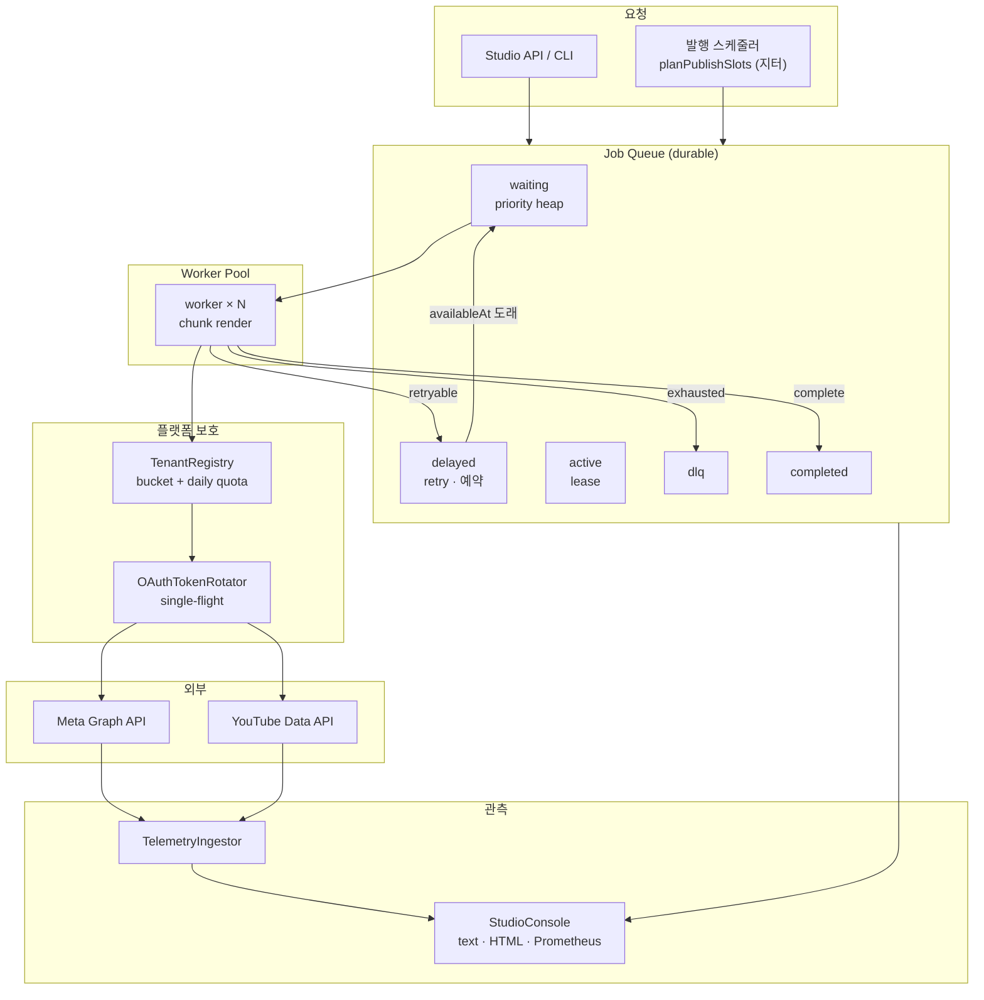

**원칙**

1. **큐가 유일한 진실** — 워커는 상태를 들고 있지 않다. 죽으면 lease가 만료되고 다른
   워커가 회수한다.
2. **부수효과는 전부 주입** — 시계·난수·sleep·HTTP·토큰 리프레셔. CI에서 실제 대기 없이
   재시도와 장애 복구를 검증한다.
3. **계산과 실행 분리** — 렌더는 계획을 먼저 만들고, 실행은 워커에서만.

모듈: `src/lib/queue` · `src/queue`(Redis 어댑터) · `src/lib/rateLimit` · `src/lib/telemetry` · `src/services/studio`.
상세 설계와 트레이드오프는 **[docs/distributed-video-pipeline-spec.md](docs/distributed-video-pipeline-spec.md)**.

---

## 3. 분산 렌더 큐

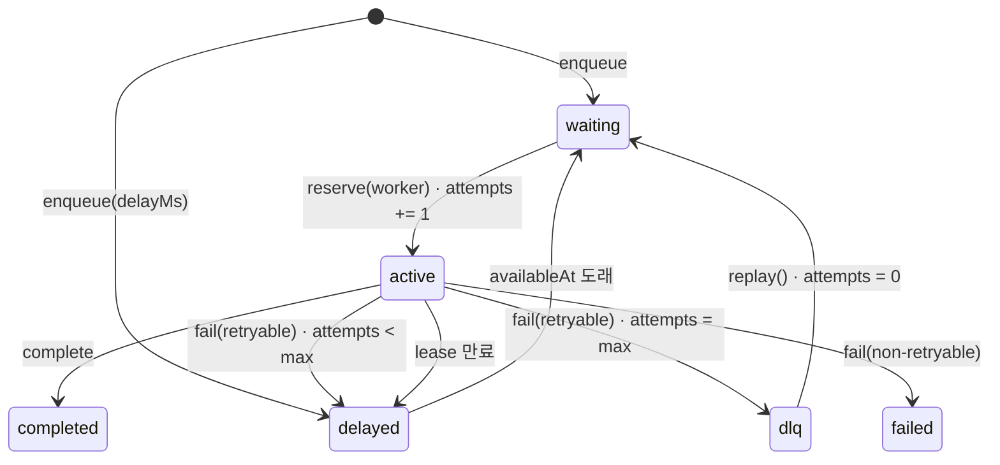

| 규칙 | 값 | 이유 |
|------|-----|------|
| 우선순위 | 0–9 | 유료 테넌트 예약(9)이 야간 백필(0)보다 먼저 |
| 동순위 | 도래시각 → 생성시각 → id | 재시작해도 순서가 결정적 |
| 재시도 | 3회 | OOM·일시 5xx는 2회 안에 대부분 회복 |
| 백오프 | **1s → 2s → 4s** (상한 30s, 지터 50%) | 트래픽 집중 완화 및 점진적 재시도 |
| lease | 30s, heartbeat 연장 | 워커 프로세스 비정상 종료 감지 및 자동 재할당 |
| DLQ | 재시도 소진 | 자동 재시도로 풀리지 않는 상태 격리 |
| 멱등 | `dedupeKey` | 웹훅 재전송이 같은 편을 두 번 렌더하지 않게 |
| 진행률 | 0–100, 단조 | 늦게 온 청크 이벤트가 바를 되감지 않게 |

```ts
const queue = new JobQueue({ store: new FileQueueStore('.work/queue/state.json') });
await queue.enqueue({
  tenantId: 'agency-morning',
  name: 'render episode-07',
  priority: 9,
  payload: { projectId: 'episode-07', platform: 'instagram-reels', durationSec: 45, chunkCount: 4 },
  dedupeKey: 'episode-07:reels',
});
```

**시도 횟수는 시작 시점에 증가**합니다. 그래서 "시작만 하고 끝나지 못하는" job도 결국
DLQ로 갑니다. 성공/실패 시에 증가시키면 그런 job이 영원히 큐를 돕니다.

**저장소**: `QueueStore` 인터페이스(`get/put/delete/all`)만 알면 됩니다. 기본은
`InMemoryQueueStore`(테스트)와 `FileQueueStore`(CLI, 원자적 tmp→rename), 그리고 여러 노드용
`RedisQueueStore`(`src/queue/redisAdapter.ts`)입니다.

### 3.1 Redis 어댑터 — 노드가 늘어도 같은 작업을 두 번 하지 않는다

`JobQueue`의 힙은 **한 프로세스** 안에서만 옳습니다. 렌더 노드가 2대가 되는 순간 각자의 힙이 같은
`waiting` 작업을 집어가고, 같은 영상을 두 번 인코딩합니다. 되돌리는 방식(집어간 뒤 중복 감지)은 이미
CPU를 쓴 뒤에야 알 수 있으므로, **집어가는 순간을 원자적으로** 만들어야 합니다.

```ts
import Redis from 'ioredis';
import { RedisQueueStore } from './src/queue/redisAdapter';
import { JobQueue } from './src/lib/queue/jobQueue';

const redis = new Redis(process.env.REDIS_URL!);
const store = new RedisQueueStore({
  client: {
    send: (commands) => redis.pipeline(commands.map(([cmd, ...args]) => [cmd, ...args])).exec().then((rows) => rows!.map(([err, value]) => { if (err) throw err; return value; })),
    watch: async (keys) => { await redis.watch(...keys); },
    multi: async (commands) => {
      const tx = redis.multi();
      for (const [cmd, ...args] of commands) tx.call(cmd, ...args);
      const rows = await tx.exec();
      return rows === null ? null : rows.map(([, value]) => value); // null = WATCH 충돌
    },
    unwatch: async () => { await redis.unwatch(); },
  },
  prefix: 'sf:queue',
});

const queue = new JobQueue({ store });   // 저장소가 선점을 지원하면 힙 대신 저장소가 결정한다
const job = await queue.reserve('worker-3');   // 여러 노드가 동시에 불러도 서로 다른 작업
```

**원자성은 WATCH → MULTI → EXEC로 만듭니다.**

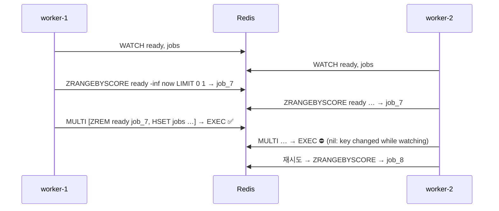

| 키 | 타입 | 역할 |
| --- | --- | --- |
| `sf:queue:jobs` | HASH | `jobId → QueueJob JSON` — 단일 진실 |
| `sf:queue:ready` | ZSET | `id → availableAt(ms)` 실행 가능 시각 순 |
| `sf:queue:delayed` | ZSET | 재시도·예약 대기 |
| `sf:queue:lease` | ZSET | `id → leaseExpiresAt(ms)` active 소유 증거 |
| `sf:queue:state:{state}` | SET | 상태별 id — `counts()`·운영 화면 |
| `sf:queue:dedupe` | HASH | `dedupeKey → jobId` 중복 인큐 방지 |

**Lua 대신 트랜잭션을 쓴 이유** — `EVAL`을 막는 관리형 Redis가 있고, 경합이 드물면 왕복 2회로 끝나며,
무엇보다 **WATCH 충돌 의미를 테스트로 재현**할 수 있습니다. 스크립트를 흉내 내는 테스트는 스크립트가
맞다는 것을 증명하지 못합니다.

**같은 연결에서 두 선점이 겹치면** WATCH가 서로를 덮어씁니다. 그래서 어댑터는 인스턴스 안에서
WATCH 연산을 직렬화하고, 노드를 늘릴 때는 **연결(인스턴스)을 늘리도록** 문서화했습니다. 충돌이 나면
작은 지터 백오프를 두고 다시 고릅니다(라이브락 방지).

**드라이버 선택** — `QUEUE_DRIVER=redis|file|memory`(기본 `memory`). 모르는 값은 조용히 기본값으로
떨어지지 않고 `CONFIG` 오류로 실패합니다: 운영에서 오타 하나로 인메모리 큐가 돌면 재시작할 때 백로그가
사라지기 때문입니다. **MySQL 기반 큐는 PHP 백엔드**(`backend/src/Repositories/ShortformRepository.php`)가
`SELECT … FOR UPDATE SKIP LOCKED`로 담당합니다 — 잠금 규칙이 두 벌이 되지 않도록 Node 쪽 어댑터는 두지
않았고, `QUEUE_DRIVER=mysql`은 그 사실을 알려 주는 오류를 냅니다.

검증은 `tests/redisAdapter.test.ts` 24케이스입니다. 가짜 Redis가 해시·집합·정렬집합과 **WATCH 충돌
규칙**을 실제 의미대로 구현하고, 6개 노드가 8개 작업을 동시에 노려도 중복 선점이 0건인지 확인합니다.

---

## 4. 워커 풀과 장애 복구

- **고정 동시성** — 인코딩은 CPU 바운드라 코어 수 이상은 p95만 나쁘게 만든다.
  `maxObservedConcurrency ≤ size`를 테스트로 고정.
- **청크 렌더** — 마지막 청크는 muxer flush + faststart 때문에 1.35배 무겁다. 진행률은
  청크 완료마다 스트리밍.
- **드레인 / 상시** — 야간 배치는 `drain({ waitForDelayed: true })`, 상시는 `start/stop`.
- **stalled 복구** — lease 만료 job을 `active → delayed`로 되돌리고 attempts는 유지.

실측 (`queue run --jobs 11 --concurrency 3 --fail-every 7`, 7번째 작업은 항상 실패 → 3회 시도 후 DLQ.
처리 시간은 실행 환경에 따라 조금씩 다르고, 건수·DLQ는 같습니다):

```
⚙ 큐 처리 시도 13건 (성공 10 / 실패 3) · 2286ms
   최대 동시 워커 3 · 평균 처리 422ms · p95 493ms
   waiting 0 · delayed 0 · dlq 1

   워커별 부하:
     worker-1    63%  완료 3 · 실패 1
     worker-2    64%  완료 3 · 실패 2
     worker-3    70%  완료 4 · 실패 0
```

---

## 5. 레이트 리밋: 버킷과 쿼터는 다른 다이얼

| 다이얼 | 질문 | 회복 |
|--------|------|------|
| 토큰 버킷 | "지금 연속으로 몇 건까지?" | 초당 리필 |
| 일일 쿼터 | "오늘 예산이 이 작업을 감당하나?" | Meta: 지난 24시간 이동 창 · YouTube: 태평양 자정 |

두 개를 분리한 이유는 **실패 모양이 다르기 때문**입니다. 버킷은 몇 분이면 회복되지만
YouTube 일일 쿼터는 태평양 자정(한국 시간 오후 4~5시)까지 회복되지 않습니다. 하나로 합치면
"5분 뒤"와 "내일 아침"을 구분할 수 없습니다.

리셋 규칙은 플랫폼마다 다르고, 코드(`DailyQuota`)가 그 차이를 그대로 가집니다.

| 플랫폼 | 리셋 방식 | 구현 | 화면 표기 |
|--------|-----------|------|-----------|
| Meta Graph | 지난 24시간 동안 올린 건수가 25건을 넘으면 차단 (이동 창) | 사용 기록을 24시간씩 버리는 이동 창 | "N시간 M분 뒤 다시 채워짐" |
| YouTube Data v3 | 태평양 자정에 10,000 unit으로 초기화 (캘린더 데이) | `America/Los_Angeles` 자정 기준 | 같은 문구, 시각은 PT 자정 기준 |

프로세스가 켜진 시점부터 24시간을 세는 고정 창은 쓰지 않습니다. 재시작할 때마다 리셋 시각이
달라져서 같은 날 두 번 한도가 차는 일이 생기기 때문입니다. 실제 플랫폼 카운터가 응답하면
그 값이 최종이며, 여기 계산은 **보내기 전에 미리 막는 용도**입니다.

| 플랫폼 | 버스트 | 지속 | 일일 | 작업 단가 |
|--------|--------|------|------|-----------|
| Meta Graph | 30 | 0.2/s | 25건 | 1 |
| YouTube Data v3 | 20 | 0.1/s | 10,000 unit | 1,600 unit (= 업로드 6편) |

- **429는 실패가 아니라 "아직"** — `Retry-After`를 하드 스톱으로 적용하고 재시도 횟수를
  깎지 않습니다.
- **테넌트 격리는 자료구조** — 버킷·쿼터·패널티가 테넌트 런타임 안에 있고,
  `exhausts one tenant's quota without touching another` 테스트로 고정.
- **차감은 all-or-nothing** — 버킷이 거절하면 쿼터도 차감되지 않습니다(거절된 호출이
  일일 예산을 먹는 버그 방지).
- **예산이 없으면 실패가 아니라 대기** — 대기 작업을 다음 창으로 미루는 배치는 §19의
  쿼터 계획기가 정합니다. 발행 어댑터는 "지금 보낼 수 있는가"만 답하고, "언제 보낼 것인가"는
  계획이 답합니다.

---

## 6. OAuth 2.0: 30개 예약, 1번의 토큰 갱신

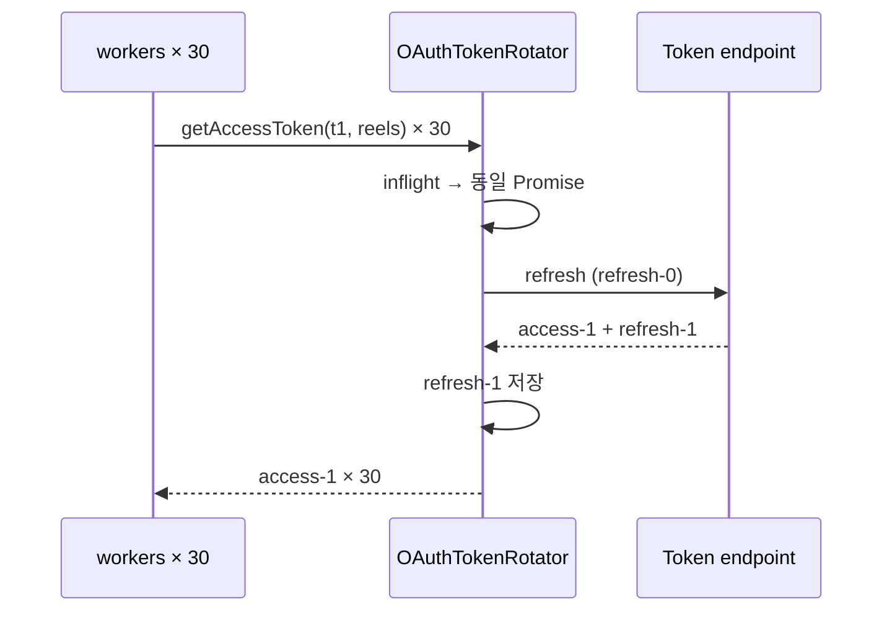

| 상황 | 처리 |
|------|------|
| 만료 5분 전 | 선제 갱신 |
| 동시 30건 | single-flight로 1회 호출 |
| `invalid_grant` | `needs-reauth` — 재시도 금지, 운영자 재연결 |
| 5xx / 타임아웃 | 재시도 가능 오류, 상태 유지 |
| 로테이션 | 새 refresh token 즉시 저장 |

콘솔 스냅샷에도 토큰 값은 없습니다. "재인증 필요"라는 사실만 노출합니다.

---

## 7. 지터 발행 스케줄러

매일 09:00:00, 10:00:00, 11:00:00 정각 발행은 스케줄러의 지문입니다. 그렇다고 무작위로
흩뿌리면 운영이 불가능합니다. 절충은 **최소 간격 + 남는 여유의 지수 분포 배분 + 양 끝
난수 오프셋 + 분 경계 15초 회피**입니다. 균등 난수로 버킷을 채우는 흔한 방식은 버킷이
최소 간격에 가까울 때 클램프되어 "정확히 120분 간격"을 만들어 냅니다.

```
발행 슬롯 6건 · 09:00~23:00 · 최소 90분
   1. 09:20:22  (+0분)
   2. 11:00:35  (+100분)
   3. 15:50:18  (+290분)
   4. 18:17:23  (+147분)
   5. 20:42:19  (+145분)
   6. 22:37:27  (+115분)
  간격 평균 159분 · 표준편차 68분 · 규칙성 0.424
```

`규칙성 = 표준편차/평균`. 0이면 기계, 1에 가까울수록 불규칙. 위는 `npm run cli -- slots --count 6
--start 09:00 --end 23:00 --min-gap 90` 실행 예이고, 난수를 쓰므로 실행마다 값이 달라집니다.
창이 최소 간격을 감당하지 못하면 **계획 단계에서 거부**합니다.

---

## 8. 훅 A/B 테스트와 성과 피드백

같은 영상에 훅 3안(질문·숫자·반론)을 만들어 노출을 나누고, 24시간/7일 지표로 판정한 뒤
다음 대본의 훅 가중치로 되돌립니다.

| 지표 | 계산 |
|------|------|
| `viewRate3s` | 3초 조회 / 노출 — 스크롤을 멈췄는가 |
| `retention` | 완청 / 3초 조회 — 끝까지 봤는가 |
| `avgWatchSec` | 시청시간 / 3초 조회 |
| `commentRate` | 댓글 / 노출 |

**판정은 일부러 보수적입니다.**

1. 변형당 표본 < 200 → `insufficient-data`. 첫 100뷰는 알고리즘 셔플이지 훅 성과가 아님.
2. **리더 vs 2위**만 z-검정. 3개를 전부 쌍비교해 최소 p값을 고르는 것이 가짜 승자의
   전형(다중비교).
3. 통계적 유의성 **그리고** 상대 리프트 ≥ 5%. n=200,000의 0.4pp 차이는 유의하지만 무의미.

필요 표본 (baseline 40%, α=0.05, power=0.8): **+5% → 9,493 / +10% → 2,389 / +20% → 604**
(변형당). 이 숫자를 README에 두는 이유는, "A/B 했습니다"보다 "이 표본이 없으면 승자를
부르지 않습니다"가 엔지니어링 주장이기 때문입니다.

피드백 가중치는 승률이 아니라 **대조군 대비 리프트**의 축소 추정 + 탐험 하한 8%로
계산합니다. 승률을 쓰면 "실험에서 진 각도"가 "아직 안 해본 각도"보다 낮게 평가되어
영원히 뒤로 밀립니다.

```bash
npm run cli -- hooks --topic "부산 신혼집 3평 주방 수납 정리법"
#  A [question  ] 2.95s  부산 신혼집, 왜 또 원래대로일까요?
#  B [numbers   ] 2.59s  부산 신혼집 3가지만 바꾸세요
#  C [contrarian] 3.25s  부산 신혼집 3평 주방, 더 하면 안 됩니다
```

모든 훅은 대본 엔진과 같은 **3.5초 상한**을 통과해야 실험에 올라갑니다.

---

## 9. 스튜디오 콘솔과 조작 API

`npm run cli -- studio` — 네트워크·ffmpeg 없이 내장 데모 상태로 실행됩니다.

```
STUDIO CONSOLE  2026-11-21T03:38:34.356Z  [DEGRADED]
──────────────────────────────────────────────────────────────────
QUEUE  total 13  ok  83%  p95 146ms  retries 3
       waiting   0  active   0  delayed   1  done  10  failed   1  dlq   1
TREND  ▁▄▅▅▅▇▇▅▇▇▅▄▇▇█▄▅▅▅▄▄█▄▅██▄█▅█▅▁  0.00/s  fail 0.0%  · 61 samples / 5.0m (demo)
──────────────────────────────────────────────────────────────────
WORKERS
  worker-1   █████████████████░  94%  idle    ok 4 fail 3
  worker-2   █████████████░░░░░  70%  idle    ok 3 fail 1
  worker-3   █████████████░░░░░  70%  idle    ok 3 fail 0
──────────────────────────────────────────────────────────────────
TENANT RATE LIMITS
  모닝픽쳐스 (대행사) (agency)
    meta     req ████████░░  57/75  quota ███░░░░░░░ 7/25
    youtube  req █████████░  46/50  quota ████░░░░░░ 3600/10000
  봄날의기록 (growth)
    meta     req █████████░  42/45  quota █████████░ 22/25
    youtube  req ██████████  30/30  quota ██████████ 10000/10000
  따뜻한스튜디오 (starter)
    meta     req ██████████  30/30  quota ██████████ 25/25
    youtube  req ██████████  20/20  quota ██████████ 10000/10000
──────────────────────────────────────────────────────────────────
OAUTH
  agency-morning instagram-reels  active       exp   42m  refreshes 0
  agency-morning youtube-shorts   active       exp   51m  refreshes 0
  creator-bom instagram-reels  expired      exp    0m  refreshes 0
──────────────────────────────────────────────────────────────────
HOOK A/B
  exp-kitchen-hook  retention/24h  winner
    B numbers     65.6%  n=18900  lift   37.5%  p 0.000
    C contrarian  53.0%  n=16800  lift   11.1%  p 0.000
    A question    47.7%  n=17400  lift    0.0%  p 1.000
    winner: B  confidence 100.0%
  exp-commute-hook  retention/24h  inconclusive
    C contrarian  41.3%  n= 6000  lift    0.1%  p 0.943
    B numbers     41.3%  n= 6100  lift    0.1%  p 0.962
    A question    41.3%  n= 6300  lift    0.0%  p 1.000
    winner: —  confidence 1.9%
──────────────────────────────────────────────────────────────────
DEAD LETTER QUEUE  1 job(s) need a decision
  job_007  agency-morning  render   attempts 3/3  waiting 0s
    render-episode-07  ·  encoder OOM (worker restarted)
  재시도/폐기: npm run cli -- queue replay <jobId> · studio --serve 로 열면 원클릭 버튼이 동작합니다
──────────────────────────────────────────────────────────────────
HEALTH: 1 job(s) in DLQ · 1 non-retryable failure(s) · success rate 83.3%
```

같은 스냅샷이 `--html .work/studio.html`(자체 CSS, 외부 CDN 없음)과 Prometheus
(`GET /v1/metrics`)로 나옵니다.

### 9.1 시계열 메트릭 — 실시간 모니터링 및 성능 이상 감지

단일 시점의 스냅샷만으로는 시스템 성능 저하나 장애 징후를 조기에 감지하기 어렵습니다.
콘솔은 고정 크기 링 버퍼(기본 600 샘플)에 시계열 메트릭을 적재하고, 누적 카운터의 차분값을 계산하여 초당 처리량(Throughput), 구간 실패율, API 토큰 잔여량 추이를 직관적으로 제공합니다.

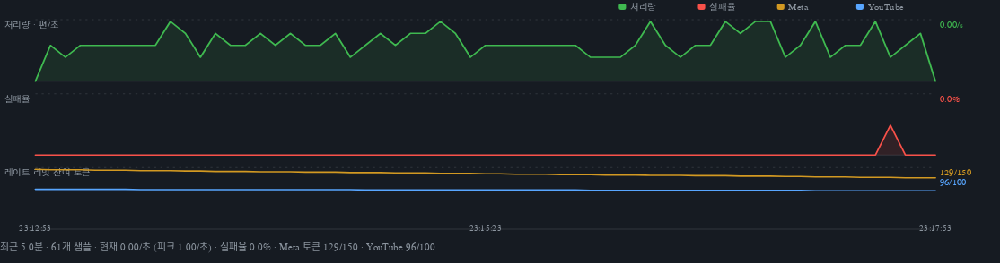

| 행 | 값 | 왜 이 축인가 |
| --- | --- | --- |
| 처리량 | 직전 샘플 대비 완료 편수 ÷ 경과 초 | 절대 편수가 아니라 속도여야 정체가 보인다 |
| 실패율 | 구간 종료 작업 중 `failed + dlq` 비율 | 재시도로 넘어간 작업은 실패가 아니다(성공도 아니다) |
| 토큰 | Meta · YouTube 잔여 요청 버킷 합계 | 0에 닿는 순간이 발행이 막히는 순간이다 |

설계 메모

- **샘플은 스냅샷에서 나온다.** 페이지·API·Prometheus가 같은 `snapshot()`을 부르므로, 별도 타이머 없이
  정상 사용만으로 이력이 쌓입니다. 프로세스가 죽으면 이력도 사라지는 것이 맞고(관측치), 장기 보관은
  Prometheus가 합니다(`shortform_render_throughput_per_sec` 등).
- **차분은 음수를 0으로 자릅니다.** 재시작·DLQ 재시도로 누적 카운터가 줄 수 있는데, 그때 음수 처리량을
  그리면 그래프가 거짓말을 합니다.
- **기하 계산은 순수 함수**(`buildMetricsChart`)이고, 표현 계층이 둘입니다: 서버 HTML용 문자열
  렌더러(의존성 0)와 React 컴포넌트. 같은 path 문자열을 쓰므로 곡선이 어긋날 수 없습니다.
- **React는 선택적 peer**입니다. 기본 콘솔은 React 없이 돌고, React 호스트에 임베드할 때만
  `MetricsTimeSeriesChart`를 가져다 씁니다.
- **데모 이력은 데모라고 표시합니다.** `markSeeded()`가 붙은 이력은 페이지에 `demo history` 배지가
  붙습니다. 시뮬레이션 숫자를 운영 텔레메트리처럼 보여 주지 않기 위해서입니다.

```tsx
import { MetricsTimeSeriesChart } from 'shortform-engine/dist/studio/MetricsTimeSeriesChart';

<MetricsTimeSeriesChart series={snapshot.metrics?.points ?? []} width={960} height={260} />;
```

**읽기 API는 GET 전용, 변경은 딱 두 개의 POST뿐입니다.** GET으로 큐를 되돌릴 수 있는
대시보드는 메일 스캐너나 미리보기 봇이 언젠가 실수로 되돌립니다. 그래서 DLQ 조작은
명시적 POST + 경로의 job id로만 가능하고, 어떤 작업이 바뀔 수 있는지는
`DlqActionService`가 판단합니다.

| 경로 | 내용 |
|------|------|
| `GET /` | 콘솔 HTML (조작 버튼이 이 서버로 연결됨) |
| `GET /v1/health` | 상태 + 사유 |
| `GET /v1/queue`, `/v1/queue/dlq` | 큐 상태·격리 작업·최근 조작 기록 |
| `GET /v1/workers` | 워커별 처리량·활용률 |
| `GET /v1/tenants/:id/limits` | 테넌트별 버킷·쿼터 잔량 |
| `GET /v1/experiments/:id` | 훅 실험 판정 |
| `GET /v1/metrics` | Prometheus text |
| `POST /v1/queue/dlq/:jobId/retry` | 재시도 (시도 횟수 초기화 후 `waiting`) |
| `POST /v1/queue/dlq/:jobId/discard` | 폐기 (행 삭제, 이벤트 로그에 사유) |

### 9.2 DLQ 원클릭 재시도 / 폐기 관리

장애 발생 시 운영자가 신속하게 조치할 수 있도록, DLQ(Dead Letter Queue)에 격리된 실패 작업에 대한 원인 상세 조회 및 원클릭 재시도·폐기 관리 기능을 제공합니다.

```bash
npm run cli -- studio --serve            # http://127.0.0.1:8099/ — 콘솔 + 조작 API
npm run cli -- studio --serve --port 0   # OS가 빈 포트를 고름
```

버튼을 누르면 무슨 일이 일어나는지가 제품의 신뢰를 만듭니다.

| 결정 | 규칙 |
|------|------|
| **누가 바꿀 수 있나** | `dlq`/`failed` 상태만. `active`·`waiting`·`completed`는 거부(409) — 실수로 진행 중인 렌더를 되살리지 않는다 |
| **재시도** | 시도 횟수·진행률·에러를 초기화하고 `waiting`으로. `attempts 3/3`이 그대로면 즉시 다시 DLQ로 간다 |
| **폐기** | 행을 지운다. `discarded` 이벤트에 사유·행위자가 남아 감사 가능하다 |
| **두 번 누르면** | 재시도된 작업은 `waiting`이므로 같은 요청이 409로 거부된다(멱등 거부) |
| **기록** | 모든 시도는 `applied`/`rejected`로 남고 콘솔·API(`actions`)에서 보인다. 거부도 기록이다 |
| **파일로 연 콘솔** | POST할 서버가 없으므로 버튼을 비활성으로 그리고 이유를 적는다(눌러도 아무 일 없는 버튼을 그리지 않는다) |

```text
$ curl -X POST localhost:8099/v1/queue/dlq/job_007/retry -d '{"actor":"seunghye"}'
{ "ok": true, "action": "retry", "jobId": "job_007", "state": "waiting", ... }
$ curl -X POST localhost:8099/v1/queue/dlq/job_007/retry
{ "ok": false, "jobId": "job_007", "message": "작업 상태가 waiting입니다. ...", "retryable": false }
```

건강도: `ok` → `degraded`(DLQ 1건·비재시도 실패·쿼터 소진·성공률 <90%) →
`critical`(DLQ ≥3·재인증 필요·성공률 <70%). DLQ 1건은 일상, DLQ가 자라는 것이 사건입니다.

---

## 10. 콘텐츠 엔진 — 큐가 운반하는 실제 작업

큐가 아무리 좋아도 렌더 결과물이 규격에 안 맞으면 의미가 없습니다. 기존 파이프라인은
그대로 유지되며, 위 계층은 이것을 작업 단위로 감쌉니다.

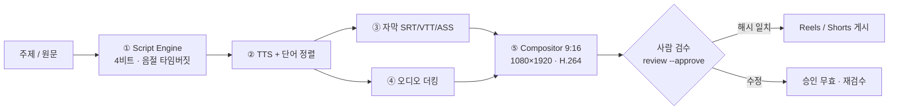

- **대본** — 60초를 한국어 5.4음절/초로 예산화(≈300음절), 초과 시 5단계 압축. 훅은
  스키마 레벨 3.5초 상한.
- **자막** — 단어 단위 타임스탬프, 픽셀 폭 기반 DP 줄바꿈, ASS 펄스/카라오케.
- **더킹** — 발화 15% / 사이 55%, 120ms 어택·280ms 릴리즈, 180ms 미만 틈은 복귀 안 함.
  ffmpeg `volume=eval=frame` 표현식으로 그대로 내보냄.
- **컴포지터** — 플랫폼 예약 영역(릴스 액션 레일 x≥880, 쇼츠 하단 y≥1580)을 피하는
  레이아웃 충돌 검사.
- **게시** — Instagram 컨테이너 폴링, YouTube 308 리줌 업로드, 프리플라이트 10항목.
- **Human-in-the-Loop** — `review --approve`가 대본+캡션+자막의 sha256을 기록하고,
  게시 시 재계산해 불일치면 거부. 승인 후 한 글자만 바뀌어도 게시가 막힙니다.

수학과 구현 디테일은 [docs/ARCHITECTURE.md](docs/ARCHITECTURE.md)에 있습니다.

---

## 11. CLI

```bash
# 콘텐츠 1편 (기존 파이프라인)
npm run cli -- craft --topic "부산 신혼집 3평 주방 수납 정리법" --raw examples/kitchen.md --duration 45
npm run cli -- review --project .work/부산-신혼집-... --approve --by 서승혜
npm run cli -- render --project .work/부산-신혼집-... --execute
npm run cli -- validate --file .work/.../render.mp4

# 분산 큐
npm run cli -- queue run --jobs 8 --concurrency 3 --fail-every 3   # 재시도·DLQ 시연
npm run cli -- queue status
npm run cli -- queue dlq
npm run cli -- queue replay <jobId>
npm run cli -- queue run --project .work/부산-신혼집-... --execute  # 실제 렌더를 큐로

# 훅 A/B · 발행 슬롯 · 콘솔
npm run cli -- hooks --topic "주방 수납" --count 3
npm run cli -- hooks --report .work/ab-samples.json --experiment exp-kitchen --metric retention
npm run cli -- slots --count 6 --start 09:00 --end 23:00 --min-gap 90
npm run cli -- quota plan --provider youtube --jobs 8 --slot-start 08:00 --slot-end 23:00 --min-gap 30
npm run cli -- quota plan --provider meta --jobs 30 --json
npm run cli -- studio --html .work/studio.html

# 크로스채널 기획 (주제 → 숏폼 + 롱폼 + 블로그)
npm run cli -- crosschannel --topic "겨울 제주 여행 2박3일 코스" --duration 45 --out .work/plan.md
npm run cli -- crosschannel --topic "팔꿈치 마사지기 리뷰" --variation 2 --blog wordpress
npm run cli -- crosschannel --topic "청약 1순위 조건" --ref examples/kitchen.md --channel instagram-reels
npm run cli -- crosschannel --topic "냉장고 재료로 10분 저녁" --llm --out .work/plan.md   # ANTHROPIC_API_KEY
```

`queue`는 파일 상태(`.work/queue/state.json`)를 쓰기 때문에 `run`과 `status`가 서로 다른
프로세스여도 같은 백로그를 봅니다.

### 산출물 구조 (콘텐츠 1편)

```
.work/부산-신혼집-.../
├── script.json        # 구조화 대본 (zod)
├── storyboard.md      # 장면표 · 타임버짓 · 압축 리포트
├── review.md          # 사람 검수 시트
├── voice.wav          # 48kHz 모노
├── captions.srt/.vtt/.ass
├── ducking.csv        # 더킹 엔벨로프
├── render-plan.json   # ffmpeg 인자 전체
└── approval.json      # 검수 승인 + 콘텐츠 해시
```

---

## 12. 검증

```bash
npm run verify    # typecheck + typecheck:web + lint + 565 tests
npm run coverage  # 89.7% statements · 81.9% branches
```

| 영역 | 파일 | 건수 |
|------|------|------|
| 큐 (우선순위·백오프·DLQ·lease·멱등·파일저장소) | `queue.test.ts` | 36 |
| DLQ 재시도/폐기·조작 API·콘솔 서버 (실제 HTTP) | `dlqConsole.test.ts` | 23 |
| 워커 풀 (동시성 상한·재시도·진행률·부하) | `workerPool.test.ts` | 18 |
| 레이트 리밋 (버스트·리필·격리·unit 계산·이동 창/캘린더 데이 리셋) | `rateLimit.test.ts` | 23 |
| OAuth (single-flight·로테이션·영구오류) | `oauth.test.ts` | 14 |
| 발행 슬롯 (창·간격·분경계·재현성) | `publishSlots.test.ts` | 11 |
| 텔레메트리 (생성·멱등·집계·검정·피드백) | `telemetry.test.ts` | 35 |
| 콘솔/API (스냅샷·HTML 이스케이프·라우팅) | `studio.test.ts` | 19 |
| **Redis 큐 (WATCH 원자성·6노드 경합·지연 승격·lease 회수·드라이버 선택)** | `redisAdapter.test.ts` | **24** |
| **시계열 메트릭 (차분·링버퍼·토큰 합계·차트 기하·SVG 이스케이프·데모 이력)** | `metricsTimeSeries.test.ts` · `metricsChart.test.tsx` | **21 + 3** |
| 기존 파이프라인 (대본·자막·더킹·렌더·게시) | 8개 파일 | 147 |
| 해시 원시함수 (SHA-1·SHA-256·HMAC 벡터 + `node:crypto` 대조) | `hash.test.ts` | 9 |
| 웹 콘솔 모델 (타임라인·더킹·게시물별 댓글 규칙·쿼터·A/B 시나리오·표시 문구) | `webModels.test.ts` | 18 |
| 웹 콘솔 클릭 (jsdom: 패널 전환·댓글→DM→수령·게시물 규칙 적용·쿼터 중단·OSMU 탭·훅 패턴 표) | `webConsole.test.tsx` | 9 |
| **OSMU 변환 (대본→3포맷·글자 상한·해시태그 규칙·스레드 분할·훅 경고)** | `osmu.test.ts` | **12** |
| **훅 패턴 비교 (기준선·카테고리 배수·훅 길이 감점·리더 판정)** | `hookPatternSim.test.ts` | **9** |
| **쿼터 인지 발행 계획 (창 경계·예산 소진·우선순위·슬롯·최소 간격·지평 넘김)** | `quotaPlanner.test.ts` | **22** |
| 인터랙티브 쿠폰 엔진 (멱등·어뷰징·5초 데드라인·1회용 토큰·풀 경합·1,000건) | `interactiveCouponDispatcher.test.ts` | 39 |
| 크로스채널 기획 (카테고리·앵글 변주·채널 구조·리퍼포징 순서) | `crossChannel.test.ts` | 22 |
| 인터랙티브 콘솔 (React: 수령·퍼널 카드) | `interactiveConsole.test.tsx` | 2 |
| **주제 도메인 대본 (형식>소재 분류·12도메인 4비트·주제어 반복 상한·훅 3.5초)** | `domainScript.test.ts` | **8** |
| **30초 프리셋 전수 검수 (12도메인 × 3포맷·글자 상한·낱말 경계 절단·태그 출처)** | `osmu30.test.ts` | **16** |
| **편집 패키지 (SRT 시간·CSV 인용·ZIP 중앙디렉터리/CRC·파일명 정리)** | `editPackage.test.ts` | **7** |
| **발행 전 점검 (규제·금칙 표현·개인정보·9:16 안전영역·상한·정상 대본 오탐 0)** | `compliance.test.ts` | **7** |
| **팔로워 전용·슬로우 큐 (확인 안 됨 차단·예산 미소모·간격/데드라인 이동)** | `couponAudience.test.ts` | **8** |
| **합계** | 33개 파일 | **565** |

네트워크·ffmpeg 없이 전부 통과합니다. 외부 API는 fake HTTP와 주입된 리프레셔로,
재시도는 주입된 시계·sleep으로 검증합니다.

### 12.1 전수 검수 실행 기록 (2026-11-21)

문서에 적은 숫자를 실제 실행으로 다시 확인한 기록입니다. 실행 환경에 따라 시간 값만 달라지고,
건수·판정은 같습니다.

| 검수 항목 | 실행 | 결과 |
|-----------|------|------|
| 타입·린트·단위 테스트 | `npm run verify` | ✅ 33개 파일 565건 통과 |
| 커버리지 | `npm run coverage` | 89.70% statements · 81.92% branches |
| 실제 렌더 | `craft → review --approve → render --execute` (ffmpeg 7.0.2) | ✅ 1080×1920 · 33.13s · 1.2MB · 프리플라이트 12/13(경고 1) |
| 큐·워커 | `queue run --jobs 11 --concurrency 3 --fail-every 7` | ✅ 시도 13 · 성공 10 · DLQ 1 · 최대 동시 워커 3 |
| MySQL 스키마 | `php bin/migrate.php --fresh --seed --verify` | ✅ 13개 테이블 · 인덱스·FK 확인 |
| PHP 단위·통합 | `SHORTFORM_INTEGRATION=1 DB_UNIX_SOCKET=… vendor/bin/phpunit` (MySQL 8.0.40 연결) | ✅ 16개 파일 185건 · 619 assertions · skip 0 |
| 렌더 큐 워커 | `php bin/worker.php --once` | ✅ job #1 선점 → 완료 → 큐 현황 출력 |
| HTTP 서버 | `php -S` 후 `/health`·웹훅 | ✅ `/health` 200, `GET /webhooks/instagram` 챌린지 반환, 서명 위조 403 |
| 게시물 발행 웹훅 | 서명된 `media` 이벤트 전송 | ✅ `applied 1` 후 `publish_logs.status=published`, 재전송은 `duplicates 1` |
| 댓글 웹훅 | 서명된 `comments` 이벤트 전송 | ✅ `comments.enqueued 1` → `webhook_interaction_events.QUEUED` + `dispatch_queue.PENDING`, 서명 위조는 403 |
| 댓글 워커 | `php bin/coupon-worker.php --once` | ✅ `sent=1` · 1회용 토큰 발급·큐 행 연결 · `dispatch_attempts` SENT(dry_run, message id) · 큐 `DISPATCHED` |
| 쿠폰 수령 | `GET /c/{token}` 두 번 호출 | ✅ 1회 `GRANTED`(3,000원) → 2회 `ALREADY_CLAIMED`, DB `claim_count=1` |
| 정적 웹 콘솔 | `npm run build:web` → 로컬 서버 | ✅ 탭 6개 렌더·클릭 동작, 콘솔 오류 0 |
| 라이브 배포 | <https://shye-seo.github.io/sns-shortform-automation/> | ✅ HTTP 200 |

---

## 13. 실제 렌더 검증

`docs/demo.mp4`는 이 파이프라인이 실제로 인코딩한 결과물입니다 (ffmpeg 6.0, 1080×1920,
33.13s, 1.2MB). 아래 프레임은 그 영상에서 추출했습니다. 2026-11-21에 ffmpeg 7.0.2로 같은
`craft → review --approve → render --execute`를 다시 돌려 같은 결과(33.13s · 1.2MB · 12/13
통과 · 비트레이트 경고 1)가 나오는 것을 확인했습니다.

| 훅 (0.0s) | 본문 (12s) | CTA (31s) |
|:---:|:---:|:---:|
| 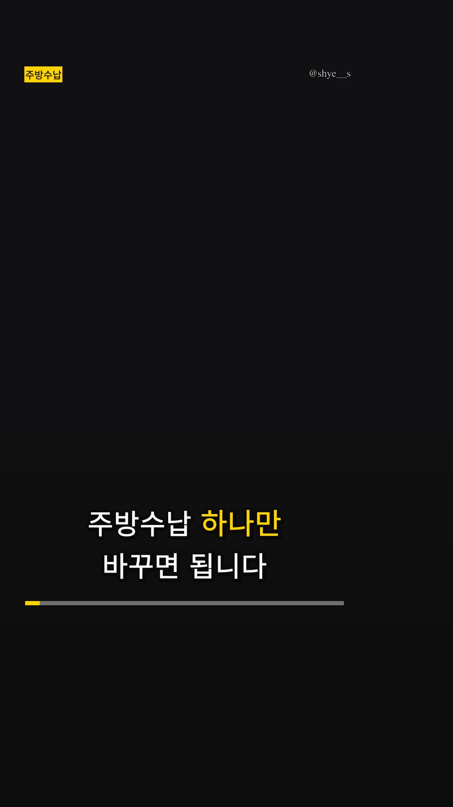 | 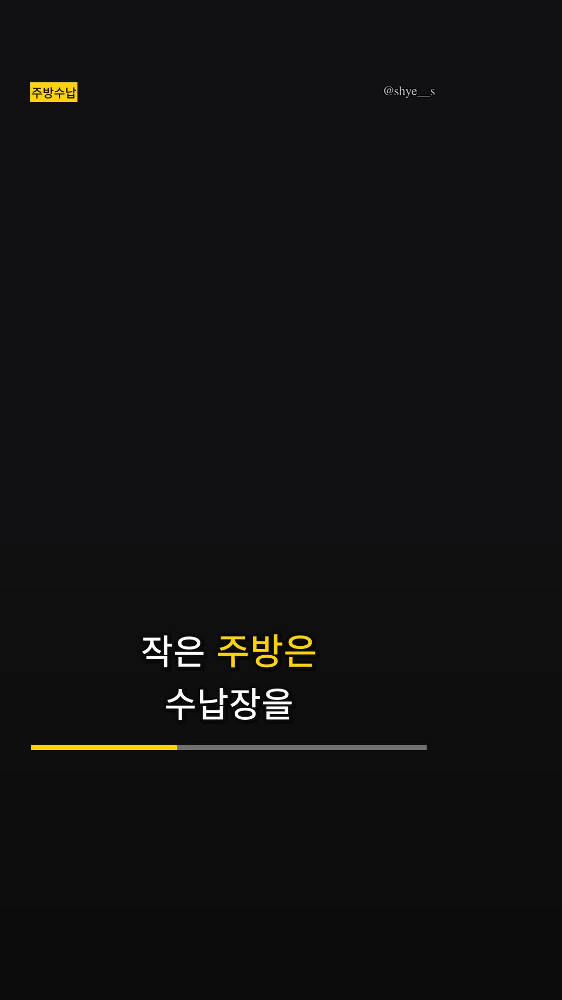 | 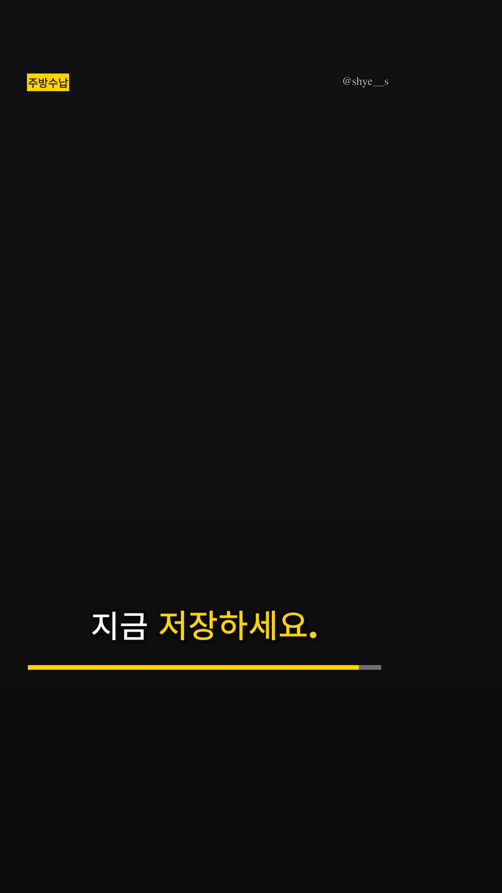 |

```
✅ 렌더 완료
   1080x1920 30.00fps h264/yuv420p · 33.13s · 1.2MB · aac 48000Hz 2ch
   업로드 가능: 12/13 항목 통과, 경고 1
   ⚠ 비트레이트: 131kbps (권장 4000–12000kbps)
```

비트레이트 경고는 정적 배경 + 단색 캡션이라 CRF 18에서 압축률이 극단적으로 높기
때문입니다(B롤을 넣으면 정상 범위). 프리플라이트는 이를 실패가 아닌 경고로 처리합니다.

---

## 14. 정직한 경계

| 항목 | 상태 |
|------|------|
| 큐 상태머신·재시도·DLQ·lease | ✅ 구현·테스트 (MySQL 8.0 `SKIP LOCKED` 기반 분산 큐 및 단일 프로세스 메모리 큐) |
| MySQL 영속 큐 & PHP 백엔드 | ✅ Modern PHP 8.2 OOP + MySQL 8.0 DDL 13개 테이블 구현. MySQL 8.0.40에서 마이그레이션·워커·통합 테스트 175건 실행 확인 |
| 웹훅 수신 & 서명 검증 | ✅ Meta Graph API `X-Hub-Signature-256` HMAC-SHA256 (`hash_equals`) 보안 검증 미들웨어 구현·테스트 |
| DLQ 콘솔 UI | ✅ 웹 콘솔 DLQ 재시도 및 폐기 인터페이스 (`POST /v1/queue/dlq/{id}/retry|discard`) 구현·테스트 |
| 토큰 버킷·일일 쿼터·격리 | ✅ 구현·테스트 |
| OAuth single-flight·로테이션 | ✅ 구현·테스트 (주입 리프레셔, 실 토큰 엔드포인트 미호출) |
| 지터 스케줄 | ✅ 계획·통계 검증. 실제 발행과의 상관 미측정 |
| A/B 통계 | ✅ 구현·테스트. 실제 플랫폼 웹훅 연동은 스키마 수신 단계 |
| 콘솔/API | ✅ text·HTML·Prometheus·JSON 서빙 및 DLQ 액션 API 연동 |
| 60초 렌더 파이프라인 | ✅ ffmpeg 실제 인코딩·프리플라이트 통과 (6.0 산출물, 7.0.2 재현 확인) |
| 웹 데모 콘솔 (GitHub Pages) | ✅ 정적 번들이 엔진 모듈을 그대로 실행. Meta·YouTube·Redis·SENS 실호출은 없음 |
| 편집 패키지 (.srt + 컷 타임시트 zip) | ✅ 브라우저에서 생성·다운로드. ZIP 중앙 디렉터리·CRC를 테스트로 대조. 렌더된 실제 영상과의 프레임 일치 검증은 미실시 |
| 발행 전 규제·안전영역 스캐너 | ✅ 규칙 13개 + 자막 폭·겹침·길이 검사, 차단 시 발행 버튼 잠금. 법률 검토 아님(§22.2) |
| 팔로워 전용 · 슬로우 큐 | ✅ 도메인·MySQL 컬럼·디스패처·브라우저 엔진·테스트. 팔로워 여부는 웹훅 페이로드가 실어 줄 때만 판정(실 Graph API 조회 미검증) |
| 인스타 댓글 웹훅 → PHP | ✅ `POST /webhooks/instagram`이 `comments`를 서명 검증 후 `InteractiveCouponDispatcher`로 넘겨 MySQL 큐에 적재하고, `bin/coupon-worker.php`가 토큰 발급·발송·이력 기록까지 수행. `GET /c/{token}` 수령까지 로컬 MySQL 8.0.40에서 엔드투엔드 확인. 실 Meta DM·SENS 호출은 자격 증명이 없어 미검증(§17.8) |

**로드맵**:
- [x] MySQL 8.0 `SKIP LOCKED` 기반 분산 비동기 렌더 큐 백엔드 (PHP 8.2)
- [x] Meta Graph API 웹훅 HMAC-SHA256 서명 보안 검증 미들웨어
- [x] Dead Letter Queue (DLQ) 원클릭 재시도 및 폐기 콘솔 UI
- [x] Redis 큐 어댑터 (WATCH/MULTI/EXEC 원자적 선점 · 지연 승격 · lease 회수 · `QUEUE_DRIVER` 스위칭)
- [x] 실시간 렌더링 큐 시계열 메트릭 차트 (처리량·실패율·플랫폼 토큰 추이, SVG/React 두 표현)
- [x] 브라우저 데모 콘솔 — 9:16 스튜디오·댓글 DM·발행 쿼터·훅 A/B (GitHub Pages 정적 배포)
- [x] 쿼터 인지 발행 계획 — 창 경계·우선순위·발행 슬롯·최소 간격을 함께 지키는 스케줄 계산 (§19)


---

## 15. English

**shortform-engine** is a distributed render queue and multi-tenant social publishing
platform built on a working 60-second shortform pipeline.

- **Render queue** — priority heap, delayed retries (1s/2s/4s with jitter), lease-based
  stalled-job recovery, idempotent enqueue, and a dead-letter queue. State lives in the
  queue, never in a worker.
- **Worker pool** — fixed concurrency below the CPU limit, per-chunk progress streaming,
  drain mode for batch backlogs and serve mode for daemons. `maxObservedConcurrency ≤ size`
  is enforced by tests.
- **Rate limiting** — token bucket (burst + sustained) and daily quota (units) are separate dials
  because they recover differently: Meta 25 publishes/24h, YouTube 10,000 units/day at 1,600
  units per upload. Meta's budget is a rolling 24-hour window; YouTube's resets at Pacific
  midnight. Buckets and quotas are per tenant, so one agency cannot delay another.
- **OAuth** — refresh-ahead, single-flight refresh (30 concurrent publishes → 1 token call),
  refresh-token rotation, and permanent vs transient failure classification.
- **Jitter scheduling** — bucket-uniform slots with a minute-grid guard and a minimum gap;
  the measured gap coefficient of variation is 0.42 in the sample run above, not the 0.0 of a
  cron fingerprint.
- **Hook A/B** — deduplicated webhook ingestion, Wilson intervals, leader-vs-runner-up z-test,
  a sample floor, a 5% lift floor, and a lift-based softmax feedback loop with an 8%
  exploration floor.
- **Studio console** — one snapshot rendered as terminal text, a self-contained HTML page,
  Prometheus text, and a read-only JSON API.
- **Quota planning** — pending jobs get concrete publish times under a fixed daily budget:
  spillover moves to the next window instead of failing, slot windows and a minimum gap are
  applied at the same time, and priority decides who keeps their preferred time.
- **Topic-aware script engine** — two layers: what the video is about (`topicProfile`) and how it
  speaks (12 script domains). A genre suffix ("…일상", "…브이로그") outranks a subject word, so
  "퇴사한 30대 개발자의 일상" becomes a daily vlog instead of résumé advice. Hooks are chosen to fit
  a 3.2s budget, and the topic noun appears at most twice per script.
- **Comment → DM coupon drop** — 5s SLA, idempotent webhooks, one-time HMAC links, and a
  follower-only filter plus a send-interval (slow queue) whose deadline moves with the slot.
- **Edit package** — one click turns the studio timeline into a `.srt` plus cut sheets
  (`.csv`/`.txt`) inside a store-only ZIP written in the browser (CRC-32, UTF-8 names).
- **Pre-publish scan** — regulated/absolute claims, personal data and 9:16 safe-area overflow
  (caption width, platform-UI collisions) block the publish button before upload.
- **Verification** — 565 Vitest cases, 89.7% statement coverage, no network and no ffmpeg
  required (injected clock, RNG, sleep, HTTP and token refresher); 185 PHPUnit cases over
  MySQL 8.0 with 0 skips.

```bash
npm ci && npm run verify
npm run cli -- studio
npm run cli -- queue run --jobs 8 --concurrency 3 --fail-every 3
```

---

---

## 16. 서버 계층 — PHP 8.2 · MySQL 8.0 · Meta Graph API · 알림톡

TypeScript 엔진이 영상 인코딩과 상태 전이 로직을 담당한다면, PHP 백엔드 및 MySQL 계층은 영속적인 작업 원장(큐 상태, 발행 기록, 알림톡 이력)을 보존하고 트랜잭션을 관리합니다.
무상태(Stateless) 처리 계층과 데이터 영속 계층을 명확히 분리하여 장애 복원력을 극대화했습니다.

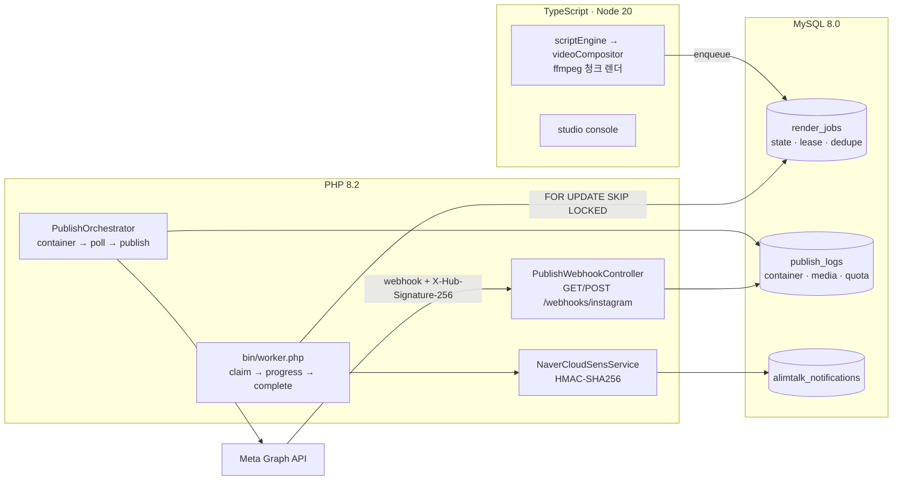

| 계층 | 무엇을 보장하나 |
| --- | --- |
| **DB (13 테이블)** | 1부 7개(큐·발행·알림) + 2부 6개(캠페인·웹훅 이벤트·발송 큐·1회용 토큰·발송 이력·전환). 큐 상태·lease·전이 이력·쿼터·알림 도달이 모두 행으로 남는다 |
| **큐 선점** | `ORDER BY priority DESC, available_at, id LIMIT 1 FOR UPDATE SKIP LOCKED` — 워커 10개가 같은 행에 줄 서지 않는다 |
| **장애 복구** | lease 만료 = 죽은 워커의 작업. 회수해서 `delayed`(또는 `dlq`)로 되돌린다 |
| **재시도 분류** | `retryable`이 상태를 정한다: 지수 백오프 재시도 / 즉시 실패 / DLQ |
| **발행** | 컨테이너 → `status_code=FINISHED` 폴링 → `media_publish`. 준비 전 발행은 24시간 25건 쿼터를 태운다 |
| **토큰** | Facebook Login / Instagram Login 두 갱신 흐름 + single-flight lease(30개 예약 → 갱신 1회) |
| **웹훅** | `MetaWebhookSignatureVerifier` — raw body HMAC-SHA256을 `hash_equals`로 비교(타이밍 공격 차단), SHA-1 헤더·형식 오류·시크릿 미설정은 각각 다른 사유로 fail-closed. `last_event_id`로 재전송 차단 |
| **알림톡** | 검수된 템플릿 + 변수 치환 + dedupe 키. 알림 실패가 렌더·발행을 실패시키지 않는다 |

**실행**

```bash
docker compose up -d mysql
cd backend && composer install
php bin/migrate.php --fresh --seed --verify     # 13 테이블 · 인덱스 · FK 확인
php bin/coupon-worker.php --once                # 댓글→쿠폰 워커 (기본 드라이런 발송)
php -S 127.0.0.1:8081 -t backend/public backend/public/router.php
php bin/worker.php --once                       # 선점 → 진행률 → 완료 → 큐 현황
composer test                                   # 175 tests (단위 151 + MySQL 실연동 24). DB가 없으면 24건 skip
```

**문서**

- [`database/ERD_SPEC.md`](database/ERD_SPEC.md) — Mermaid ERD, 테이블·관계, 큐/발행 상태머신,
  인덱싱 전략(`(state, priority DESC, available_at, id)` 등), 타입 선택 근거, 운영 쿼리
- [`backend/README.md`](backend/README.md) — API 계약, Graph API 재시도 분류표, 토큰 2흐름,
  웹훅 서명, SENS 서명 함정 3가지, 테스트 목록

## 17. 인터랙티브 숏폼 드롭 — 댓글 → 5초 쿠폰 디스패치

> 1부가 "영상 1편을 만들어 예약 발행하는 일"이라면, 이 파트는 **발행한 영상이 만든 트래픽을
> 돈으로 바꾸는 일**입니다. 릴스 댓글에 '할인'이라고 쓴 사람에게 **5초 안에** 1회용 쿠폰
> 딥링크를 보내고, 그 링크가 결제로 이어졌는지(ROAS)까지 셉니다.

### 17.1 왜 숏폼에 이 계층이 필요한가

댓글 이벤트는 **재전송되고, 몰리고, 위조됩니다.** 이 세 가지가 기능보다 먼저입니다.

| 실제로 터지는 일 | 결과 | 이 저장소의 답 |
| --- | --- | --- |
| Meta가 같은 댓글 웹훅을 5번 보냄 | 쿠폰 5장 | `external_event_id` UNIQUE + 처리 상태 기록 |
| 웹훅 안에서 DM 발송(0.8초)을 기다림 | Meta 타임아웃 → 재전송 폭풍 | 접수(웹훅)와 발송(워커) 분리, `dispatch_deadline_at` 5초 |
| 워커가 죽었다 살아남 | 같은 사람에게 DM 2번 | `idempotency_key`(이벤트×채널×수신자) UNIQUE |
| 실패가 무한 재시도 | 쿼터 소진 | 지수 백오프 + `DEAD_LETTER` 분리 |
| 딥링크가 단톡방에 뿌려짐 | 여러 명이 한 링크 사용 | 1회용 토큰 + `claim_count` compare-and-set |
| DB 덤프로 링크 위조 | 무한 쿠폰 | 원문 토큰 미저장 + HMAC-SHA256 서명 |
| 매크로가 '할인' 3,000번 | 예산 소진 | 작성자 버스트·서브넷·신규계정·스팸문구 점수 |

### 17.2 파이프라인과 5초 예산

```
Meta 웹훅 (X-Hub-Signature-256)
   │ ① 서명 검증 (raw body 기준 HMAC-SHA256)            ~1ms
   ▼
② 파싱: object=instagram → entry[].changes[].value      ~2ms
   ▼
③ 캠페인 매칭: platform + content_ref (인덱스)          ~1ms
   │    키워드 매칭(정규화 후 부분일치 — 한국어 조사 대응)
   ▼
④ 멱등 INSERT: external_event_id UNIQUE                 ~2ms  → 중복이면 200 응답(재전송 종료)
   ▼
⑤ 어뷰징 점수(작성자·서브넷·신규·문구)                   ~2ms  → 50점 이상이면 REJECTED
   ▼
⑥ dispatch_queue INSERT (PENDING, deadline=now+5s)      ~2ms
   │  ── 여기까지가 웹훅 응답 경로: 10ms 이내 ──
   ▼
⑦ 워커: 토큰 발급(HMAC) → DM/알림톡 발송 → 발송 이력 → DISPATCHED    ~300~800ms
   ▼
⑧ 실패 시 RETRY(1s→2s→4s) → 데드라인 초과 시 DEAD_LETTER
```

**웹훅 경로에서 발송하지 않는 이유**: Meta는 5초 안에 200을 못 받으면 같은 이벤트를 최대 24시간
재전송합니다. 발송을 인라인으로 넣으면 재전송이 다시 발송을 유발해 "한 사람에게 쿠폰 3장"이 됩니다.
사용자 체감 SLA 5초는 `dispatch_deadline_at`으로 관리하고, 데드라인을 넘긴 건은 **늦게라도 보내지
않습니다**(이미 앱을 떠난 사용자에게 늦은 쿠폰은 CS 비용만 만듭니다).

### 17.3 멱등성 3중 방어

| 계층 | 장치 | 막는 것 |
| --- | --- | --- |
| 1 | `webhook_interaction_events.external_event_id` UNIQUE | 같은 댓글 웹훅 재전송 |
| 2 | `dispatch_queue.idempotency_key` UNIQUE | 워커 재시작·중복 선점 |
| 3 | `instant_claim_tokens.claim_count = 0` CAS | 링크 더블클릭·동시 사용 |
| 4 | `dispatch_attempts`의 `SENT` 행 | 발송 후 마킹 전에 워커가 죽었을 때 재발송 |

1번만 있으면 워커 재시작 시 다시 발송할 수 있고, 2번만 있으면 재전송 웹훅이 이벤트 행을 두 개
만듭니다. 3번은 발송이 아니라 **사용**을 막는 층입니다. 4번은 1·2번이 덮지 못하는 구간
(전송은 성공했는데 큐 행이 DISPATCHED가 되기 전에 프로세스가 죽은 경우)을 덮습니다. 서로 다른
실패 모드라 하나로 합칠 수 없습니다.

### 17.4 1회용 토큰 — 원문은 저장하지 않는다

```
링크   https://coupon.shye.kr/c/{uuid}.{secret}
저장   token_uuid(공개) · token_hash = SHA-256(전체) · signature = HMAC-SHA256(key, "uuid|expiresAt")
검증   해시로 조회 → 서명 검증 → claim_count=0 CAS → 성공
TTL    15분 (캠페인 설정)
```

- 원문을 저장하지 않으므로 DB 덤프로 링크를 위조할 수 없습니다.
- 서명 키는 **회전 가능**합니다(`HmacTokenSigner`가 키 목록을 받음). TTL 15분 동안 이전 키를 함께
  허용해야 이미 나간 링크가 죽지 않습니다.
- 검증은 `hash_equals`(상수 시간)로 합니다. `===`는 첫 바이트에서 끊겨 서명을 한 바이트씩 맞춰볼 수 있습니다.

### 17.5 어뷰징 점수 (댓글 도메인)

| 신호 | 가중치 | 근거 |
| --- | --- | --- |
| 같은 작성자 10초에 3건 이상 | +40 | 사람이 손으로 하기 어려운 속도 |
| 같은 /24 서브넷 10초에 20건 이상 | +30 | 매크로 팜은 계정을 바꾸고 IP 대역은 유지 |
| 가입 24시간 이내 계정 | +20 | 대량 생성 계정 |
| 본문 3자 미만 또는 동일 문구 5회 이상 | +15 | '할인'만 수천 번 |
| 레이트 리밋 초과 | +35 | 스크립트 연타 |

50점 이상이면 발송하지 않고, **차단된 건은 예산을 쓰지 않습니다**(예산 검사보다 앞에서 거른다).

### 17.6 대량 트래픽 동시 인입 시뮬레이션 (1,000건 부하 테스트)

동일 엔진을 Node.js 런타임에서 시뮬레이션한 부하 테스트 결과입니다(네트워크 모킹, 시드 고정).

```bash
npx tsx -e "...simulateCommentStorm({ comments: 1000, concurrency: 256, clickRate: 0.7, abuseRate: 0.05 })"
```

| 항목 | 값 |
| --- | --- |
| 접수 댓글 | 1,000건 (초당 약 17,000건 처리 — 순수 인프로세스) |
| 어뷰징 차단 | 41건 |
| 발송(DISPATCHED) | 500건 (발급 한도 500장) |
| 수령(GRANTED) | 349건 |
| **오버이슈** | **0건** (풀 잔여 151장, 보존식 유지) |
| 풀 경합(대기) | 347회 — 동시 수령에서 락 대기가 실제로 발생했고, 전부 직렬화됨 |

`tests/interactiveCouponDispatcher.test.ts`가 이 수치를 테스트로 고정합니다(1,000건 동시 수령 →
100장 풀에서 정확히 100장, 오버이슈 0건).

### 17.7 코드 지도

| 계층 | 파일 | 역할 |
| --- | --- | --- |
| 코어 엔진 | `src/core/interactiveCouponDispatcher.ts` | 파서, 키워드 정규화, 멱등 처리, 5초 SLA 디스패치, DLQ 격리, HMAC 1회용 토큰, 퍼널 분석, 부하 시뮬레이터 |
| 콘솔(React) | `src/ui/InteractivePromotionConsole.tsx` | 웹훅 접수·발송·SLA·퍼널·DLQ·시뮬레이션 카드 |
| HTTP 입구 | `backend/src/Controllers/InstagramWebhookController.php` | 서명 1회 검증 후 `media`는 발행으로, `comments`는 쿠폰으로 라우팅 |
| 백엔드 | `backend/src/Services/InteractiveCouponDispatcher.php` | 웹훅 수신→큐 적재→워커 발송→수령 검증, 발송 이력 기록 |
| 저장소 | `backend/src/Repositories/MySql/` | 캠페인·웹훅 이벤트·발송 큐(`SKIP LOCKED`)·1회용 토큰(CAS)·발송 이력 5종 PDO 어댑터 |
| 워커 | `backend/bin/coupon-worker.php` | 대기열 선점 → 토큰 발급 → DM/알림톡 → DISPATCHED/RETRY/DEAD_LETTER |
| 발송기 | `backend/src/Services/Messaging/` | 드라이런 · Instagram private reply · SENS 알림톡 · 채널 라우터/팩토리 |
| 백엔드 | `backend/src/Services/FraudDetectionService.php` | 작성자/서브넷/신규/문구 점수 |
| 보안 | `backend/src/Security/HmacTokenSigner.php` | HMAC-SHA256 서명·키 회전·`hash_equals` |
| 보안 | `backend/src/Security/Pseudonymizer.php` | 작성자 플랫폼 id를 키 있는 HMAC으로 저장(원문 미보관) |
| 스키마 | `database/schema.sql` §8~13 | 캠페인·웹훅 이벤트·발송 큐·1회용 토큰·발송 이력·전환 퍼널 6테이블 |
| 설계서 | `database/ERD_SPEC.md` §9~15 | ERD·5초 시간 예산·멱등 3중 방어·어뷰징·운영 쿼리 |

### 17.8 정직한 경계

- **이제 HTTP부터 수령까지 실제로 연결되어 있습니다.** `POST /webhooks/instagram`은 `media`와
  `comments`를 한 번의 서명 검증으로 나눠 처리하고, 댓글은 `webhook_interaction_events`(멱등)
  → `dispatch_queue`(5초 데드라인)로 적재됩니다. `php backend/bin/coupon-worker.php`가 그 행을
  `FOR UPDATE SKIP LOCKED`로 선점해 1회용 토큰을 발급하고 발송한 뒤 `dispatch_attempts`에
  결과를 남깁니다. `GET /c/{token}`은 같은 토큰의 두 번째 클릭을 `ALREADY_CLAIMED`로 끊습니다.
  검증 범위: MySQL 8.0.40 + `php -S` + curl로 위 전 구간, PHPUnit 175건(그중 실 DB 24건).
- **실발송은 여전히 검증 범위 밖입니다.** 기본 발송기는 드라이런(`provider=dry_run`)이고,
  `COUPON_SENDER=live`와 Meta/SENS 자격 증명을 넣어야 실제 호출이 나갑니다. Instagram private
  reply는 `instagram_manage_messages` 권한과 앱 검수가 필요하고, SENS 알림톡은 검수된 템플릿
  코드(`SENS_TEMPLATE_COUPON`)가 있어야 합니다. 어댑터의 요청 형식·오류 분류(429/코드 4 재시도,
  190/100 영구실패)까지가 테스트로 고정된 범위입니다.
- **인스타 앱 쪽 등록은 남아 있습니다.** Meta 앱에서 콜백 URL과 `comments` 구독을 켜고
  `IG_VERIFY_TOKEN`·`IG_APP_SECRET`·페이지 토큰을 넣는 일은 계정 소유자만 할 수 있습니다.
  코드와 화면(18장 3단계)은 그 순서를 그대로 안내합니다.
- **발송 수신자 id는 큐에 원문으로 둡니다.** Meta가 DM을 보낼 때 요구하는 값이라 해시로 바꿀 수
  없습니다. 대신 이벤트 원장(`webhook_interaction_events.author_platform_id`)은 키 있는 HMAC만
  저장하고, 1회용 토큰 원문은 어디에도 저장하지 않습니다. 운영에서는 `recipient_ref`를 암호화
  하거나 발송 후 파기하는 정책이 필요합니다.
- **1인당 발급 수(`max_claims_per_user`)는 아직 강제하지 않습니다.** 컬럼과 도메인 값은 있지만
  발급 단계의 판정은 캠페인 장수(`claim_limit`)와 예산(`total_reward_budget`) 두 가지입니다.
  같은 사람이 다른 댓글로 여러 장 받는 경우는 어뷰징 점수(작성자 버스트)로만 걸립니다.
- **부하 수치는 인프로세스 시뮬레이션입니다.** 17.6의 초당 처리량은 Node 런타임 안에서 잰 값이고,
  이번에 붙인 MySQL 경로의 처리량은 별도로 측정하지 않았습니다. 운영 TPS로 주장하지 않습니다.
- **팔로워 여부는 Meta 댓글 웹훅에 없습니다.** 그래서 `author_follows_account`(팔로워 전용) 판정은
  팔로워 목록을 동기화하는 쪽이 `from.is_follower`로 실어 보낼 때만 동작하고, 값이 없으면 **보내지
  않는 쪽**으로 정합니다(§17.9). 실제 Graph API 팔로워 조회는 자격 증명이 없어 미검증입니다.
- **HMAC 키 관리는 문서화만 되어 있습니다.** 키 회전용 이전 키(`COUPON_TOKEN_SIGNING_KEY_OLD`)는
  지원하지만 KMS 연동은 없습니다. 운영에서는 `COUPON_TOKEN_SIGNING_KEY`를 필수로 두고(미설정 시
  기동 실패) KMS/Secret Manager에서 주입해야 합니다.

### 17.9 팔로워 전용 필터와 슬로우 큐 — "누구에게, 어떤 간격으로"

쿠폰을 아끼는 문제가 아니라 **DM을 보내는 방식**의 문제입니다. 인스타는 짧은 시간에 같은 계정에서
DM이 몰리면 스팸 신호로 읽고, 모르는 사람에게 먼저 보낸 DM은 신고로 이어집니다. 두 가지를 캠페인
설정으로 뺐습니다.

| 설정 | 컬럼 | 동작 |
|------|------|------|
| 팔로워만 | `interactive_campaigns.follower_only` | 작성자가 팔로워임이 확인된 댓글에만 DM. 확인되지 않은(`null`) 작성자는 건너뛴다 |
| 발송 간격 | `interactive_campaigns.send_interval_seconds` (0~3,600) | 같은 캠페인의 DM을 이 간격만큼 띄운다. 0이면 즉시 |

- **필터는 예산보다 먼저.** 팔로워가 아닌 댓글은 `webhook_interaction_events`에 `IGNORED` /
  `FOLLOWER_ONLY`로 남기고 큐에 넣지 않습니다. 발급 장수도 쓰지 않으므로, 뒤에 온 팔로워가
  `BUDGET_EXHAUSTED`로 막히지 않습니다(테스트).
- **간격은 SLA를 깨지 않습니다.** 발송 가능 시각을 `max(지금, 마지막 예약 + 간격)`으로 밀고,
  데드라인은 **그 시각에서 다시 5초**를 셉니다. 간격 10초에 세 건이면 `0s / +10s / +20s`에 나가고
  데드라인은 각각 `+5s / +15s / +25s`입니다. 늦게 보내는 게 아니라 줄을 서는 것입니다.
- 웹훅 응답에는 `comments.filtered`가 추가되어, "몇 건이 팔로워가 아니어서 지나갔는지"를 바로 봅니다.
- 브라우저 콘솔(§18)도 같은 규칙을 `src/core/interactiveCouponDispatcher.ts`에서 돌립니다.
  댓글 → DM 쿠폰 탭에서 **팔로워만** 스위치와 **즉시/3초/10초/30초** 간격을 고르고, 데모 댓글을
  `팔로워 / 팔로워 아님 / 확인 안 됨`으로 넣어 결과를 확인할 수 있습니다.

```
팔로워만 ON, 간격 10초
  댓글(확인 안 됨) → IGNORED / FOLLOWER_ONLY     (장수 미소모)
  댓글(팔로워 아님) → IGNORED / FOLLOWER_ONLY
  댓글(팔로워)      → QUEUED  available_at = now
  댓글(팔로워)      → QUEUED  available_at = now + 10s, deadline = +15s
```

---

## 18. 웹 데모 콘솔 — 주제연동 스튜디오 · 크로스채널 기획 · 한 편을 세 곳으로(OSMU) · 댓글 DM · 발행 쿼터 · 훅 A/B

**데모**: <https://shye-seo.github.io/sns-shortform-automation/>

빌드된 정적 산출물이 `docs/`에 있고, 저장소 Pages 소스가 `main` / `/docs`로 설정되어 위 주소가
실제로 열립니다(2026-11-21 HTTP 200 확인). 설치 없이 열리고, 클릭으로 동작합니다. 화면의 숫자는
미리 만들어 둔 값이 아니라 브라우저에서 같은 엔진 모듈을 실행한 결과입니다.

> 화면 표기 원칙: 엔진 상태값(`dlq`, `failed`)과 영문 오류 로그는 화면에 그대로 그리지 않습니다.
> `web/model/labels.ts`가 그 뜻과 다음 할 일을 한국어로 옮기고, 모르는 오류는 원문 대신
> "원인을 확인하지 못했습니다"로 끝냅니다. 판정(한도·실패·재시도)은 엔진이 계산한 값을 그대로 씁니다.

| 탭 | 확인하는 것 | 실행되는 코드 |
|----|------------|---------------|
| **9:16 스튜디오** | 주제를 바꾸면 대본·타임라인·자막이 즉시 다시 계산. '대본 다시 생성'은 앵글과 문장을 함께 교체. 안전영역 가이드, 재생 위치에 맞춘 단어별 자막 강조, 발화 시 BGM 15% 감쇠 곡선 | `topicProfile`(분류), `topicDraftWriter`(주제·앵글별 대본), `scriptEngine`(`planTimeBudget`·`fitDrafts`·`buildTimeline`), `tts.estimateAlignmentFor`, `audioEngine`(`computeDuckingEnvelope`·`buildCues`), `videoCompositor`(`planOverlayLayout`·`checkLayoutCollisions`) |
| **크로스채널 기획** | 주제 하나로 릴스/쇼츠 대본 + 유튜브 롱폼 목차 + 네이버·티스토리·워드프레스 글 뼈대를 같은 단계 순서로 생성. 레퍼런스 글을 붙이면 훅 유형·단계 수·저장 유도를 읽어 앵글과 목차에 반영하고, 숏폼→챕터→H2 리퍼포징 맵을 표로 보여줌 | `topicProfile`, `patternLibrary`(6개 채널 구조), `contentAnalyzer`, `crossChannelPlanner`, `planMarkdown` |
| **댓글 → DM 쿠폰** | ① 게시물(릴스·피드) 선택 → ② 키워드·보상·수량·유효시간 규칙 적용 → ③ 웹훅 연결 3단계 안내(콜백 주소·구독 항목·서버 처리 순서) → ④ 받은 댓글·보낸 DM·퍼널. 다른 게시물의 댓글은 같은 계정이라도 반응하지 않고, 연결 전에는 같은 엔진에 시험 댓글을 넣어 확인 | `core/interactiveCouponDispatcher` 전체(서명 검증·멱등·어뷰징·5초 데드라인·1회용 토큰·퍼널), `web/model/coupon.ts`(게시물별 캠페인) |
| **발행 캘린더 · 쿼터** | 지터가 들어간 예약 타임라인, 인스타그램 25건/24시간·유튜브 10,000할당량 게이지, 한도 소진 시 발행 중단, 실패 작업 재시도/정리와 운영자 기록 | `rateLimit/jitter.planPublishSlots`, `rateLimit/tenantRegistry`(이동 창·캘린더 데이 리셋), `queue/jobQueue`, `studio/dlqActions`, `web/model/labels`(사유 번역) |
| **한 편을 세 곳으로** (OSMU 변환) | 스튜디오의 4비트 대본을 릴스 캡션·쇼츠 설명(비트 타임라인 포함)·블로그/스레드 요약으로 동시 변환. 글자 상한과 작성 규칙을 체크로 표시하고, 스레드는 500자 단위로 분할해 각각 복사 | `osmuConverter`(`buildBeatTimeline`·`buildHashtags`·`splitForThreads`), `scriptEngine` 대본, `topicProfile`, `topicBanks` |
| **훅 A/B** | 수집 주기(1시간·6시간·하루)와 비교 기간(24시간·7일)을 고르고, 수집이 끝난 상태를 시나리오 4종(3시간·24시간·7일·차이 없던 주)으로 재현. 끝까지 본 비율·쿠폰 사용을 같은 통계로 비교하고, 표본이 부족하거나 차이가 우연이면 승자를 부르지 않음. 승자 채택 시 스튜디오 대본에 반영. 같은 주제의 훅 4유형 추정치도 함께 비교 | `telemetry/hooks.generateHookVariants`, `telemetry/significance`(`evaluateExperiment`·`twoProportionZTest`·`wilsonInterval`·`requiredSampleSize`), `hookPatternSim`, `web/model/abtest`(시나리오) |

<table>
  <tr>
    <td>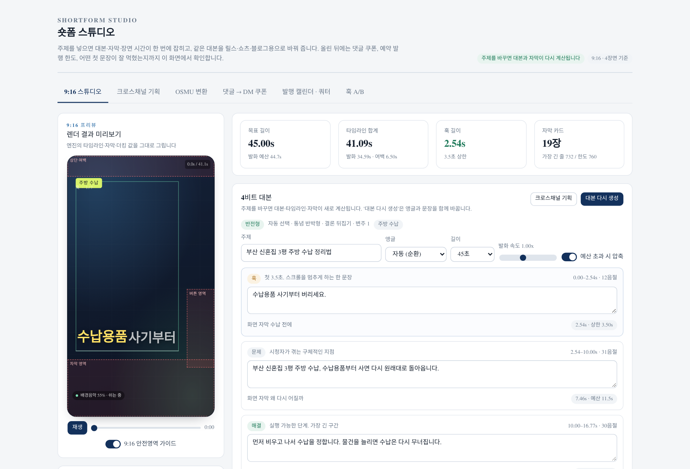</td>
    <td>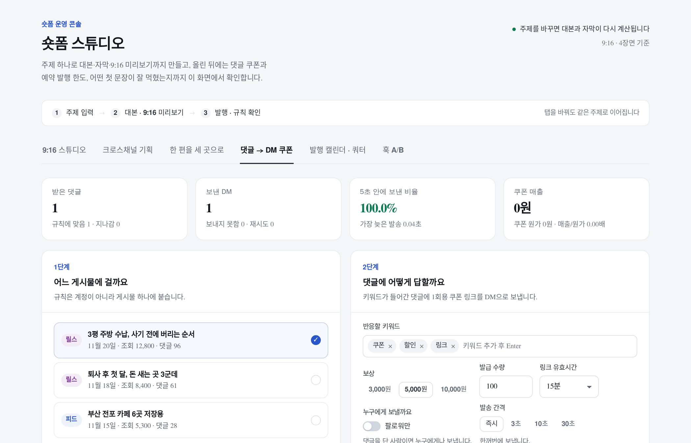</td>
  </tr>
  <tr>
    <td>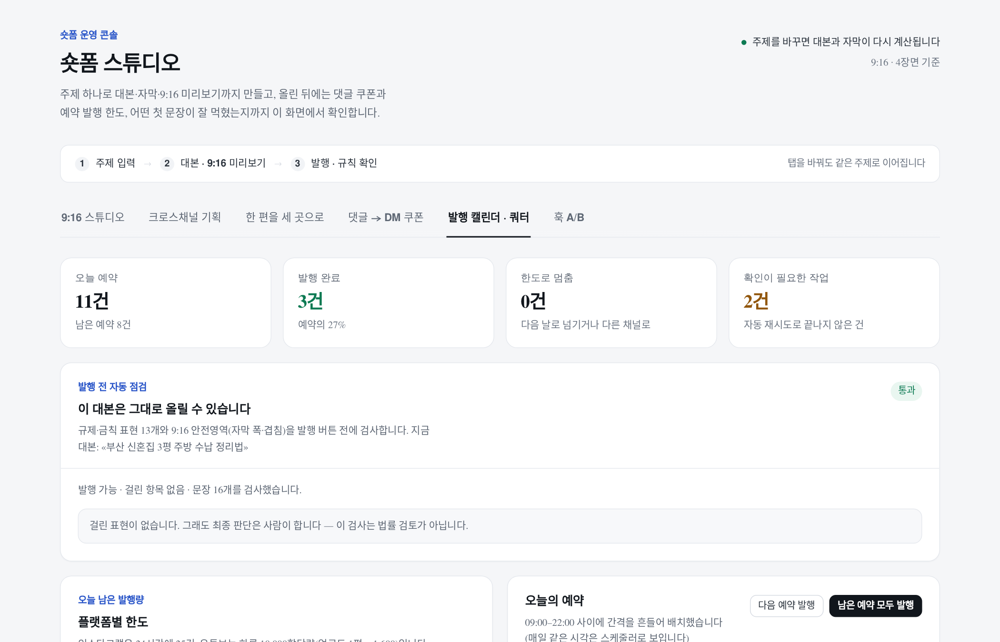</td>
    <td>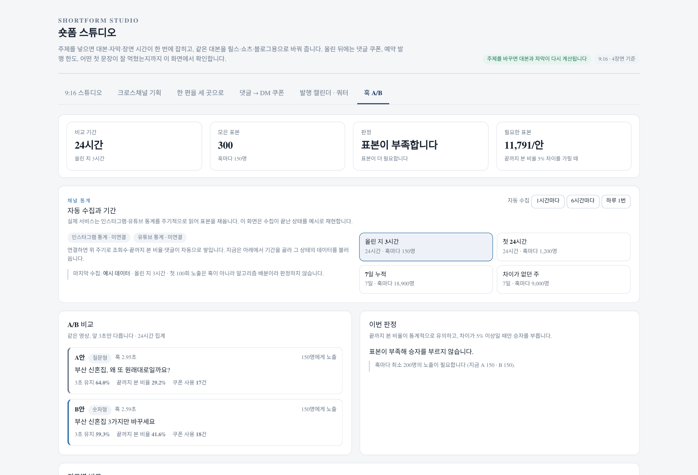</td>
  </tr>
  <tr>
    <td colspan="2">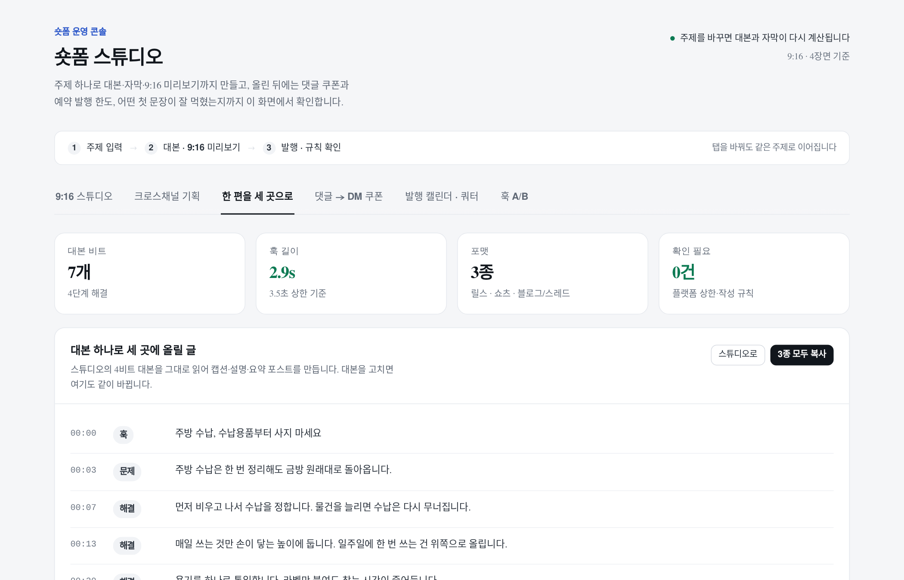</td>
  </tr>
</table>

### 18.1 같은 코드를 두 런타임에서 돌리는 방식

- `docs/app/app.js`는 `web/main.tsx`를 esbuild로 번들한 단일 파일입니다(런타임 의존성 없음).
  React는 이미 devDependency였고, 번들러는 esbuild 하나만 추가했습니다.
- 엔진 모듈은 수정 없이 가져옵니다. 화면과 테스트가 같은 함수를 보므로 프리뷰의 단어 위치와
  렌더 결과가 어긋날 수 없습니다. 자막 줄바꿈도 렌더러와 같은 캡션 박스 폭(`layout.caption.w`)으로
  계산합니다.
- Node 내장 모듈 4개(`node:fs/promises`·`node:path`·`node:child_process`·`node:crypto`)만
  `web/shims/`로 매핑했습니다. 데모가 부르지 않는 경로(파일 쓰기, ffmpeg 실행)는 호출되면
  명시적으로 실패합니다 — 조용히 성공한 척하지 않습니다.
- 해시는 `src/lib/hash.ts` 한 곳에 모았습니다. SHA-256·SHA-1·HMAC-SHA256을 의존성 없이 구현하고
  `tests/hash.test.ts`가 FIPS 180-4 벡터와 `node:crypto` 결과를 함께 대조합니다. 이 작업에서
  55바이트 경계의 패딩 오프바이원(길이가 55 mod 64일 때만 다이제스트가 달라지던 버그)을 찾아
  고쳤습니다. 토큰·서명이 걸린 코드라 테스트 없이 옮기지 않았습니다.

### 18.2 로컬 실행

```bash
npm install
npm run build:web     # docs/ 갱신 (docs/index.html + docs/app/app.js)
npm run dev:web       # http://127.0.0.1:4173 (의존성 없는 정적 서버)
npm run typecheck:web # 타입 검사 (src + web, DOM lib 포함)
```

### 18.3 테스트

| 파일 | 건수 | 내용 |
|------|------|------|
| `tests/hash.test.ts` | 9 | SHA-1/SHA-256/HMAC 벡터, `node:crypto` 대조, 55바이트 경계, `createHash` 표면 |
| `tests/webModels.test.ts` | 18 | 타임라인 합계·3.5초 훅·자막 폭·더킹 15/55%·편집 문장 보존·댓글 1건→DM 1건·도배 차단·5초 초과 DLQ·1,000건 오버이슈 0·쿼터 소진·DLQ 재시도·A/B 판정·게시물별 규칙 분리·표시 문구 번역·시나리오 판정 |
| `tests/webConsole.test.tsx` | 9 | jsdom에서 실제 클릭: 스튜디오 렌더, 댓글→DM→수령, 게시물 규칙 적용, 쿼터 중단, A/B 기간 전환, OSMU 3포맷 전환, 훅 패턴 표 |
| `tests/osmu.test.ts` | 12 | 편집한 대본이 캡션에 반영 · 릴스 5~8태그·저장 CTA · 쇼츠 제목 40자·타임라인 오름차순 · 스레드 500자 분할 · 훅 3.5초 경고 |
| `tests/hookPatternSim.test.ts` | 9 | 4유형 순서·범위 · 저장/공유 리더 1개씩 · 3초 초과 감점 · 숫자 주제 보정 · 결정성 |

### 18.4 정직한 경계

- Meta Graph API·YouTube Data API·Redis·SENS는 자격 증명이 없어 호출하지 않습니다. 데모의
  한도·거부·DLQ는 엔진이 내린 판정이고, 플랫폼의 응답이 아닙니다.
- 훅 A/B의 노출·시청 수는 시뮬레이션입니다. 검정·신뢰구간·승자 판정은 실제 통계 모듈이 계산합니다.
- 브라우저는 렌더하지 않습니다. 프리뷰는 타임라인·자막·더킹 값을 그리는 화면이고, 인코딩은
  워커의 ffmpeg가 `docs/demo.mp4`처럼 수행합니다.

---

## 19. 쿼터 인지 발행 계획 — 예산이 없으면 미루고, 실패시키지 않는다

발행 어댑터는 "지금 보낼 수 있는가"에만 답합니다. 그런데 대행사는 하루에 한 편이 아니라
열 편을 예약합니다. YouTube 업로드는 1편 1,600 unit, 하루 예산은 10,000 unit이므로 **6편까지가
오늘 몫**이고 나머지는 리셋 이후입니다. 이 계산을 사람이 매일 아침 다시 하면, 그게 바로
자동화가 덜 된 지점입니다.

`src/lib/rateLimit/quotaPlanner.ts`는 대기 작업 목록과 플랫폼 예산을 받아 **각 작업이 실제로
나갈 시각**을 냅니다. 작업은 실패하지 않습니다. 예산이 없으면 다음 창의 첫 슬롯으로 밀리고,
그 사실이 `reason: 'quota-shifted'`로 남습니다.

```bash
npm run cli -- quota plan --provider youtube --jobs 8 --slot-start 08:00 --slot-end 23:00 --min-gap 30
```

```
  job-1    2026-11-19T08:00:00Z   w0  slot-shifted  (+480분)
  job-2    2026-11-19T08:30:00Z   w0  gap-shifted  (+510분)
  ...
  job-6    2026-11-19T10:30:00Z   w0  gap-shifted  (+630분)
  job-7    2026-11-20T08:00:00Z   w1  quota-shifted  (+1920분)
  job-8    2026-11-20T08:30:00Z   w1  quota-shifted  (+1950분)

  창별 사용량
  w0  2026-11-19T00:00:00Z ~ 2026-11-20T00:00:00Z    9600 / 10000  unit   6편   96%
  w1  2026-11-20T00:00:00Z ~ 2026-11-21T00:00:00Z    3200 / 10000  unit   2편   32%

  배치 8편 · 미배치 0편 · 사용 단위 12800 · 창 2개
```

(위 실행은 `--from 2026-11-19T00:00:00Z` 기준입니다. 슬롯 시작이 08:00이라 1편은 슬롯으로,
나머지는 30분 간격으로 밀리고, 7편째부터는 다음 창으로 넘어갑니다.)

### 19.1 세 제약을 한 번에

| 제약 | 무엇을 막나 | 계획에서의 처리 |
|------|-------------|-----------------|
| **쿼터 창** | 하루 예산 초과 | 창을 고정 길이로 두고, 첫 창은 이미 쓴 양만큼 줄여 시작 |
| **발행 슬롯** | 새벽 3시 발행 같은 사고 | 슬롯 밖 시각은 다음 슬롯 opening으로 이동 (`slot-shifted`) |
| **최소 간격** | 같은 창에서 두 편이 붙어 알고리즘 피드백을 오염 | `minGapMs` 안에 겹치면 뒤로 밀기 (`gap-shifted`) |

우선순위가 높은 작업이 먼저 자리를 잡고, 같은 우선순위면 희망 시각이 이른 순서, 그것도 같으면
작업 id 순서입니다. 같은 입력이면 항상 같은 계획이 나오므로(순수 함수) 결과를 테스트로 고정합니다.

### 19.2 테넌트의 현재 소비 상태에서 시작

`planFromLimitDecision`은 `LimitDecision`(남은 예산 + 리셋까지 남은 시간)에서,
`planFromTenantView`는 콘솔 스냅숏에서 바로 계획을 세웁니다. "지금 8,400을 썼고 3시간 뒤
리셋"이라는 상태가 그대로 첫 창(`capacity 1,600`, 3시간짜리)이 되고, 그다음부터 24시간 창이
이어집니다.

### 19.3 검증

| 구분 | 내용 |
|------|------|
| 예산 | YouTube 6편/창, 7편째 다음 창 / Meta 25편/창, 30편 → 25+5 / 이미 8,400 사용 시 1편 |
| 제약 | 슬롯 밖 이동(같은 날·다음 날·자정 넘는 슬롯), 최소 간격, `notBefore` 승인 대기 |
| 순서 | 우선순위 → 희망 시각 → id, 입력 순서가 달라도 동일 결과 |
| 경계 | 계획 지평(창 수) 초과 시 `earliestAtMs: null`, 작업 0건, 잘못된 예산·중복 id는 오류 |

**한계**: 리셋 시각은 플랫폼 정책에서 오는 값이라 호출자가 넘깁니다(YouTube는 태평양 자정).
실제 발행 시점의 플랫폼 카운터가 계획과 어긋나면, 어댑터의 429/`quotaExceeded` 응답이 정답이고
계획은 다음 실행에서 그 값으로 다시 세워집니다.

---

## 20. 크로스채널 기획 엔진 — 주제 하나, 세 채널, 같은 단계

라이브 데모에서 제기된 문제는 두 가지였습니다. **주제를 바꿔도 자막이 그대로**였고, **'대본 다시 생성'을
눌러도 같은 문장**이 나왔습니다. 원인은 화면이 아니라 데이터 흐름이었습니다.

1. `App`이 주제 입력을 `topic` 상태에만 넣고 `drafts`(대본 상태)는 그대로 뒀습니다. 스튜디오 모델은
   `drafts.length >= 4`면 그 대본을 그대로 그리므로, 첫 화면의 "주방수납" 대본이 주제를 바꿔도 남았습니다.
2. 휴리스틱 작가는 `hash(주제 + 훅타입 + CTA)`로 템플릿을 고르는 **순수 함수**였습니다. 같은 주제면
   같은 인덱스가 나오고, 카테고리 개념이 없어 명사만 치환됐습니다.
3. 미리보기 배지가 `KITCHEN 3평`으로 하드코딩돼 있어 주제와 무관한 라벨이 남았습니다.

수정은 세 층으로 나눴습니다.

### 20.1 두 층의 분류 — `topicProfile`(무엇에 대한 영상인가) + `scriptDomains`(어떤 말로 말하는가)

2026-11-21 피드백: `"퇴사한 30대 개발자의 일상"`을 넣었더니 `"길게 쓰기부터 버리세요"`,
`"제목과 첫 문장만 다시 씁니다"`가 나왔습니다. 원인은 분류기가 **'개발'이라는 소재 하나**만 보고
커리어(문서) 카테고리를 골랐고, 그 카테고리의 문장 은행이 글쓰기 조언이었기 때문입니다.
영상의 형식은 "일상 기록"인데 소재만 따라간 것입니다.

그래서 분류를 두 층으로 나눴습니다.

| 층 | 모듈 | 정하는 것 | 쓰이는 곳 |
|----|------|-----------|-----------|
| 주제 분류 | `topicProfile` | 무엇에 대한 영상인가(여행·제품·정보·요리·수납·뷰티·돈·건강·커리어·일상)와 레버(이동 동선·소음·무게·자격 조건·재료 순서) | 블로그·롱폼 구조, 배지 |
| 대본 도메인 | `scriptDomains` | 어떤 말로 말하는가 — 12개 도메인(일상·커리어·제품·뷰티·살림·레시피·여행·카페·재테크·콘텐츠·정보·운동) | 4비트 대본, 태그, 캡션 |

`scriptDomains`의 분류는 **가중치 합 + 장르 어미**입니다. `…의 일상`, `… 브이로그`처럼 끝이 형식을
말하면 9점이라, 소재 단어(퇴사 +3, 개발 +3)를 합쳐도 뒤집히지 않습니다. 동점이면 더 좁은 도메인이
이깁니다(카페 > 여행, 뷰티 > 제품). 장소는 도시보다 동네를 먼저 잡고(`부산 전포` → `전포`),
기간은 `2박3일`을 통째로 읽습니다.

```
퇴사한 30대 개발자의 일상        → 일상·브이로그 (이름: 개발자의 일상, 사람: 퇴사한 30대 개발자)
퇴사 후 첫 달 정리             → 퇴사·커리어·개발 (이름: 퇴사 후 첫 달)
부산 전포 카페 리스트           → 카페·맛집 (이름: 전포 카페, 장소: 전포)
겨울 제주 여행 2박3일 코스       → 여행 (이름: 제주 2박3일)
인스타 릴스 대본 쓰는 법        → 콘텐츠·글쓰기 (이름: 인스타 릴스 대본)
```

### 20.2 도메인별 4비트 + 앵글 × 변주 (`domainScriptWriter`)

도메인마다 훅·문제·해결·마지막 유도를 **따로 씁니다**. 은행 하나에 주제 명사를 끼워 넣는 방식이
아니라, 그 도메인에서 실제로 하는 말을 문장으로 두고 (도메인, 앵글, 변주) 세 값으로 고릅니다.

| 앵글 | 훅 방식 | 예 (일상·브이로그) |
|------|---------|--------------------|
| 문제해결형 | 질문형 · 막히는 지점 지적 | 개발자의 일상, 하루가 자꾸 밀리나요? |
| 숫자비교형 | 숫자 제시형 | 개발자의 일상, 하루 세 장면이면 됩니다 |
| 체크리스트형 | 목록 예고형 | 개발자의 일상, 시작 전에 정할 건 하나 |
| 비포애프터형 | 결과 선노출형 | 개발자의 일상, 한 달이면 달라집니다 |
| 반전형 | 통념 반박형 | 개발자의 일상, 계획부터 세우지 마세요 |

- **훅은 3.2초 안에서 고른다.** 마침표 하나가 0.24초를 먹어서, 3.25초 상한을 넘긴 훅은 엔진이
  `"제주 2박3일"`만 남기고 문장을 잘라 버린다. 그래서 훅에는 마침표를 붙이지 않고, 긴 이름은
  (전체 → 장소 → 앞 두 낱말 → 뒤 두 낱말 → 핵심 명사) 순서로 **두 문장이 들어가는 가장 긴 이름**을 쓴다.
- **주제어는 두 번까지만.** 훅에서 한 번, 문제에서 한 번. 해결 단계에 다시 넣으면
  `"주방 수납은 … 주방 수납은 …"`처럼 기계적으로 반복된다(테스트가 상한 2를 고정).
- **사람 묘사는 사람일 때만.** `"퇴사한 30대 개발자도 처음엔 아침에 다 끝내려고 합니다"`처럼
  문제 문장에 한 번 쓴다. `"부산 전포"`, `"겨울 제주 여행"`처럼 사람이 아닌 수식어는 버린다.
- `variation`이 1 올라갈 때마다 앵글이 5개를 순환하고, 같은 앵글 안에서도 문장 인덱스와 단계 구간이
  함께 밀립니다. 연속 6번을 눌러도 훅·문제·단계·CTA·캡션이 모두 다릅니다(테스트로 고정).
- 단계 문장은 도메인 은행에서 **연속 구간**으로 뽑기 때문에 순서가 깨지지 않습니다.

실제 출력(45초, 변주 0):

```
[훅]       개발자의 일상, 계획부터 세우지 마세요
[문제]     개발자의 일상을 남기려고 카메라를 켜면 정작 하루는 더 흐트러집니다.
[해결 1]   일어나는 시간만 먼저 고정합니다. 나머지 순서는 그날 정해도 하루가 무너지지 않습니다.
[해결 2]   하루에 하나만 정해두고, 끝나면 바로 다음 걸 적습니다. 목록이 길면 시작을 못 합니다.
[해결 3]   카메라를 켜두고 그대로 남깁니다. 편집은 10분 안에 끝내야 다음 날도 켭니다.
[해결 4]   저녁에 세 줄만 적습니다. 무엇을 했고, 어디서 막혔고, 내일 뭘 할지입니다.
[마지막]   다음 기록도 같은 순서로 올립니다. 저장해두세요.
```

**한계**: 도메인 은행은 12개 주제군에 대한 **휴리스틱 문장 풀**입니다. 어떤 주제든 그럴듯한 4비트를
만들지만, 실제 그 사람의 하루를 관찰한 문장은 아닙니다. 문장을 고치는 일은 사람이 하고, 엔진은
"어떤 말투로 말할지"와 "길이·중복"을 지킵니다. 영어 주제도 한국어 은행으로 쓰입니다(영어 은행 없음).

### 20.3 채널 구조 (`patternLibrary`)와 분석 (`contentAnalyzer`)

채널마다 구조가 다릅니다. 릴스는 1.5초 훅 + 저장 트리거, 쇼츠는 결론 선노출 + 검색 제목,
롱폼은 콜드오픈 + 챕터, 블로그는 목차 + 표 + FAQ입니다. 이 구조를 `ChannelPattern`으로 내장했고,
`segments`의 합은 100%입니다(테스트). 수치는 **플랫폼 제한과 작성 규칙**이며 성과 지표가 아닙니다.

`analyzeReference`는 붙여넣은 글에서 첫 줄 훅 유형, 번호 단계 수, 저장·공유 유도, 문장 길이,
CTA 문장을 읽습니다. 레퍼런스가 있으면 그 훅 앵글을 시작점으로 삼고, 단계 수와 저장 유도 횟수를
숏폼·롱폼·블로그 배분에 반영합니다. 브라우저는 다른 사이트를 읽을 수 없어 텍스트만 받고,
URL은 CLI(`--ref-url`)에서 HTML을 텍스트로 바꿔 분석합니다.

### 20.4 리퍼포징 맵

`planCrossChannel`은 숏폼 장면 → 롱폼 챕터 → 블로그 H2를 1:1로 잇는 표를 만듭니다. 블로그 문단은
숏폼과 **같은 단계 순서**를 쓰므로, 영상에서 본 순서가 글에서 뒤집히지 않습니다.

### 20.5 LLM은 덮어쓰기만

패턴 엔진이 항상 먼저 완성본을 만들고, `ANTHROPIC_API_KEY`가 있으면 같은 스키마로 Claude에
재작성을 요청합니다. 응답은 필드 단위로 검증해 유효한 것만 덮어쓰고, 키가 없거나 호출이 실패하면
오프라인 결과가 그대로 최종본이 됩니다. 데모 콘솔에는 키가 없으므로 브라우저는 네트워크를 쓰지 않습니다.

```bash
npm run cli -- crosschannel --topic "겨울 제주 여행 2박3일 코스" --out .work/plan.md
```

**한계**: 패턴은 공개 크리에이터 가이드와 상위 글에서 반복되는 구조를 규칙화한 휴리스틱이며,
조회수·저장률 같은 성과를 실측한 데이터가 아닙니다. 문장 은행은 한국어 기준이라 영어 주제도
한국어 대본으로 나옵니다(영어 은행 없음). LLM 경로는 응답 스키마를 검증하지만 사실 관계를
검증하지 않습니다.

---

## 21. OSMU 변환기 & 훅 패턴 비교 — 같은 대본을 세 곳에, 같은 주제로 네 가지 훅

크로스채널 기획(§20)이 "주제 하나로 무엇을 만들 것인가"를 정한다면, 이 두 기능은 그 다음 질문을 맡는다.
**이미 만든 대본으로 각 플랫폼에 올릴 글을 한 번에 쓰는 일**과, **노출을 쓰기 전에 어떤 형태의 훅이 유리한지 비교하는 일**이다.

### 21.1 원소스 멀티유즈 — `osmuConverter.ts`

입력은 주제가 아니라 **스튜디오의 4비트 대본**(`SceneDraft[]`)이다. 주제로 캡션을 다시 쓰면 작가가 스튜디오에서
한 줄을 고친 순간 캡션이 영상과 어긋난다. 같은 대본을 읽으면 캡션이 영상과 같은 말을 하고, 쇼츠 설명의
타임라인은 `estimateSpeechSeconds`로 잰 비트 길이를 그대로 쓴다(목표 길이를 넘으면 비례 축소).

| 포맷 | 구성 | 지키는 상한 · 규칙 |
| --- | --- | --- |
| 인스타그램 릴스 캡션 | 첫 줄(훅) → 문제 → 번호 매긴 해결 단계 → 저장 요청 → 해시태그 | 2,200자 · 태그 5~8개 · 첫 줄 60자 이내 · 저장 문장 포함 |
| 유튜브 쇼츠 설명 | 제목 → 한 문단 요약 → `00:00 훅 …` 비트 타임라인 → CTA → 태그 | 5,000자 · 제목 40자 이내 · 태그 3개 이내 · 타임라인 오름차순 |
| 블로그 · 스레드 요약 | 제목 → 도입 → 번호 목록 → 마무리 → 태그, 스레드는 같은 글을 500자 단위로 분할 | 요약 250~1,200자 · 태그 5개 이내 · 스레드 글당 500자 이내 |

- 각 포맷은 `checks[]`를 함께 돌려준다. 화면은 통과/실패를 그대로 보여 주고, "확인 필요" KPI가 실패 수를 센다.
  조용히 잘라서 통과시키지 않는다.
- 스레드 분할은 문단 → 문장 순서로 자른다. 500자를 넘는 문단 하나가 있으면 문장 경계에서 쪼개고,
  각 글자를 화면에 표시해 상한을 넘지 않았음을 확인할 수 있게 했다.
- 대본에 훅이 없거나 3.5초를 넘으면 경고를 남긴다. 캡션에서 임의로 지우지 않는다.

### 21.2 훅 패턴 비교 — `hookPatternSim.ts`

A/B 카드는 "이미 노출을 쓴 뒤"의 질문에 답한다. 이 표는 그 전에 네 가지 **형태**(질문형·숫자형·반전형·체크리스트형)를
같은 주제로 실제 작성해 보고 상대 비교한다. 훅 문장은 앵글만 바꿔 엔진(`topicDraftWriter`)이 쓴 것이고,
길이(초)는 렌더러와 같은 발화 추정식이다.

```
추정 저장률 = 기준선 × 카테고리 저장 성향 × 숫자 포함 보정 × 의도 보정 × 훅 길이 감점
```

- 기준선·배수는 **상대 비교용 휴리스틱**이다. 실측 전환율이 아니며 화면에도 `휴리스틱 추정(실측 아님)`으로 적는다.
- 어떤 배수가 적용됐는지 행마다 돌려주므로, 화면은 "왜 이 유형이 앞서는지"를 함께 보여 준다.
- 결정은 여전히 A/B가 한다. 이 표의 역할은 **어떤 훅부터 실험할지**를 정하는 것이다.

### 21.3 검증

| 구분 | 내용 |
| --- | --- |
| 단위 (`osmu.test.ts`, 12) | 편집한 대본이 캡션에 반영(주제만으로는 나올 수 없는 문장) · 3포맷 순서 · 릴스 태그/CTA/글자 수 · 쇼츠 제목·타임라인 · 스레드 분할 상한 · 훅 경고 · 결정성 |
| 단위 (`hookPatternSim.test.ts`, 9) | 4유형 순서·범위 · 저장/공유 리더 각 1개 · 3초/3.5초 감점 · 숫자 주제 보정 · 카테고리 배수 노출 · 결정성 |
| jsdom (`webConsole.test.tsx`, +2) | OSMU 탭에서 3포맷 전환·스레드 분할 표시, 훅 탭에서 4유형 표와 `실측 아님` 문구 |

---

## 22. 실전 기능 3종 — 편집 패키지 · 발행 전 점검 · 팔로워/슬로우 큐

스튜디오에서 대본을 만든 다음에 실제로 막히는 세 지점을 붙였습니다. **편집자가 쓸 파일이 없다**,
**올리기 전에 규제 표현과 화면 잘림을 확인할 방법이 없다**, **DM을 누구에게 어떤 간격으로 보낼지
정할 수 없다**입니다.

### 22.1 원클릭 편집 패키지 — 자막 `.srt` + 컷 타임시트 `.csv/.txt`를 zip으로

스튜디오 오른쪽 위 **편집 패키지** 버튼을 누르면 브라우저가 zip 하나를 내려받습니다. 서버 왕복이
없습니다 — 타임라인과 자막 큐는 이미 화면에 있고, 같은 계산을 서버에 다시 시키면 미리보기와 다른
숫자가 나올 수 있기 때문입니다.

| 파일 | 내용 | 쓰는 곳 |
|------|------|---------|
| `<제목>.srt` | 큐마다 `번호 / 00:00:02,490 --> 00:00:03,090 / 두 줄` | 프리미어·다빈치·유튜브 자막 |
| `<제목>_컷타임시트.csv` | 컷 번호·비트·시작·끝·길이·발화 초·화면 자막·나레이션·촬영 메모 | 편집 프로그램 재편집, 협업 공유 |
| `<제목>_컷타임시트.txt` | 같은 내용을 사람이 훑기 좋게 | 편집자에게 붙여넣기 |

- **zip은 직접 씁니다.** 텍스트 몇 개에 deflate 이득이 없어 압축 없이(store) 쓰고, CRC-32와
  중앙 디렉터리는 ZIP 표준대로 채웁니다. 파일 이름은 UTF-8 플래그(`0x0800`)를 세워 한글이
  깨지지 않습니다. 테스트가 zip 바이트를 다시 읽어 이름·내용·CRC를 대조합니다.
- SRT 시간은 밀리초, 타임시트는 100분의 1초입니다. `0.345초`가 이진 부동소수에서 `34.4999…`가
  되는 문제 때문에 타임시트는 100분의 1초로 먼저 반올림합니다.
- 파일 이름에 쓸 수 없는 문자(`/ : * ? " < > |`)는 지우고, 제목이 비면 `shortform`으로 둡니다.

### 22.2 발행 전 규제어·9:16 안전영역 스캐너 — 발행 버튼을 잠그는 검사

발행 캘린더 탭 맨 위에 **발행 전 자동 점검** 카드가 있습니다. 지금 스튜디오에서 만들고 있는 대본을
그대로 검사하고, **차단** 항목이 하나라도 있으면 발행 버튼이 눌리지 않습니다.

| 종류 | 예 | 판정 |
|------|-----|------|
| 의료 효능·완치 | 완치, 치료 효과, 항암 효과, 만병통치 | 차단 |
| 부작용 단정 | 부작용이 없습니다 | 차단 |
| 재생·노화·면역 | 피부 재생, 노화 방지, 면역력 강화 | 차단 |
| 최저가 보장 | 최저가 보장, 업계 최저 | 차단 |
| 1위·유일 / 절대·완벽 | 국내 유일, 판매 1위, 완벽, 무조건, 100% 효과 | 주의 |
| 결과 보장 | 다이어트 보장, 수익 보장, 원금 보장 | 주의 |
| 개인정보 | 전화번호, 주민등록번호 형태 | 차단 / 계좌번호는 주의 |
| 플랫폼 정책 | 외부 링크, 자동 DM 유도 | 주의 |
| 9:16 안전영역 | 자막 한 줄이 자막 박스 폭을 넘음, 플랫폼 UI와 겹침 | 차단 |
| 길이 | 훅 3.5초 초과, 캡션 2,200자 초과, 목표 길이 초과 | 차단 / 주의 |

- 안전영역 수치는 스튜디오 모델이 이미 계산한 값(자막 박스 폭·글자 크기·겹침 결과)을 그대로 씁니다.
  스캐너가 따로 계산하면 미리보기와 다른 숫자로 판정하게 됩니다.
- 규칙 13개를 데이터로 두고(`SCAN_RULES`) 걸린 문자열·위치·고칠 방법을 함께 돌려줍니다.
- **정직한 경계**: 법률 검토가 아닙니다. 방송통신심의·공정거래위원회가 문제 삼아 온 표현과 플랫폼
  게시 정책에서 흔한 항목을 규칙으로 옮긴 것이고, 규칙에 없는 표현은 통과합니다. 정상 대본 12종에
  오탐이 없는 것은 테스트로 고정했지만, "이 문장은 안전하다"를 보증하지는 않습니다.

### 22.3 팔로워 전용 필터 + 발송 간격(슬로우 큐)

백엔드·브라우저 양쪽에 같은 규칙으로 들어갔습니다. 자세한 동작과 데드라인 계산은 §17.9에 있고,
여기서는 화면에서 무엇을 만질 수 있는지만 적습니다.

- 댓글 → DM 쿠폰 탭의 규칙 카드에 **팔로워만** 스위치와 **즉시 / 3초 / 10초 / 30초** 간격이 있습니다.
- 적용된 규칙 요약에 `대상: 팔로워로 확인된 사람만 · 발송 간격 10초`가 함께 남습니다.
- 데모 댓글을 넣을 때 `팔로워 / 팔로워 아님 / 확인 안 됨`을 골라, 필터가 실제로 거르는지 볼 수 있습니다.
- KPI의 "받은 댓글" 아래에 `팔로워 아님 N`이 붙어, 얼마나 걸러졌는지 바로 보입니다.

### 22.4 30초 프리셋 전수 검수 — 발견한 것과 고친 것

`crosschannel`(한 편을 세 곳으로)에서 30초는 문장이 가장 적은 프리셋이라 문제가 드러났습니다.
12개 도메인을 30초로 변환해 **36개 포맷 전부**를 돌려 본 결과:

| 발견 | 원인 | 수정 |
|------|------|------|
| 블로그 요약이 `189~246자`로 "250자 이상" 검사 실패 | 30초는 해결 단계가 2개뿐 | 영상 시간 순서 + 화면 자막 체크리스트를 덧붙임(정보 손실 없이 250자 이상) |
| 쇼츠 설명 첫 두 줄이 같은 문장 | 제목이 훅과 같을 때 훅을 또 씀 | 제목=훅이면 설명은 문제 문장으로 시작 |
| `… 정작 하루는 더 흐트…` 낱말 중간 절단 | 글자 수로 자름 | 공백·쉼표 경계에서 자르고, 조사 하나만 남는 절단 금지 |
| 일상 주제에 `#포트폴리오 #첫문장` | 태그를 옛 카테고리 은행에서 가져옴 | 도메인 태그로 교체 |
| 요약 제목 `… — 2단계로 정리` | 모든 도메인에 같은 꼬리 | 도메인별 꼬리(기록·코스·리스트·후기·조건…) |
| `가기 전에 전포는 …` | 문제 문장 앞에 접두어를 붙임 | 접두어 없이 문장 그대로 |

`tests/osmu30.test.ts`가 12개 도메인 × 3포맷을 한 번에 돌려 위 항목을 모두 다시 검사합니다.

## 작성자

**서승혜 (Seunghye Seo)** — Frontend & Fullstack Engineer (4년 차)  
GitHub [@Shye-Seo](https://github.com/Shye-Seo) · tjtmdgp95@gmail.com · 정보처리기사

### 주요 실무 경력 (주식회사 채티스 · 커머스 SaaS 셀링스톰)
이커머스 자동화 솔루션(SellingStorm) 기획·개발팀에서 프론트엔드(TypeScript, Tailwind)부터 백엔드(Modern PHP), DB 모델링(MySQL Workbench), 외부 연동까지 **서비스 1인 풀사이클을 주도 완주**했습니다.
- **아임웹 앱스토어 OAuth 2.0 온보딩**: 이커머스 입점 셀러의 무중단 계정 연동 및 웹훅 기반 구독·해지 라이프사이클 파이프라인 설계
- **상세페이지 임베디드 위젯 SDK**: 자사몰·스마트스토어 상세페이지용 초경량 반응형 위젯 SDK 개발 및 크롤러 방어(`X-Robots-Tag: noindex`) 최적화
- **멀티 테넌트 쿼터 관리 백오피스**: 테넌트별 API 호출량 및 플랜별 리소스 사용량을 격리 제어하는 쿼터(Quota) 관리 시스템 구축
- **대외 서비스 연동 & DB 설계**: 네이버클라우드 SENS 알림톡 및 인스타그램 Graph API 연동, MySQL 8.0 EER 스키마 설계 및 성능 튜닝

> 이 저장소의 질문은 "AI로 대본을 어떻게 뽑는가"가 아니라, **창작 이후의 60분과
> 운영 이후의 실패를 어떻게 결정론적으로 제거하는가**입니다. 남은 판단은 사람이
> 3분 안에 하고, 나머지는 큐가 책임집니다.

## License

MIT — `LICENSE` 참고. 폰트(Pretendard)와 BGM은 포함하지 않으며 각 라이선스를 따라
직접 준비해야 합니다.
