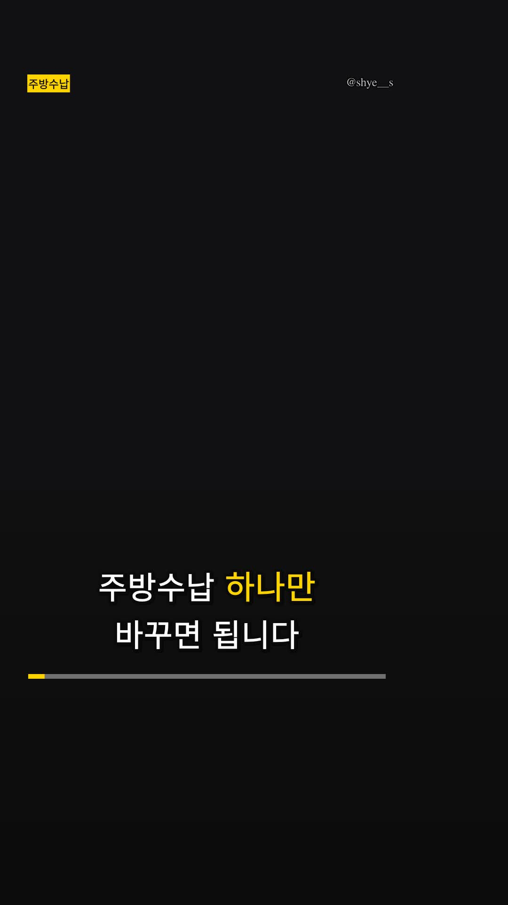
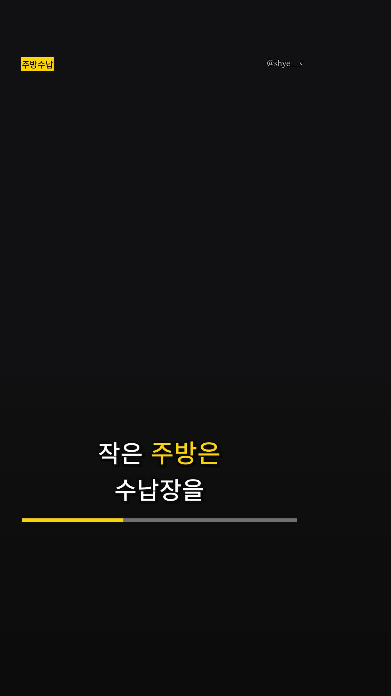
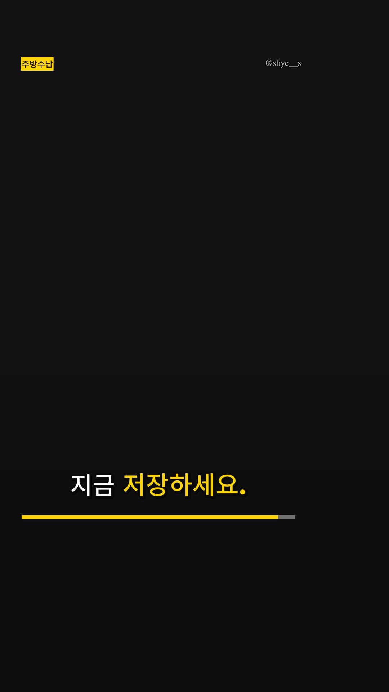
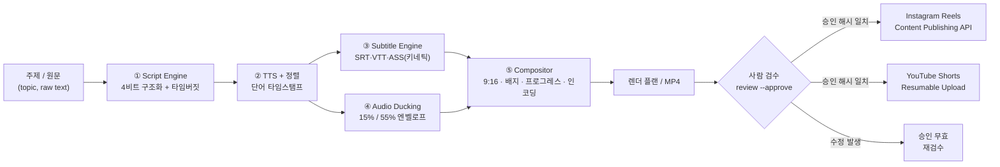

# shortform-engine

**숏폼 1편에 90분 쓰던 편집 병목을, 검수 3분으로 바꾸는 원소스 멀티유즈 엔진.**

릴스·쇼츠용 60초 대본 작성부터 단어 단위 자막 싱크, 오디오 더킹, 9:16 인코딩, Meta Graph / YouTube Data API 게시까지 한 파이프라인으로 처리합니다. 단, **게시 버튼은 사람이 누릅니다** — 100% 무인 봇이 계정 정지로 이어지는 구조를 피하기 위해 Human-in-the-Loop로 설계했습니다.

`TypeScript` · `Node.js 20` · `ffmpeg` · `Vitest` · 테스트 147개 / 커버리지 약 80%

| 훅 (0.0s) | 본문 (12s) | CTA (31s) |
|:---:|:---:|:---:|
|  |  |  |

> 위 프레임은 이 저장소의 파이프라인이 **실제로 렌더한 `docs/demo.mp4`**에서 추출했습니다 (ffmpeg 6.0, 1080×1920, 33.13s, 1.2MB). 음성은 오프라인 합성 보이스(테스트용 톤)입니다.

---

## 1. 문제: 숏폼 한 편에 90분이 사라지는 이유

| 단계 | 수작업 시간 | 실제로 하는 일 |
|------|------------|----------------|
| 소재·훅 리서치 | 15분 | 첫 3초에 뭘 말할지 결정 |
| 대본 작성 | 15분 | 60초 = 한국어 약 320음절 안에 4단 구성 넣기 |
| 녹음·재녹음 | 10분 | 톤, 속도, 숨소리 |
| 자막 싱크 | **20분** | 단어 하나하나 타이밍 맞추기 (가장 지루한 구간) |
| BGM + 더킹 | 10분 | 목소리 구간마다 음악 볼륨 키프레임 찍기 |
| 9:16 규격 인코딩 | 10분 | 해상도·코덱·비트레이트·용량 맞추기 |
| 업로드·검수 | 10분 | 플랫폼별 규격 거절, 캡션/해시태그 |
| **합계** | **90분** | 이 중 60분은 창작이 아니라 규격 맞추기 |

핵심은 **창작이 아닌 구간이 대부분**이라는 점입니다. 대본의 4단 구조, 자막 타이밍, 더킹 커브, 9:16 규격, 업로드 페이로드는 전부 결정론적으로 계산할 수 있습니다. 이 엔진은 그 60분을 코드로 대체합니다.

---

## 2. 해결: 5단계 파이프라인



### ① Script Engine — 60초를 음절 단위로 예산화

- 주제/원문 → `[3초 훅 → 문제 제기 → 해결책 2~4개 → CTA]` JSON 구조
- **발화 속도 기반 타임버짓**: 한국어 5.4음절/초 기준으로 60초 예산(≈300음절)을 계산하고, 초과하면 5단계 압축 패스 실행
  1. 괄호 부연 삭제 → 2. 군더더기(사실/진짜/그냥…) 제거 → 3. 구어 축약 → 4. 정보량 낮은 문장 삭제 → 5. 절 단위 트리밍
- 훅은 **3.5초 상한**을 스키마 레벨에서 강제 (초과 시 검증 실패로 배포 차단)
- LLM을 붙이면 초안 품질이 올라가지만, 실패하면 결정론적 휴리스틱 라이터로 자동 폴백 → 파이프라인이 멈추지 않음

### ② TTS + 단어 정렬

- `TtsProvider` 인터페이스로 교체 가능: **ElevenLabs**(문자 단위 정렬 제공) / **OpenAI TTS**(추정 정렬) / **Local**(오프라인 합성음, CI용)
- 씬 단위로 합성 → 한 줄만 고쳐도 그 씬만 재합성 (전체 재렌더 없음)
- 정렬 소스가 `provider`인지 `estimated`인지 결과물에 명시 → 자막 신뢰도를 속이지 않음

### ③ Subtitle Engine — 단어 단위 키네틱 타이포그래피

- SRT / VTT / **ASS**(1080×1920 기준 스타일, `PlayResX/Y`)
- 두 가지 하이라이트 모드
  - `pulse`: 단어마다 이벤트를 만들어 **지금 말하는 단어만** 액센트 컬러 + 104% 스케일
  - `sweep`: `{\kf}` 카라오케 채움
- 줄바꿈은 글자 수가 아니라 **픽셀 폭 기반 DP**: 줄 수를 최소화하고, 각 줄의 여백 제곱합을 최소화해 고아 줄(한 단어만 남는 줄)을 방지

### ④ Audio Ducking — 목소리가 나올 때만 음악을 낮춘다

목표: 보이스 구간 **15%**, 멘트 사이 **55%**, 램프 120ms/280ms.

- 단어 타임스탬프를 120ms 이내 간격으로 병합 → 실제 "말하는 구간"만 추출
- 180ms 미만의 짧은 틈에서는 **복귀하지 않음** (펌핑 방지)
- 40ms 미만의 튀는 소리는 무시 (불필요한 덕킹 방지)
- 결과는 조각별 선형(piecewise-linear) 엔벨로프 → 테스트에서 수학적으로 검증 가능하고, ffmpeg `volume=eval=frame`으로 그대로 재생

### ⑤ Compositor — 플랫폼 UI를 피하는 레이아웃

- 1080×1920 / 30fps / H.264 **High** / `yuv420p` / AAC 192k / `+faststart`
- 상단 카테고리 뱃지, 단어별 캡션, 하단 프로그레스 바를 **플랫폼 예약 영역 밖**에 배치
- 인스타 릴스는 우측 액션 레일(x≥880, y 980~1560), 유튜브 쇼츠는 x≥900 · 하단 1580~을 침범하면 검증 실패

---

## 3. 왜 100% 자동이 아니라 Human-in-the-Loop인가

무인 업로드 봇은 세 가지 이유로 현업에서 쓰이지 않습니다.

1. **계정 리스크** — 반복적·기계적 업로드 패턴은 플랫폼 스팸 정책의 표적이 됩니다. 한 번의 섀도우밴은 계정 자산 전체를 잃는 일입니다.
2. **품질 리스크** — TTS 억양, 오탈자, 브랜드 톤, 규정(광고 표기·의료·금융)은 자동 판정이 불가능합니다.
3. **책임 소재** — 게시물은 결국 사람의 이름으로 나갑니다.

그래서 이 엔진은 **준비는 전부 자동, 게시만 사람 승인**으로 나눕니다.

```
review.md 생성 → 사람이 자막·캡션 확인
review --approve → 대본+캡션+자막의 sha256 지문을 approval.json에 기록
publish --live → 현재 파일의 해시 재계산, 승인 해시와 불일치하면 게시 거부
```

승인 후에 자막 한 글자만 바뀌어도 게시가 막힙니다. "검수했다"는 말과 실제 게시물이 어긋날 수 없게 만든 것이 이 게이트의 목적입니다.

---

## 4. 해결한 3대 기술 난제

### 4.1 단어 단위 자막 싱크 — 추정과 실측을 구분하기

TTS가 문자 타임스탬프를 주면 그대로 쓰고(ElevenLabs), 안 주면 음절 가중치로 분배합니다(OpenAI, 로컬).

```ts
// 가중치 = 음절 수 + 뒤따르는 문장부호의 쉼
weight_i = max(0.6, syllables(word_i))
gap_i    = pause(punctuation after word_i)

span_i = weight_i * (D / Σ(weight + gap))
```

- 단어 최소 노출 60ms 보장 (짧은 단어가 깜빡임으로 보이지 않게)
- 마지막 단어가 오디오 끝에 정확히 정렬되도록 전체 재정규화
- 정렬 출처를 `alignmentSource: 'provider' | 'estimated'`로 산출물에 남김

**검증**: 단조 증가, 최소 길이, 총합 일치, 긴 단어 > 짧은 단어 (테스트 5종)

### 4.2 오디오 더킹의 수학

목표 게인 함수 `g(t)`는 조각별 선형입니다.

| 구간 | `g(t)` |
|------|--------|
| 목소리 시작 전 | `0.55` |
| 어택 `[s, s+0.12]` | `0.55 → 0.15` 선형 |
| 발화 `[s+0.12, e]` | `0.15` |
| 릴리즈 `[e, e+0.28]` | `0.15 → 0.55` 선형 |
| 짧은 틈 (`next - e < 0.18 + 0.28`) | 릴리즈 생략, `0.15` 유지 |

이걸 ffmpeg에서 그대로 쓰려면 중첩 `if` 표현식이 필요합니다.

```
volume=eval=frame:volume='if(lt(t,1.12),0.55-0.4*(t-1)/0.12,if(lt(t,2),0.15,...))'
```

- 필터그래프 안에서는 반드시 **작은따옴표로 감싸** `if()` 내부의 쉼표가 필터 구분자로 오인되지 않게 함
- `minGapMs` 규칙이 없으면 단어 사이 100ms 틈마다 음악이 튀어올라 "아마추어 냄새"가 남

**검증**: 게인 상·하한, 램프 시간, 짧은 틈 미복귀, 블립 무시, 키프레임 단조성 (테스트 8종)

### 4.3 Meta / YouTube API 재시도 큐

두 플랫폼은 실패 방식이 다릅니다. 같은 재시도 로직을 쓰면 한쪽이 반드시 깨집니다.

| 플랫폼 | 흐름 | 재시도 가능 | 영구 실패 |
|--------|------|-------------|-----------|
| Instagram | 컨테이너 생성 → `status_code` 폴링 → `media_publish` | 429, 5xx, 코드 4/17/32/613 | 코드 9004(다운로드 실패), 190(토큰 만료) |
| YouTube | 세션 생성(POST) → 청크 PUT → 308이면 `Range`부터 재개 | 5xx, 429, 408 | 403 quotaExceeded, 400 메타데이터 |

- **YouTube 리줌**: 308 응답의 `Range: bytes=0-N`을 읽어 `N+1`부터 재전송. 연결이 끊겨도 100MB를 처음부터 다시 올리지 않음
- **Instagram 폴링**: `FINISHED` 전에 `media_publish`를 호출하면 실패 + 24시간 쿼터(25건)만 소모. 그래서 폴링 간격을 2s→8s로 지수 증가시키며 최대 180s 대기
- **백오프**: full jitter `delay = random() * min(max, base·2^attempt)` — 재시도 폭주 방지
- **쿼터 사전 확인**: 게시 전 `content_publishing_limit` 조회, YouTube는 1600 units/영상 · 10,000 units/일 명시

---

## 5. 생산성 / 비용 비교

| 항목 | 외주·수작업 | 이 엔진 |
|------|-------------|---------|
| 편당 제작 시간 | 90분 | **3분** (검수 포함 5분) |
| 자막 싱크 | 20분 수동 | 0분 (자동 계산) |
| BGM 더킹 | 10분 키프레임 | 0분 (엔벨로프 자동) |
| 규격 인코딩 | 10분 시행착오 | 0분 (프리플라이트 통과) |
| 편당 비용 | 50,000원 (외주) | **약 120~200원** (TTS 실비) · 로컬 보이스 0원 |
| 10편 제작 | 15시간 / 50만원 | 30분 / 약 2,000원 |
| 대량 발행 리스크 | 사람이 매번 판단 | 승인 해시로 통제 |

> 비용은 ElevenLabs Creator($0.22/1k chars) 기준 200자 내외 편당 환산값이며, 환율·플랜에 따라 달라집니다. 렌더는 로컬 CPU만 사용합니다.

---

## 6. 설치

```bash
git clone https://github.com/Shye-Seo/sns-shortform-automation.git
cd sns-shortform-automation
npm ci
npm run verify          # 타입체크 + 린트 + 테스트 147개
```

ffmpeg가 없어도 **대본·보이스·자막·렌더 플랜**까지 전부 생성됩니다. 실제 MP4 인코딩과 미디어 검증만 ffmpeg가 필요합니다.

```bash
# macOS
brew install ffmpeg
# Ubuntu
sudo apt install ffmpeg
```

환경변수는 `.env.example` 참고. 전부 선택 사항입니다.

| 변수 | 없을 때 동작 |
|------|--------------|
| `OPENAI_API_KEY` | 휴리스틱 라이터로 대본 생성 |
| `ELEVENLABS_API_KEY` / `_VOICE_ID` | 로컬 합성 보이스(테스트용) |
| `IG_USER_ID` / `IG_ACCESS_TOKEN` | 인스타 게시 불가 (드라이런만) |
| `YOUTUBE_REFRESH_TOKEN` 등 | 유튜브 업로드 불가 (드라이런만) |

---

## 7. CLI

```bash
# 1) 대본 + 보이스 + 자막 + 렌더 플랜
npm run cli -- craft \
  --topic "부산 신혼집 3평 주방 수납 정리법" \
  --raw examples/kitchen.md \
  --duration 45 --platform instagram-reels --cta save \
  --fonts ~/fonts            # 한글 자막 폰트 디렉터리 (libass)

# 2) 검수 시트 확인 → 승인 (사람이 하는 유일한 단계)
npm run cli -- review --project .work/부산-신혼집-...-8a5e
npm run cli -- review --project .work/부산-신혼집-...-8a5e --approve --by 서승혜

# 3) 렌더 (기본은 플랜만, --execute 로 인코딩)
npm run cli -- render --project .work/부산-신혼집-...-8a5e
npm run cli -- render --project .work/부산-신혼집-...-8a5e --execute

# 4) 규격 검증
npm run cli -- validate --file .work/.../render.mp4 --platform instagram-reels

# 5) 게시 (기본 드라이런)
npm run cli -- publish --project .work/... --video-url https://cdn.example.com/render.mp4
npm run cli -- publish --project .work/... --video-url https://cdn.example.com/render.mp4 --live
```

실제 `craft` 출력:

```
🎬 부산 신혼집 3평 주방 수납 정리법
   37.56s / 목표 45s · 장면 6개 · heuristic
   발화 31.08s · 4.95음절/초 · 훅 3.2s

    1. [hook    ]   0.0s  주방수납 하나만 바꾸면 됩니다
    2. [problem ]   3.2s  주방수납, 해봤는데 금방 원래대로 돌아왔죠.
    3. [solution]   8.3s  첫째, 주방수납에서 제일 번거로운 한 가지를 먼저 없앱니다. …
    4. [solution]  17.5s  둘째, 기준을 하나로 줄입니다. 예외를 만들면 다시 원래대로 돌아옵니다.
    5. [solution]  24.2s  셋째, 매일 반복되는 동작에만 붙입니다. …
    6. [cta     ]  32.0s  나중에 또 헷갈립니다. 지금 저장하세요.

   자막 16큐 · 최대 7.3자/초
   보이스 local-synthetic (estimated)
   레이아웃 충돌 없음
```

`render`는 기본적으로 계획만 세우고 명령을 보여줍니다. 이게 "무엇이 실행될지 모르는 자동화"를 막는 장치입니다.

```
📋 렌더 플랜 (아직 인코딩하지 않았습니다)
   출력: .work/.../render.mp4  (41.2MB 예상, 37.56s)
   코덱: h264/high/yuv420p @ 1080x1920 30fps
   ffmpeg -y -hide_banner -i .../voice.wav -filter_complex "…" -map [vout] -map [aout] …
```

### 산출물 구조

```
.work/부산-신혼집-3평-주방-수납-정리법-8a5e/
├── script.json          # 구조화 대본 (스키마 검증 통과)
├── storyboard.md        # 장면표 · 타임버짓 · 압축 리포트
├── review.md            # 사람 검수 시트 (자막 큐 포함)
├── project.json         # 매니페스트 (해시, 레이아웃, 파일 목록)
├── voice.wav            # 48kHz 모노 보이스 트랙
├── voice/s1.wav …       # 씬별 재합성 단위
├── captions.srt/.vtt/.ass
├── overlay.ass          # 뱃지 · 워터마크
├── ducking.csv          # 오디오 더킹 엔벨로프
├── render-plan.json     # ffmpeg 인자 전체
├── render.sh            # 수동 재렌더용 스크립트
└── approval.json        # 검수 승인 + 콘텐츠 해시 (review --approve)
```

---

## 8. 테스트

```bash
npm test              # 147 tests, 8 files
npm run coverage      # 약 80% line coverage
npm run verify        # typecheck + lint + test
```

| 테스트 | 검증하는 것 |
|--------|-------------|
| `scriptEngine.test.ts` | 타임버짓 수식, 압축 패스, 훅 상한, 스키마 계약, 모델 실패 폴백 |
| `audioDucking.test.ts` | 게인 커브 상·하한, 어택/릴리즈, 펌핑 방지, 블립 무시, 단어 정렬 |
| `subtitles.test.ts` | 픽셀 기반 줄바꿈 DP, 큐 분할, SRT/VTT/ASS 포맷 |
| `preflight.test.ts` | 10개 규격 항목 각각의 통과·경고·실패 판정 |
| `publisher.test.ts` | 인스타 컨테이너 폴링, 쿼터, YouTube 308 리줌, 승인 해시 |
| `compositor`의 overlay 케이스 | 프로그레스 바 ASS 애니메이션, 뱃지 좌표, fontsdir 전달 |
| `compositor.test.ts` | 플랫폼 안전영역 충돌, 필터그래프 라벨 균형, 인코딩 인자 |
| `pipeline.test.ts` | 프로젝트 산출물 전체, 보이스 오버런 재배치, 승인 무효화 |
| `media.test.ts` | ffprobe 파싱, 백오프, 토큰 버킷 |

CI는 네트워크·ffmpeg 없이 동작합니다. 외부 API는 의존성 주입으로 fake HTTP를 사용합니다.

> 워크플로 템플릿은 `docs/ci.yml`에 있습니다. 저장소 앱 권한에 `workflows`가 없어 `.github/workflows/`에 직접 두지 못했으므로, 필요할 때 그 경로로 복사해 활성화하세요.

---

## 9. 실제 렌더 검증

`docs/demo.mp4`는 다음 명령으로 생성된 실제 결과물입니다.

```bash
ffmpeg=ffmpeg-6.0-static ffprobe=ffprobe-static \
SHORTFORM_FONTS_DIR=~/fonts \
npm run cli -- craft --topic "부산 신혼집 3평 주방 수납 정리법" --raw examples/kitchen.md --duration 40
npm run cli -- render --project .work/부산-신혼집-... --execute
npm run cli -- validate --file .work/부산-신혼집-.../render.mp4
```

```
✅ 렌더 완료
   1080x1920 30.00fps h264/yuv420p · 33.13s · 1.2MB · aac 48000Hz 2ch
   업로드 가능: 12/13 항목 통과, 경고 1
   ⚠ 비트레이트: 131kbps (권장 4000–12000kbps)
```

비트레이트 경고는 **정적 배경 + 단색 캡션**이라 CRF 18에서 압축률이 극단적으로 높기 때문입니다(B롤을 넣으면 정상 범위로 올라갑니다). 프리플라이트는 이를 실패가 아닌 경고로 처리해, 실제 게시는 막지 않으면서 담당자에게 알립니다.

한글 자막을 burn-in 하려면 폰트가 필요합니다. `--fonts <dir>`(또는 `SHORTFORM_FONTS_DIR`)로 TTF/OTF 디렉터리를 넘기면 libass가 해당 폰트로 렌더합니다. 폰트를 지정하지 않으면 시스템 폰트로 폴백하며, 한글 글리프가 없으면 네모(□)로 보일 수 있습니다.

## 10. 정직한 경계

만들어 놓고 "다 된다"고 말하지 않기 위해, 검증된 것과 아닌 것을 나눕니다.

| 항목 | 상태 |
|------|------|
| 대본 구조·타임버짓·압축 | ✅ 구현·테스트 |
| 단어 정렬·자막 3종 생성·키네틱 ASS | ✅ 구현·테스트 (실제 폰트 렌더는 ffmpeg 필요) |
| 더킹 엔벨로프·ffmpeg 표현식 | ✅ 구현·테스트 (실제 청감 검수는 미실시) |
| 9:16 필터그래프·인코딩 | ✅ ffmpeg 6.0으로 실제 MP4 렌더·프리플라이트 통과 (`docs/demo.mp4`) |
| 프리플라이트 10항목 | ✅ 구현·테스트 (실제 ffprobe 결과 파싱 포함) |
| Meta/YouTube API 호출 | ✅ 프로토콜·재시도·리줌 구현, fake HTTP로 테스트 / **실계정 게시는 자격증명 필요** |
| 인스타 영상 호스팅 | ⚠️ Meta가 URL을 직접 내려받으므로 공개 HTTPS URL 필요 (S3/R2 등) |
| 로컬 합성 보이스 | ⚠️ 테스트용 톤. 실제 납품은 ElevenLabs/OpenAI 보이스 필요 |

**로드맵**: 다국어 자막 자동 번역 → A/B 훅 3안 동시 생성 후 지표 비교 → 댓글·DM 자동 응대 초안 → 프리미어/파이널컷 프로젝트(xml) 내보내기

---

## 11. English

**shortform-engine** turns a topic into a publish-ready 9:16 video: a four-beat 60-second script, word-level captions, audio ducking, H.264 render, and validated uploads — with a human approval gate before anything goes live.

- **Script engine** — budget the 60 seconds in syllables (5.4/sec for Korean), then compress in five passes (parentheticals → fillers → contractions → low-value sentences → clause trims). The 3.5s hook ceiling is enforced by the schema, not by convention.
- **Audio ducking** — a piecewise-linear gain envelope: 15% under speech, 55% between lines, 120ms attack, 280ms release, no release into gaps under 180ms. Emitted as an ffmpeg `volume=eval=frame` expression and verified in unit tests against the same sampling function.
- **Captions** — pixel-accurate DP line breaking (minimises line count, then squared slack), word-level ASS pulse highlighting or karaoke sweep, plus SRT/VTT.
- **Compositor** — 1080×1920@30, H.264 High, yuv420p, AAC 192k, faststart. Overlays are placed inside the platform content box, which excludes the Reels action rail (x ≥ 880) and Shorts caption sheet (y ≥ 1580).
- **Publishers** — Instagram container → status polling → media_publish with quota checks; YouTube resumable upload that resumes from the server's `Range` after a 308 instead of restarting a 100MB upload.
- **Human-in-the-Loop** — `review --approve` stores a sha256 of script + caption + subtitles; `publish` refuses when the artifact changed afterwards.
- **Tests** — 147 Vitest cases, ~80% line coverage, no network and no ffmpeg required (fake HTTP clients, synthetic WAV fixtures).

```bash
npm ci && npm run verify
npm run cli -- craft --topic "small kitchen storage" --duration 45
npm run cli -- review --project .work/<episode> --approve
npm run cli -- render --project .work/<episode> --execute
npm run cli -- publish --project .work/<episode> --video-url https://cdn.example.com/render.mp4
```

---

## 작성자

**서승혜 (Seunghye Seo)** — Frontend & Fullstack Engineer
커머스 SaaS(SellingStorm · chatis.net) 기획·개발 실무, 정보처리기사
GitHub [@Shye-Seo](https://github.com/Shye-Seo) · tjtmdgp95@gmail.com

> 이 엔진은 "AI로 대본 뽑기"가 아니라, 창작 이후의 60분(자막 싱크·더킹·규격·업로드)을 어떻게 결정론적으로 제거할지에 대한 작업입니다. 남은 판단은 사람이 3분 안에 합니다.

## License

MIT — `LICENSE` 참고. 폰트(Pretendard)와 BGM은 포함하지 않으며 각 라이선스를 따라 직접 준비해야 합니다.
