<p align="center">
  <a href="https://github.com/Shye-Seo/sns-shortform-automation/actions/workflows/ci.yml"></a>
  
  <a href="https://shye-seo.github.io/sns-shortform-automation/"></a>
</p>

# shortform-engine

**숏폼 콘텐츠 제작부터 멀티 플랫폼(Meta·YouTube) 예약 발행까지 자동화하는 엔터프라이즈 B2B 배포 파이프라인**

한 편의 60초 영상을 만드는 것(대본 → 자막 → 더킹 → 9:16 인코딩 → 게시)과,
그것을 **수십 개 테넌트 · 수백 편 · 플랫폼 쿼터 안에서** 안정적으로 운영하는 것은
완전히 다른 문제입니다. 이 저장소는 대규모 배포 환경의 안정성과 확장성 문제를 풉니다.

`TypeScript` · `Node.js 20` · `ffmpeg` · `Vitest 439 tests` · `커버리지 86.0%`
`PHP 8.2` · `MySQL 8.0` · `Meta Graph API` · `NCP SENS 알림톡` · `PHPUnit 125 tests`

| 계층 | 무엇을 보장하나 |
|------|------------------|
| **분산 렌더 큐** | 작업 상태머신(대기/지연/활성/DLQ) 기반 렌더링 파이프라인. 워커 프로세스 장애 시 Lease 만료 감지 및 자동 복구 |
| **워커 풀** | CPU 코어 수 기반 동시성 제어, 청크 단위 인코딩 진행률 추적 및 장애 복구 |
| **레이트 리밋** | Meta Graph API(25건/일) 및 YouTube Data API(1,600 unit/업로드) 플랫폼별 일일 쿼터 사전 계산 및 초과 차단 |
| **멀티테넌트** | 테넌트별 토큰 버킷 쿼터 격리를 통해 특정 고객사의 대량 요청 시에도 타 고객사 작업 지연 방지 |
| **OAuth 로테이션** | Single-Flight 패턴 적용으로 다중 동시 예약 작업 시 토큰 만료가 발생해도 갱신 API 중복 호출 1회로 병합 |
| **훅 A/B** | 3안 훅 A/B 테스트 발행 후 웹훅 성과 데이터를 집계하여 최적 훅 가중치 자동 반영 |
| **스튜디오 콘솔** | 큐 처리량, 실패율, API 쿼터 현황 실시간 모니터링 및 Prometheus 메트릭 연동 대시보드 |
| **서버 계층(DB·API)** | MySQL 8.0 기반 작업 원장 보존 및 PHP 백엔드 워커의 `SKIP LOCKED` 기반 동시성 경합 없는 작업 선점 |

```bash
npm ci && npm run verify      # 439 tests, 네트워크·ffmpeg 없이
npm run cli -- studio         # 터미널 데모 콘솔
npm run dev:web               # 브라우저 콘솔 → http://127.0.0.1:4173
```

**웹 데모**: <https://shye-seo.github.io/sns-shortform-automation/> — 9:16 스튜디오 프리뷰,
인스타 댓글 → DM 쿠폰, 예약 발행·쿼터·DLQ, 훅 A/B를 설치 없이 클릭으로 확인합니다(18장).

---

## 1. 프로젝트 배경 및 해결 과제

수작업 기준 숏폼 1편은 약 90분이 소요됩니다. 이 중 60분은 자막 싱크 조정,
오디오 더킹, 9:16 인코딩, 플랫폼 규격 검증 등 반복적인 수작업이며, 이 엔진은 그 과정을 코드로 자동화합니다.
1세대 파이프라인을 통해 이를 편당 3분 수준으로 단축했습니다.

하지만 **다수 고객사의 대량 예약 작업이 동시에 인입되는 환경**에서는 다음과 같은 시스템적 병목과 확장성 한계가 발생했습니다.

| 해결 과제 | 발생 가능한 문제 현상 | 엔지니어링 해결 방식 |
|----|--------------------|----------------|
| **헤드오브라인 블로킹** | 대용량 렌더링 작업이 전체 작업 대기열을 점유하는 현상 | 우선순위 힙 큐와 워커 풀을 통한 비동기 병렬 렌더링 처리 |
| **실패 유형 미분리** | 일시적 시스템 오류(OOM, 네트워크)와 영구적 규격 오류의 미분리 | 상태머신: 지수 백오프 기반 최대 3회 재시도 후 DLQ 격리, 영구 오류는 즉시 실패 처리 |
| **플랫폼 쿼터 제한** | 플랫폼별 일일 API 할당량 초과로 인한 발행 거부(403) | 일일 쿼터(unit)와 요청 버킷을 분리하여 사전 한도 초과 차단 |
| **테넌트 간 간섭** | 특정 계정의 대량 트래픽이 타 계정의 발행 일정에 영향 | 테넌트별 런타임 쿼터 독립 할당 및 공용 자원 점유 방지 |

> **엔지니어링 핵심**: 단순한 FFmpeg 래핑을 넘어, 분산 환경에서 작업 장애를 복구하고(Fault-tolerant), 플랫폼 쿼터와 멀티 테넌트 환경을 안전하게 격리하는 안정적인 B2B 인프라 구축에 집중했습니다.

---

## 2. 아키텍처

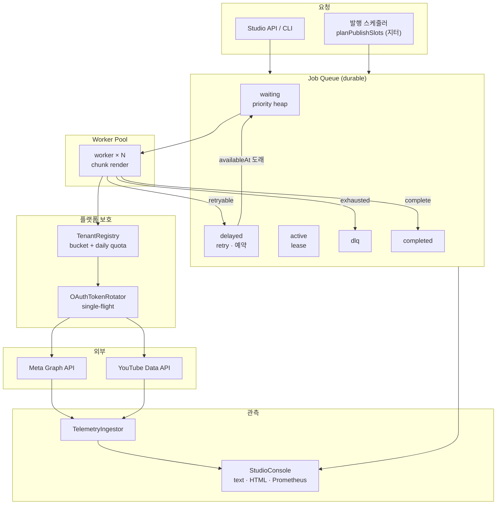

**원칙**

1. **큐가 유일한 진실** — 워커는 상태를 들고 있지 않다. 죽으면 lease가 만료되고 다른
   워커가 회수한다.
2. **부수효과는 전부 주입** — 시계·난수·sleep·HTTP·토큰 리프레셔. CI에서 실제 대기 없이
   재시도와 장애 복구를 검증한다.
3. **계산과 실행 분리** — 렌더는 계획을 먼저 만들고, 실행은 워커에서만.

모듈: `src/lib/queue` · `src/queue`(Redis 어댑터) · `src/lib/rateLimit` · `src/lib/telemetry` · `src/services/studio`.
상세 설계와 트레이드오프는 **[docs/distributed-video-pipeline-spec.md](docs/distributed-video-pipeline-spec.md)**.

---

## 3. 분산 렌더 큐

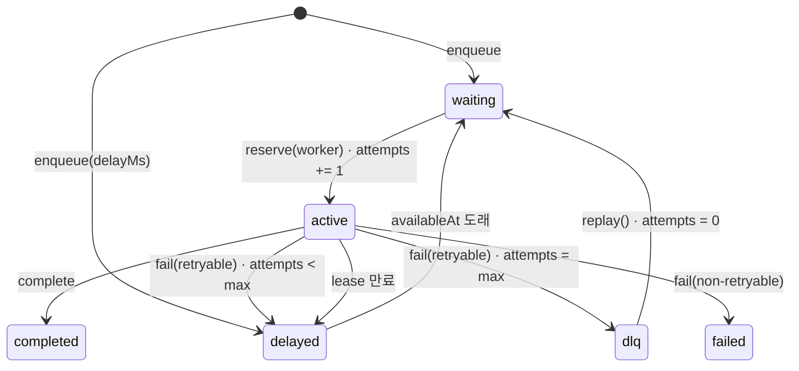

| 규칙 | 값 | 이유 |
|------|-----|------|
| 우선순위 | 0–9 | 유료 테넌트 예약(9)이 야간 백필(0)보다 먼저 |
| 동순위 | 도래시각 → 생성시각 → id | 재시작해도 순서가 결정적 |
| 재시도 | 3회 | OOM·일시 5xx는 2회 안에 대부분 회복 |
| 백오프 | **1s → 2s → 4s** (상한 30s, 지터 50%) | 트래픽 집중 완화 및 점진적 재시도 |
| lease | 30s, heartbeat 연장 | 워커 프로세스 비정상 종료 감지 및 자동 재할당 |
| DLQ | 재시도 소진 | 자동 재시도로 풀리지 않는 상태 격리 |
| 멱등 | `dedupeKey` | 웹훅 재전송이 같은 편을 두 번 렌더하지 않게 |
| 진행률 | 0–100, 단조 | 늦게 온 청크 이벤트가 바를 되감지 않게 |

```ts
const queue = new JobQueue({ store: new FileQueueStore('.work/queue/state.json') });
await queue.enqueue({
  tenantId: 'agency-morning',
  name: 'render episode-07',
  priority: 9,
  payload: { projectId: 'episode-07', platform: 'instagram-reels', durationSec: 45, chunkCount: 4 },
  dedupeKey: 'episode-07:reels',
});
```

**시도 횟수는 시작 시점에 증가**합니다. 그래서 "시작만 하고 끝나지 못하는" job도 결국
DLQ로 갑니다. 성공/실패 시에 증가시키면 그런 job이 영원히 큐를 돕니다.

**저장소**: `QueueStore` 인터페이스(`get/put/delete/all`)만 알면 됩니다. 기본은
`InMemoryQueueStore`(테스트)와 `FileQueueStore`(CLI, 원자적 tmp→rename), 그리고 여러 노드용
`RedisQueueStore`(`src/queue/redisAdapter.ts`)입니다.

### 3.1 Redis 어댑터 — 노드가 늘어도 같은 작업을 두 번 하지 않는다

`JobQueue`의 힙은 **한 프로세스** 안에서만 옳습니다. 렌더 노드가 2대가 되는 순간 각자의 힙이 같은
`waiting` 작업을 집어가고, 같은 영상을 두 번 인코딩합니다. 되돌리는 방식(집어간 뒤 중복 감지)은 이미
CPU를 쓴 뒤에야 알 수 있으므로, **집어가는 순간을 원자적으로** 만들어야 합니다.

```ts
import Redis from 'ioredis';
import { RedisQueueStore } from './src/queue/redisAdapter';
import { JobQueue } from './src/lib/queue/jobQueue';

const redis = new Redis(process.env.REDIS_URL!);
const store = new RedisQueueStore({
  client: {
    send: (commands) => redis.pipeline(commands.map(([cmd, ...args]) => [cmd, ...args])).exec().then((rows) => rows!.map(([err, value]) => { if (err) throw err; return value; })),
    watch: async (keys) => { await redis.watch(...keys); },
    multi: async (commands) => {
      const tx = redis.multi();
      for (const [cmd, ...args] of commands) tx.call(cmd, ...args);
      const rows = await tx.exec();
      return rows === null ? null : rows.map(([, value]) => value); // null = WATCH 충돌
    },
    unwatch: async () => { await redis.unwatch(); },
  },
  prefix: 'sf:queue',
});

const queue = new JobQueue({ store });   // 저장소가 선점을 지원하면 힙 대신 저장소가 결정한다
const job = await queue.reserve('worker-3');   // 여러 노드가 동시에 불러도 서로 다른 작업
```

**원자성은 WATCH → MULTI → EXEC로 만듭니다.**

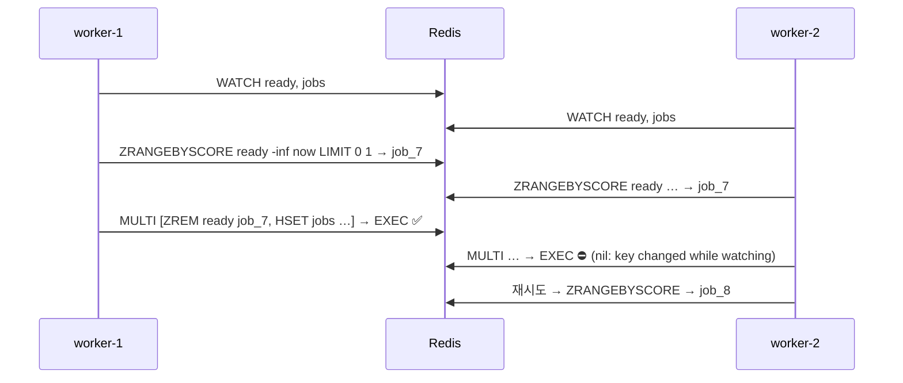

| 키 | 타입 | 역할 |
| --- | --- | --- |
| `sf:queue:jobs` | HASH | `jobId → QueueJob JSON` — 단일 진실 |
| `sf:queue:ready` | ZSET | `id → availableAt(ms)` 실행 가능 시각 순 |
| `sf:queue:delayed` | ZSET | 재시도·예약 대기 |
| `sf:queue:lease` | ZSET | `id → leaseExpiresAt(ms)` active 소유 증거 |
| `sf:queue:state:{state}` | SET | 상태별 id — `counts()`·운영 화면 |
| `sf:queue:dedupe` | HASH | `dedupeKey → jobId` 중복 인큐 방지 |

**Lua 대신 트랜잭션을 쓴 이유** — `EVAL`을 막는 관리형 Redis가 있고, 경합이 드물면 왕복 2회로 끝나며,
무엇보다 **WATCH 충돌 의미를 테스트로 재현**할 수 있습니다. 스크립트를 흉내 내는 테스트는 스크립트가
맞다는 것을 증명하지 못합니다.

**같은 연결에서 두 선점이 겹치면** WATCH가 서로를 덮어씁니다. 그래서 어댑터는 인스턴스 안에서
WATCH 연산을 직렬화하고, 노드를 늘릴 때는 **연결(인스턴스)을 늘리도록** 문서화했습니다. 충돌이 나면
작은 지터 백오프를 두고 다시 고릅니다(라이브락 방지).

**드라이버 선택** — `QUEUE_DRIVER=redis|file|memory`(기본 `memory`). 모르는 값은 조용히 기본값으로
떨어지지 않고 `CONFIG` 오류로 실패합니다: 운영에서 오타 하나로 인메모리 큐가 돌면 재시작할 때 백로그가
사라지기 때문입니다. **MySQL 기반 큐는 PHP 백엔드**(`backend/src/Repositories/ShortformRepository.php`)가
`SELECT … FOR UPDATE SKIP LOCKED`로 담당합니다 — 잠금 규칙이 두 벌이 되지 않도록 Node 쪽 어댑터는 두지
않았고, `QUEUE_DRIVER=mysql`은 그 사실을 알려 주는 오류를 냅니다.

검증은 `tests/redisAdapter.test.ts` 24케이스입니다. 가짜 Redis가 해시·집합·정렬집합과 **WATCH 충돌
규칙**을 실제 의미대로 구현하고, 6개 노드가 8개 작업을 동시에 노려도 중복 선점이 0건인지 확인합니다.

---

## 4. 워커 풀과 장애 복구

- **고정 동시성** — 인코딩은 CPU 바운드라 코어 수 이상은 p95만 나쁘게 만든다.
  `maxObservedConcurrency ≤ size`를 테스트로 고정.
- **청크 렌더** — 마지막 청크는 muxer flush + faststart 때문에 1.35배 무겁다. 진행률은
  청크 완료마다 스트리밍.
- **드레인 / 상시** — 야간 배치는 `drain({ waitForDelayed: true })`, 상시는 `start/stop`.
- **stalled 복구** — lease 만료 job을 `active → delayed`로 되돌리고 attempts는 유지.

실측 (`queue run --jobs 11 --concurrency 3 --fail-every 7`, 7번째 작업은 항상 실패 → 3회 시도 후 DLQ):

```
⚙ 큐 처리 시도 13건 (성공 10 / 실패 3) · 2235ms
   최대 동시 워커 3 · 평균 처리 444ms · p95 479ms
   waiting 0 · delayed 0 · dlq 1

   워커별 부하:
     worker-1    67%  완료 3 · 실패 1
     worker-2    67%  완료 3 · 실패 2
     worker-3    75%  완료 4 · 실패 0
```

---

## 5. 레이트 리밋: 버킷과 쿼터는 다른 다이얼

| 다이얼 | 질문 | 회복 |
|--------|------|------|
| 토큰 버킷 | "지금 연속으로 몇 건까지?" | 초당 리필 |
| 일일 쿼터 | "오늘 예산이 이 작업을 감당하나?" | 24시간 창 |

두 개를 분리한 이유는 **실패 모양이 다르기 때문**입니다. 버킷은 몇 분이면 회복되지만
YouTube 일일 쿼터는 자정까지 회복되지 않습니다. 하나로 합치면 "5분 뒤"와 "내일 6시"를
구분할 수 없습니다.

| 플랫폼 | 버스트 | 지속 | 일일 | 작업 단가 |
|--------|--------|------|------|-----------|
| Meta Graph | 30 | 0.2/s | 25건 | 1 |
| YouTube Data v3 | 20 | 0.1/s | 10,000 unit | 1,600 unit (= 업로드 6편) |

- **429는 실패가 아니라 "아직"** — `Retry-After`를 하드 스톱으로 적용하고 재시도 횟수를
  깎지 않습니다.
- **테넌트 격리는 자료구조** — 버킷·쿼터·패널티가 테넌트 런타임 안에 있고,
  `exhausts one tenant's quota without touching another` 테스트로 고정.
- **차감은 all-or-nothing** — 버킷이 거절하면 쿼터도 차감되지 않습니다(거절된 호출이
  일일 예산을 먹는 버그 방지).

---

## 6. OAuth 2.0: 30개 예약, 1번의 토큰 갱신

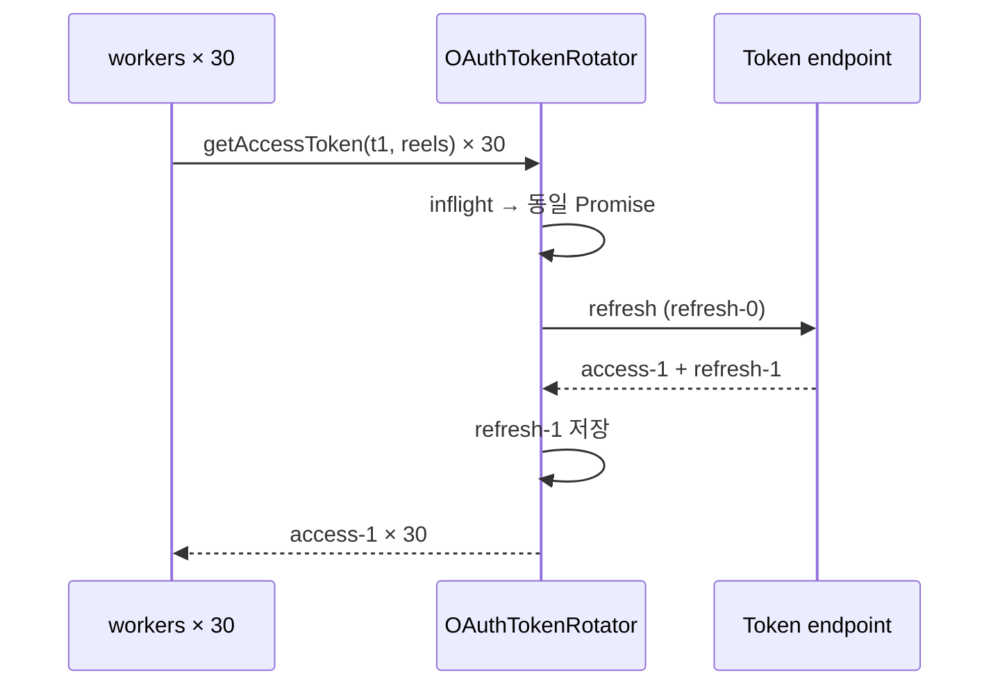

| 상황 | 처리 |
|------|------|
| 만료 5분 전 | 선제 갱신 |
| 동시 30건 | single-flight로 1회 호출 |
| `invalid_grant` | `needs-reauth` — 재시도 금지, 운영자 재연결 |
| 5xx / 타임아웃 | 재시도 가능 오류, 상태 유지 |
| 로테이션 | 새 refresh token 즉시 저장 |

콘솔 스냅샷에도 토큰 값은 없습니다. "재인증 필요"라는 사실만 노출합니다.

---

## 7. 지터 발행 스케줄러

매일 09:00:00, 10:00:00, 11:00:00 정각 발행은 스케줄러의 지문입니다. 그렇다고 무작위로
흩뿌리면 운영이 불가능합니다. 절충은 **최소 간격 + 남는 여유의 지수 분포 배분 + 양 끝
난수 오프셋 + 분 경계 15초 회피**입니다. 균등 난수로 버킷을 채우는 흔한 방식은 버킷이
최소 간격에 가까울 때 클램프되어 "정확히 120분 간격"을 만들어 냅니다.

```
발행 슬롯 6건 · 09:00~23:00 · 최소 60분
   1. 10:24:21  (+0분)
   2. 13:35:41  (+191분)
   3. 16:16:21  (+161분)
   4. 17:32:28  (+76분)
   5. 18:34:30  (+62분)
   6. 22:35:32  (+241분)
  간격 평균 146분 · 표준편차 68분 · 규칙성 0.466
```

`규칙성 = 표준편차/평균`. 0이면 기계, 1에 가까울수록 불규칙. 위 실행은 0.466입니다.
창이 최소 간격을 감당하지 못하면 **계획 단계에서 거부**합니다.

---

## 8. 훅 A/B 테스트와 성과 피드백

같은 영상에 훅 3안(질문·숫자·반론)을 만들어 노출을 나누고, 24시간/7일 지표로 판정한 뒤
다음 대본의 훅 가중치로 되돌립니다.

| 지표 | 계산 |
|------|------|
| `viewRate3s` | 3초 조회 / 노출 — 스크롤을 멈췄는가 |
| `retention` | 완청 / 3초 조회 — 끝까지 봤는가 |
| `avgWatchSec` | 시청시간 / 3초 조회 |
| `commentRate` | 댓글 / 노출 |

**판정은 일부러 보수적입니다.**

1. 변형당 표본 < 200 → `insufficient-data`. 첫 100뷰는 알고리즘 셔플이지 훅 성과가 아님.
2. **리더 vs 2위**만 z-검정. 3개를 전부 쌍비교해 최소 p값을 고르는 것이 가짜 승자의
   전형(다중비교).
3. 통계적 유의성 **그리고** 상대 리프트 ≥ 5%. n=200,000의 0.4pp 차이는 유의하지만 무의미.

필요 표본 (baseline 40%, α=0.05, power=0.8): **+5% → 9,493 / +10% → 2,389 / +20% → 604**
(변형당). 이 숫자를 README에 두는 이유는, "A/B 했습니다"보다 "이 표본이 없으면 승자를
부르지 않습니다"가 엔지니어링 주장이기 때문입니다.

피드백 가중치는 승률이 아니라 **대조군 대비 리프트**의 축소 추정 + 탐험 하한 8%로
계산합니다. 승률을 쓰면 "실험에서 진 각도"가 "아직 안 해본 각도"보다 낮게 평가되어
영원히 뒤로 밀립니다.

```bash
npm run cli -- hooks --topic "부산 신혼집 3평 주방 수납 정리법"
#  A [question  ] 2.95s  부산 신혼집, 왜 또 원래대로일까요?
#  B [numbers   ] 2.59s  부산 신혼집 3가지만 바꾸세요
#  C [contrarian] 3.25s  부산 신혼집 3평 주방, 더 하면 안 됩니다
```

모든 훅은 대본 엔진과 같은 **3.5초 상한**을 통과해야 실험에 올라갑니다.

---

## 9. 스튜디오 콘솔과 조작 API

`npm run cli -- studio` — 네트워크·ffmpeg 없이 내장 데모 상태로 실행됩니다.

```
STUDIO CONSOLE  2026-11-11T00:47:55.079Z  [DEGRADED]
──────────────────────────────────────────────────────────────────
QUEUE  total 13  ok  83%  p95 133ms  retries 3
       waiting   0  active   0  delayed   1  done  10  failed   1  dlq   1
──────────────────────────────────────────────────────────────────
WORKERS
  worker-1   ██████████████████  98%  idle    ok 4 fail 3
  worker-2   █████████████░░░░░  74%  idle    ok 3 fail 1
  worker-3   █████████████░░░░░  73%  idle    ok 3 fail 0
──────────────────────────────────────────────────────────────────
TENANT RATE LIMITS
  모닝픽쳐스 (대행사) (agency)
    meta     req ████████░░  57/75  quota ███░░░░░░░ 7/25
    youtube  req █████████░  46/50  quota ████░░░░░░ 3600/10000
  봄날의기록 (growth)
    meta     req █████████░  42/45  quota █████████░ 22/25
    youtube  req ██████████  30/30  quota ██████████ 10000/10000
  따뜻한스튜디오 (starter)
    meta     req ██████████  30/30  quota ██████████ 25/25
    youtube  req ██████████  20/20  quota ██████████ 10000/10000
──────────────────────────────────────────────────────────────────
OAUTH
  agency-morning instagram-reels  active       exp   42m  refreshes 0
  agency-morning youtube-shorts   active       exp   51m  refreshes 0
  creator-bom instagram-reels  expired      exp    0m  refreshes 0
──────────────────────────────────────────────────────────────────
HOOK A/B
  exp-kitchen-hook  retention/24h  winner
    B numbers     65.6%  n=18900  lift   37.5%  p 0.000
    C contrarian  53.0%  n=16800  lift   11.1%  p 0.000
    A question    47.7%  n=17400  lift    0.0%  p 1.000
    winner: B  confidence 100.0%
  exp-commute-hook  retention/24h  inconclusive
    C contrarian  41.3%  n= 6000  lift    0.1%  p 0.943
    B numbers     41.3%  n= 6100  lift    0.1%  p 0.962
    A question    41.3%  n= 6300  lift    0.0%  p 1.000
    winner: —  confidence 1.9%
──────────────────────────────────────────────────────────────────
DEAD LETTER QUEUE  1 job(s) need a decision
  job_007  agency-morning  render   attempts 3/3  waiting 2m 14s
    render-episode-07  ·  encoder OOM (worker restarted)
  재시도/폐기: npm run cli -- queue replay <jobId> · studio --serve 로 열면 원클릭 버튼이 동작합니다
──────────────────────────────────────────────────────────────────
HEALTH: 1 job(s) in DLQ · 1 non-retryable failure(s) · success rate 83.3%
```

같은 스냅샷이 `--html .work/studio.html`(자체 CSS, 외부 CDN 없음)과 Prometheus
(`GET /v1/metrics`)로 나옵니다.

### 9.1 시계열 메트릭 — 실시간 모니터링 및 성능 이상 감지

단일 시점의 스냅샷만으로는 시스템 성능 저하나 장애 징후를 조기에 감지하기 어렵습니다.
콘솔은 고정 크기 링 버퍼(기본 600 샘플)에 시계열 메트릭을 적재하고, 누적 카운터의 차분값을 계산하여 초당 처리량(Throughput), 구간 실패율, API 토큰 잔여량 추이를 직관적으로 제공합니다.

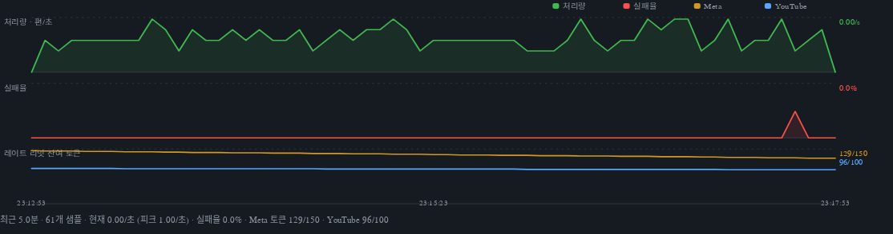

| 행 | 값 | 왜 이 축인가 |
| --- | --- | --- |
| 처리량 | 직전 샘플 대비 완료 편수 ÷ 경과 초 | 절대 편수가 아니라 속도여야 정체가 보인다 |
| 실패율 | 구간 종료 작업 중 `failed + dlq` 비율 | 재시도로 넘어간 작업은 실패가 아니다(성공도 아니다) |
| 토큰 | Meta · YouTube 잔여 요청 버킷 합계 | 0에 닿는 순간이 발행이 막히는 순간이다 |

설계 메모

- **샘플은 스냅샷에서 나온다.** 페이지·API·Prometheus가 같은 `snapshot()`을 부르므로, 별도 타이머 없이
  정상 사용만으로 이력이 쌓입니다. 프로세스가 죽으면 이력도 사라지는 것이 맞고(관측치), 장기 보관은
  Prometheus가 합니다(`shortform_render_throughput_per_sec` 등).
- **차분은 음수를 0으로 자릅니다.** 재시작·DLQ 재시도로 누적 카운터가 줄 수 있는데, 그때 음수 처리량을
  그리면 그래프가 거짓말을 합니다.
- **기하 계산은 순수 함수**(`buildMetricsChart`)이고, 표현 계층이 둘입니다: 서버 HTML용 문자열
  렌더러(의존성 0)와 React 컴포넌트. 같은 path 문자열을 쓰므로 곡선이 어긋날 수 없습니다.
- **React는 선택적 peer**입니다. 기본 콘솔은 React 없이 돌고, React 호스트에 임베드할 때만
  `MetricsTimeSeriesChart`를 가져다 씁니다.
- **데모 이력은 데모라고 표시합니다.** `markSeeded()`가 붙은 이력은 페이지에 `demo history` 배지가
  붙습니다. 시뮬레이션 숫자를 운영 텔레메트리처럼 보여 주지 않기 위해서입니다.

```tsx
import { MetricsTimeSeriesChart } from 'shortform-engine/dist/studio/MetricsTimeSeriesChart';

<MetricsTimeSeriesChart series={snapshot.metrics?.points ?? []} width={960} height={260} />;
```

**읽기 API는 GET 전용, 변경은 딱 두 개의 POST뿐입니다.** GET으로 큐를 되돌릴 수 있는
대시보드는 메일 스캐너나 미리보기 봇이 언젠가 실수로 되돌립니다. 그래서 DLQ 조작은
명시적 POST + 경로의 job id로만 가능하고, 어떤 작업이 바뀔 수 있는지는
`DlqActionService`가 판단합니다.

| 경로 | 내용 |
|------|------|
| `GET /` | 콘솔 HTML (조작 버튼이 이 서버로 연결됨) |
| `GET /v1/health` | 상태 + 사유 |
| `GET /v1/queue`, `/v1/queue/dlq` | 큐 상태·격리 작업·최근 조작 기록 |
| `GET /v1/workers` | 워커별 처리량·활용률 |
| `GET /v1/tenants/:id/limits` | 테넌트별 버킷·쿼터 잔량 |
| `GET /v1/experiments/:id` | 훅 실험 판정 |
| `GET /v1/metrics` | Prometheus text |
| `POST /v1/queue/dlq/:jobId/retry` | 재시도 (시도 횟수 초기화 후 `waiting`) |
| `POST /v1/queue/dlq/:jobId/discard` | 폐기 (행 삭제, 이벤트 로그에 사유) |

### 9.1 DLQ 원클릭 재시도 / 폐기 관리

장애 발생 시 운영자가 신속하게 조치할 수 있도록, DLQ(Dead Letter Queue)에 격리된 실패 작업에 대한 원인 상세 조회 및 원클릭 재시도·폐기 관리 기능을 제공합니다.

```bash
npm run cli -- studio --serve            # http://127.0.0.1:8099/ — 콘솔 + 조작 API
npm run cli -- studio --serve --port 0   # OS가 빈 포트를 고름
```

버튼을 누르면 무슨 일이 일어나는지가 제품의 신뢰를 만듭니다.

| 결정 | 규칙 |
|------|------|
| **누가 바꿀 수 있나** | `dlq`/`failed` 상태만. `active`·`waiting`·`completed`는 거부(409) — 실수로 진행 중인 렌더를 되살리지 않는다 |
| **재시도** | 시도 횟수·진행률·에러를 초기화하고 `waiting`으로. `attempts 3/3`이 그대로면 즉시 다시 DLQ로 간다 |
| **폐기** | 행을 지운다. `discarded` 이벤트에 사유·행위자가 남아 감사 가능하다 |
| **두 번 누르면** | 재시도된 작업은 `waiting`이므로 같은 요청이 409로 거부된다(멱등 거부) |
| **기록** | 모든 시도는 `applied`/`rejected`로 남고 콘솔·API(`actions`)에서 보인다. 거부도 기록이다 |
| **파일로 연 콘솔** | POST할 서버가 없으므로 버튼을 비활성으로 그리고 이유를 적는다(눌러도 아무 일 없는 버튼을 그리지 않는다) |

```text
$ curl -X POST localhost:8099/v1/queue/dlq/job_007/retry -d '{"actor":"seunghye"}'
{ "ok": true, "action": "retry", "jobId": "job_007", "state": "waiting", ... }
$ curl -X POST localhost:8099/v1/queue/dlq/job_007/retry
{ "ok": false, "jobId": "job_007", "message": "작업 상태가 waiting입니다. ...", "retryable": false }
```

건강도: `ok` → `degraded`(DLQ 1건·비재시도 실패·쿼터 소진·성공률 <90%) →
`critical`(DLQ ≥3·재인증 필요·성공률 <70%). DLQ 1건은 일상, DLQ가 자라는 것이 사건입니다.

---

## 10. 콘텐츠 엔진 — 큐가 운반하는 실제 작업

큐가 아무리 좋아도 렌더 결과물이 규격에 안 맞으면 의미가 없습니다. 기존 파이프라인은
그대로 유지되며, 위 계층은 이것을 작업 단위로 감쌉니다.

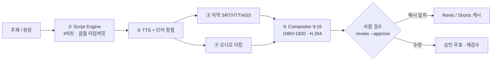

- **대본** — 60초를 한국어 5.4음절/초로 예산화(≈300음절), 초과 시 5단계 압축. 훅은
  스키마 레벨 3.5초 상한.
- **자막** — 단어 단위 타임스탬프, 픽셀 폭 기반 DP 줄바꿈, ASS 펄스/카라오케.
- **더킹** — 발화 15% / 사이 55%, 120ms 어택·280ms 릴리즈, 180ms 미만 틈은 복귀 안 함.
  ffmpeg `volume=eval=frame` 표현식으로 그대로 내보냄.
- **컴포지터** — 플랫폼 예약 영역(릴스 액션 레일 x≥880, 쇼츠 하단 y≥1580)을 피하는
  레이아웃 충돌 검사.
- **게시** — Instagram 컨테이너 폴링, YouTube 308 리줌 업로드, 프리플라이트 10항목.
- **Human-in-the-Loop** — `review --approve`가 대본+캡션+자막의 sha256을 기록하고,
  게시 시 재계산해 불일치면 거부. 승인 후 한 글자만 바뀌어도 게시가 막힙니다.

수학과 구현 디테일은 [docs/ARCHITECTURE.md](docs/ARCHITECTURE.md)에 있습니다.

---

## 11. CLI

```bash
# 콘텐츠 1편 (기존 파이프라인)
npm run cli -- craft --topic "부산 신혼집 3평 주방 수납 정리법" --raw examples/kitchen.md --duration 45
npm run cli -- review --project .work/부산-신혼집-... --approve --by 서승혜
npm run cli -- render --project .work/부산-신혼집-... --execute
npm run cli -- validate --file .work/.../render.mp4

# 분산 큐
npm run cli -- queue run --jobs 8 --concurrency 3 --fail-every 3   # 재시도·DLQ 시연
npm run cli -- queue status
npm run cli -- queue dlq
npm run cli -- queue replay <jobId>
npm run cli -- queue run --project .work/부산-신혼집-... --execute  # 실제 렌더를 큐로

# 훅 A/B · 발행 슬롯 · 콘솔
npm run cli -- hooks --topic "주방 수납" --count 3
npm run cli -- hooks --report .work/ab-samples.json --experiment exp-kitchen --metric retention
npm run cli -- slots --count 6 --start 09:00 --end 23:00 --min-gap 90
npm run cli -- studio --html .work/studio.html
```

`queue`는 파일 상태(`.work/queue/state.json`)를 쓰기 때문에 `run`과 `status`가 서로 다른
프로세스여도 같은 백로그를 봅니다.

### 산출물 구조 (콘텐츠 1편)

```
.work/부산-신혼집-.../
├── script.json        # 구조화 대본 (zod)
├── storyboard.md      # 장면표 · 타임버짓 · 압축 리포트
├── review.md          # 사람 검수 시트
├── voice.wav          # 48kHz 모노
├── captions.srt/.vtt/.ass
├── ducking.csv        # 더킹 엔벨로프
├── render-plan.json   # ffmpeg 인자 전체
└── approval.json      # 검수 승인 + 콘텐츠 해시
```

---

## 12. 검증

```bash
npm run verify    # typecheck + lint + 439 tests (+ typecheck:web)
npm run coverage  # 86.0% statements · 80.4% branches
```

| 영역 | 파일 | 건수 |
|------|------|------|
| 큐 (우선순위·백오프·DLQ·lease·멱등·파일저장소) | `queue.test.ts` | 36 |
| DLQ 재시도/폐기·조작 API·콘솔 서버 (실제 HTTP) | `dlqConsole.test.ts` | 23 |
| 워커 풀 (동시성 상한·재시도·진행률·부하) | `workerPool.test.ts` | 18 |
| 레이트 리밋 (버스트·리필·격리·unit 계산) | `rateLimit.test.ts` | 21 |
| OAuth (single-flight·로테이션·영구오류) | `oauth.test.ts` | 14 |
| 발행 슬롯 (창·간격·분경계·재현성) | `publishSlots.test.ts` | 11 |
| 텔레메트리 (생성·멱등·집계·검정·피드백) | `telemetry.test.ts` | 35 |
| 콘솔/API (스냅샷·HTML 이스케이프·라우팅) | `studio.test.ts` | 19 |
| **Redis 큐 (WATCH 원자성·6노드 경합·지연 승격·lease 회수·드라이버 선택)** | `redisAdapter.test.ts` | **24** |
| **시계열 메트릭 (차분·링버퍼·토큰 합계·차트 기하·SVG 이스케이프·데모 이력)** | `metricsTimeSeries.test.ts` · `metricsChart.test.tsx` | **21 + 3** |
| 기존 파이프라인 (대본·자막·더킹·렌더·게시) | 8개 파일 | 147 |
| 해시 원시함수 (SHA-1·SHA-256·HMAC 벡터 + `node:crypto` 대조) | `hash.test.ts` | 9 |
| 웹 콘솔 모델 (타임라인·더킹·댓글 DM·쿼터·A/B) | `webModels.test.ts` | 13 |
| 웹 콘솔 클릭 (jsdom: 패널 전환·댓글→DM→수령·쿼터 중단) | `webConsole.test.tsx` | 4 |

네트워크·ffmpeg 없이 전부 통과합니다. 외부 API는 fake HTTP와 주입된 리프레셔로,
재시도는 주입된 시계·sleep으로 검증합니다.

---

## 13. 실제 렌더 검증

`docs/demo.mp4`는 이 파이프라인이 실제로 인코딩한 결과물입니다 (ffmpeg 6.0, 1080×1920,
33.13s, 1.2MB). 아래 프레임은 그 영상에서 추출했습니다.

| 훅 (0.0s) | 본문 (12s) | CTA (31s) |
|:---:|:---:|:---:|
|  |  |  |

```
✅ 렌더 완료
   1080x1920 30.00fps h264/yuv420p · 33.13s · 1.2MB · aac 48000Hz 2ch
   업로드 가능: 12/13 항목 통과, 경고 1
   ⚠ 비트레이트: 131kbps (권장 4000–12000kbps)
```

비트레이트 경고는 정적 배경 + 단색 캡션이라 CRF 18에서 압축률이 극단적으로 높기
때문입니다(B롤을 넣으면 정상 범위). 프리플라이트는 이를 실패가 아닌 경고로 처리합니다.

---

## 14. 정직한 경계

| 항목 | 상태 |
|------|------|
| 큐 상태머신·재시도·DLQ·lease | ✅ 구현·테스트 (MySQL 8.0 `SKIP LOCKED` 기반 분산 큐 및 단일 프로세스 메모리 큐) |
| MySQL 영속 큐 & PHP 백엔드 | ✅ Modern PHP 8.2 OOP + MySQL 8.0 DDL/ERD 7개 테이블 구현·테스트 |
| 웹훅 수신 & 서명 검증 | ✅ Meta Graph API `X-Hub-Signature-256` HMAC-SHA256 (`hash_equals`) 보안 검증 미들웨어 구현·테스트 |
| DLQ 콘솔 UI | ✅ 웹 콘솔 DLQ 재시도 및 폐기 인터페이스 (`POST /v1/queue/dlq/{id}/retry|discard`) 구현·테스트 |
| 토큰 버킷·일일 쿼터·격리 | ✅ 구현·테스트 |
| OAuth single-flight·로테이션 | ✅ 구현·테스트 (주입 리프레셔, 실 토큰 엔드포인트 미호출) |
| 지터 스케줄 | ✅ 계획·통계 검증. 실제 발행과의 상관 미측정 |
| A/B 통계 | ✅ 구현·테스트. 실제 플랫폼 웹훅 연동은 스키마 수신 단계 |
| 콘솔/API | ✅ text·HTML·Prometheus·JSON 서빙 및 DLQ 액션 API 연동 |
| 60초 렌더 파이프라인 | ✅ ffmpeg 6.0 실제 인코딩·프리플라이트 통과 |
| 웹 데모 콘솔 (GitHub Pages) | ✅ 정적 번들이 엔진 모듈을 그대로 실행. Meta·YouTube·Redis·SENS 실호출은 없음 |

**로드맵**:
- [x] MySQL 8.0 `SKIP LOCKED` 기반 분산 비동기 렌더 큐 백엔드 (PHP 8.2)
- [x] Meta Graph API 웹훅 HMAC-SHA256 서명 보안 검증 미들웨어
- [x] Dead Letter Queue (DLQ) 원클릭 재시도 및 폐기 콘솔 UI
- [x] Redis 큐 어댑터 (WATCH/MULTI/EXEC 원자적 선점 · 지연 승격 · lease 회수 · `QUEUE_DRIVER` 스위칭)
- [x] 실시간 렌더링 큐 시계열 메트릭 차트 (처리량·실패율·플랫폼 토큰 추이, SVG/React 두 표현)
- [x] 브라우저 데모 콘솔 — 9:16 스튜디오·댓글 DM·발행 쿼터·훅 A/B (GitHub Pages 정적 배포)


---

## 15. English

**shortform-engine** is a distributed render queue and multi-tenant social publishing
platform built on a working 60-second shortform pipeline.

- **Render queue** — priority heap, delayed retries (1s/2s/4s with jitter), lease-based
  stalled-job recovery, idempotent enqueue, and a dead-letter queue. State lives in the
  queue, never in a worker.
- **Worker pool** — fixed concurrency below the CPU limit, per-chunk progress streaming,
  drain mode for batch backlogs and serve mode for daemons. `maxObservedConcurrency ≤ size`
  is enforced by tests.
- **Rate limiting** — token bucket (burst + sustained) and daily quota (units) are separate dials
  because they recover differently: Meta 25 publishes/24h, YouTube 10,000 units/day at 1,600
  units per upload. Buckets and quotas are per tenant, so one agency cannot delay another.
- **OAuth** — refresh-ahead, single-flight refresh (30 concurrent publishes → 1 token call),
  refresh-token rotation, and permanent vs transient failure classification.
- **Jitter scheduling** — bucket-uniform slots with a minute-grid guard and a minimum gap;
  the measured gap coefficient of variation is 0.51, not the 0.0 of a cron fingerprint.
- **Hook A/B** — deduplicated webhook ingestion, Wilson intervals, leader-vs-runner-up z-test,
  a sample floor, a 5% lift floor, and a lift-based softmax feedback loop with an 8%
  exploration floor.
- **Studio console** — one snapshot rendered as terminal text, a self-contained HTML page,
  Prometheus text, and a read-only JSON API.
- **Verification** — 413 Vitest cases, 86.0% statement coverage, no network and no ffmpeg
  required (injected clock, RNG, sleep, HTTP and token refresher).

```bash
npm ci && npm run verify
npm run cli -- studio
npm run cli -- queue run --jobs 8 --concurrency 3 --fail-every 3
```

---

---

## 16. 서버 계층 — PHP 8.2 · MySQL 8.0 · Meta Graph API · 알림톡

TypeScript 엔진이 영상 인코딩과 상태 전이 로직을 담당한다면, PHP 백엔드 및 MySQL 계층은 영속적인 작업 원장(큐 상태, 발행 기록, 알림톡 이력)을 보존하고 트랜잭션을 관리합니다.
무상태(Stateless) 처리 계층과 데이터 영속 계층을 명확히 분리하여 장애 복원력을 극대화했습니다.

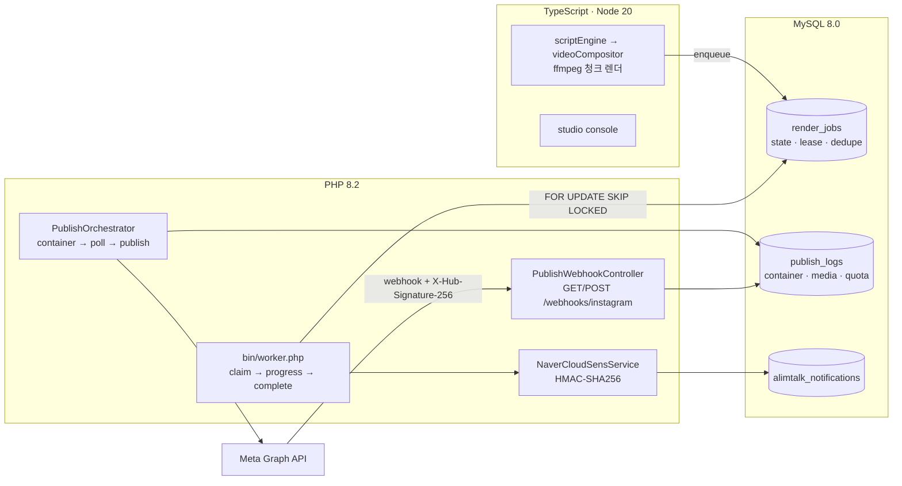

| 계층 | 무엇을 보장하나 |
| --- | --- |
| **DB (7 테이블)** | 큐 상태·lease·전이 이력·발행 3단계·쿼터·알림 도달이 모두 행으로 남는다 |
| **큐 선점** | `ORDER BY priority DESC, available_at, id LIMIT 1 FOR UPDATE SKIP LOCKED` — 워커 10개가 같은 행에 줄 서지 않는다 |
| **장애 복구** | lease 만료 = 죽은 워커의 작업. 회수해서 `delayed`(또는 `dlq`)로 되돌린다 |
| **재시도 분류** | `retryable`이 상태를 정한다: 지수 백오프 재시도 / 즉시 실패 / DLQ |
| **발행** | 컨테이너 → `status_code=FINISHED` 폴링 → `media_publish`. 준비 전 발행은 일일 25건 쿼터를 태운다 |
| **토큰** | Facebook Login / Instagram Login 두 갱신 흐름 + single-flight lease(30개 예약 → 갱신 1회) |
| **웹훅** | `MetaWebhookSignatureVerifier` — raw body HMAC-SHA256을 `hash_equals`로 비교(타이밍 공격 차단), SHA-1 헤더·형식 오류·시크릿 미설정은 각각 다른 사유로 fail-closed. `last_event_id`로 재전송 차단 |
| **알림톡** | 검수된 템플릿 + 변수 치환 + dedupe 키. 알림 실패가 렌더·발행을 실패시키지 않는다 |

**실행**

```bash
docker compose up -d mysql
cd backend && composer install
php bin/migrate.php --fresh --seed --verify     # 7 테이블 · 인덱스 · FK 확인
php bin/worker.php --once                       # 선점 → 진행률 → 완료 → 큐 현황
composer test                                   # 125 tests (단위 112 + MySQL 실연동 13 skip)
```

**문서**

- [`database/ERD_SPEC.md`](database/ERD_SPEC.md) — Mermaid ERD, 테이블·관계, 큐/발행 상태머신,
  인덱싱 전략(`(state, priority DESC, available_at, id)` 등), 타입 선택 근거, 운영 쿼리
- [`backend/README.md`](backend/README.md) — API 계약, Graph API 재시도 분류표, 토큰 2흐름,
  웹훅 서명, SENS 서명 함정 3가지, 테스트 목록

## 17. 인터랙티브 숏폼 드롭 — 댓글 → 5초 쿠폰 디스패치

> 1부가 "영상 1편을 만들어 예약 발행하는 일"이라면, 이 파트는 **발행한 영상이 만든 트래픽을
> 돈으로 바꾸는 일**입니다. 릴스 댓글에 '할인'이라고 쓴 사람에게 **5초 안에** 1회용 쿠폰
> 딥링크를 보내고, 그 링크가 결제로 이어졌는지(ROAS)까지 셉니다.

### 17.1 왜 숏폼에 이 계층이 필요한가

댓글 이벤트는 **재전송되고, 몰리고, 위조됩니다.** 이 세 가지가 기능보다 먼저입니다.

| 실제로 터지는 일 | 결과 | 이 저장소의 답 |
| --- | --- | --- |
| Meta가 같은 댓글 웹훅을 5번 보냄 | 쿠폰 5장 | `external_event_id` UNIQUE + 처리 상태 기록 |
| 웹훅 안에서 DM 발송(0.8초)을 기다림 | Meta 타임아웃 → 재전송 폭풍 | 접수(웹훅)와 발송(워커) 분리, `dispatch_deadline_at` 5초 |
| 워커가 죽었다 살아남 | 같은 사람에게 DM 2번 | `idempotency_key`(이벤트×채널×수신자) UNIQUE |
| 실패가 무한 재시도 | 쿼터 소진 | 지수 백오프 + `DEAD_LETTER` 분리 |
| 딥링크가 단톡방에 뿌려짐 | 여러 명이 한 링크 사용 | 1회용 토큰 + `claim_count` compare-and-set |
| DB 덤프로 링크 위조 | 무한 쿠폰 | 원문 토큰 미저장 + HMAC-SHA256 서명 |
| 매크로가 '할인' 3,000번 | 예산 소진 | 작성자 버스트·서브넷·신규계정·스팸문구 점수 |

### 17.2 파이프라인과 5초 예산

```
Meta 웹훅 (X-Hub-Signature-256)
   │ ① 서명 검증 (raw body 기준 HMAC-SHA256)            ~1ms
   ▼
② 파싱: object=instagram → entry[].changes[].value      ~2ms
   ▼
③ 캠페인 매칭: platform + content_ref (인덱스)          ~1ms
   │    키워드 매칭(정규화 후 부분일치 — 한국어 조사 대응)
   ▼
④ 멱등 INSERT: external_event_id UNIQUE                 ~2ms  → 중복이면 200 응답(재전송 종료)
   ▼
⑤ 어뷰징 점수(작성자·서브넷·신규·문구)                   ~2ms  → 50점 이상이면 REJECTED
   ▼
⑥ dispatch_queue INSERT (PENDING, deadline=now+5s)      ~2ms
   │  ── 여기까지가 웹훅 응답 경로: 10ms 이내 ──
   ▼
⑦ 워커: 토큰 발급(HMAC) → DM/알림톡 발송 → DISPATCHED    ~300~800ms
   ▼
⑧ 실패 시 RETRY(1s→2s→4s) → 데드라인 초과 시 DEAD_LETTER
```

**웹훅 경로에서 발송하지 않는 이유**: Meta는 5초 안에 200을 못 받으면 같은 이벤트를 최대 24시간
재전송합니다. 발송을 인라인으로 넣으면 재전송이 다시 발송을 유발해 "한 사람에게 쿠폰 3장"이 됩니다.
사용자 체감 SLA 5초는 `dispatch_deadline_at`으로 관리하고, 데드라인을 넘긴 건은 **늦게라도 보내지
않습니다**(이미 앱을 떠난 사용자에게 늦은 쿠폰은 CS 비용만 만듭니다).

### 17.3 멱등성 3중 방어

| 계층 | 장치 | 막는 것 |
| --- | --- | --- |
| 1 | `webhook_interaction_events.external_event_id` UNIQUE | 같은 댓글 웹훅 재전송 |
| 2 | `dispatch_queue.idempotency_key` UNIQUE | 워커 재시작·중복 선점 |
| 3 | `instant_claim_tokens.claim_count = 0` CAS | 링크 더블클릭·동시 사용 |

1번만 있으면 워커 재시작 시 다시 발송할 수 있고, 2번만 있으면 재전송 웹훅이 이벤트 행을 두 개
만듭니다. 3번은 발송이 아니라 **사용**을 막는 층입니다. 서로 다른 실패 모드라 하나로 합칠 수 없습니다.

### 17.4 1회용 토큰 — 원문은 저장하지 않는다

```
링크   https://coupon.shye.kr/c/{uuid}.{secret}
저장   token_uuid(공개) · token_hash = SHA-256(전체) · signature = HMAC-SHA256(key, "uuid|expiresAt")
검증   해시로 조회 → 서명 검증 → claim_count=0 CAS → 성공
TTL    15분 (캠페인 설정)
```

- 원문을 저장하지 않으므로 DB 덤프로 링크를 위조할 수 없습니다.
- 서명 키는 **회전 가능**합니다(`HmacTokenSigner`가 키 목록을 받음). TTL 15분 동안 이전 키를 함께
  허용해야 이미 나간 링크가 죽지 않습니다.
- 검증은 `hash_equals`(상수 시간)로 합니다. `===`는 첫 바이트에서 끊겨 서명을 한 바이트씩 맞춰볼 수 있습니다.

### 17.5 어뷰징 점수 (댓글 도메인)

| 신호 | 가중치 | 근거 |
| --- | --- | --- |
| 같은 작성자 10초에 3건 이상 | +40 | 사람이 손으로 하기 어려운 속도 |
| 같은 /24 서브넷 10초에 20건 이상 | +30 | 매크로 팜은 계정을 바꾸고 IP 대역은 유지 |
| 가입 24시간 이내 계정 | +20 | 대량 생성 계정 |
| 본문 3자 미만 또는 동일 문구 5회 이상 | +15 | '할인'만 수천 번 |
| 레이트 리밋 초과 | +35 | 스크립트 연타 |

50점 이상이면 발송하지 않고, **차단된 건은 예산을 쓰지 않습니다**(예산 검사보다 앞에서 거른다).

### 17.6 대량 트래픽 동시 인입 시뮬레이션 (1,000건 부하 테스트)

동일 엔진을 Node.js 런타임에서 시뮬레이션한 부하 테스트 결과입니다(네트워크 모킹, 시드 고정).

```bash
npx tsx -e "...simulateCommentStorm({ comments: 1000, concurrency: 256, clickRate: 0.7, abuseRate: 0.05 })"
```

| 항목 | 값 |
| --- | --- |
| 접수 댓글 | 1,000건 (초당 약 17,000건 처리 — 순수 인프로세스) |
| 어뷰징 차단 | 41건 |
| 발송(DISPATCHED) | 500건 (발급 한도 500장) |
| 수령(GRANTED) | 349건 |
| **오버이슈** | **0건** (풀 잔여 151장, 보존식 유지) |
| 풀 경합(대기) | 347회 — 동시 수령에서 락 대기가 실제로 발생했고, 전부 직렬화됨 |

`tests/interactiveCouponDispatcher.test.ts`가 이 수치를 테스트로 고정합니다(1,000건 동시 수령 →
100장 풀에서 정확히 100장, 오버이슈 0건).

### 17.7 코드 지도

| 계층 | 파일 | 역할 |
| --- | --- | --- |
| 코어 엔진 | `src/core/interactiveCouponDispatcher.ts` | 파서, 키워드 정규화, 멱등 처리, 5초 SLA 디스패치, DLQ 격리, HMAC 1회용 토큰, 퍼널 분석, 부하 시뮬레이터 |
| 콘솔(React) | `src/ui/InteractivePromotionConsole.tsx` | 웹훅 접수·발송·SLA·퍼널·DLQ·시뮬레이션 카드 |
| 백엔드 | `backend/src/Services/InteractiveCouponDispatcher.php` | 웹훅 수신→큐 적재→워커 발송→수령 검증 |
| 백엔드 | `backend/src/Services/FraudDetectionService.php` | 작성자/서브넷/신규/문구 점수 |
| 보안 | `backend/src/Security/HmacTokenSigner.php` | HMAC-SHA256 서명·키 회전·`hash_equals` |
| 스키마 | `database/schema.sql` §8~12 | 캠페인·웹훅 이벤트·발송 큐·1회용 토큰·전환 퍼널 5테이블 |
| 설계서 | `database/ERD_SPEC.md` §9~15 | ERD·5초 시간 예산·멱등 3중 방어·어뷰징·운영 쿼리 |

### 17.8 정직한 경계

- **실발송은 검증 범위 밖**입니다. Meta DM·네이버클라우드 SENS 실호출은 자격 증명이 없어, 어댑터
  인터페이스·서명 벡터·실패 분류까지가 검증 범위입니다.
- **HMAC-SHA256은 양쪽 구현이 같은 함수**임을 테스트 벡터로 확인했습니다(TS 구현이 RFC 벡터와 일치,
  PHP는 `hash_hmac`). 다만 키 관리(KMS·회전 주기)는 문서화만 되어 있고 실제 KMS 연동은 없습니다.
- 위 17.6의 초당 처리량은 **인프로세스 시뮬레이션**입니다. 실제 Meta 웹훅 처리량은 네트워크·DB가
  결정하며, 이 수치를 운영 TPS로 주장하지 않습니다.

---

## 18. 웹 데모 콘솔 — 9:16 스튜디오 · 댓글 DM · 발행 쿼터 · 훅 A/B

**라이브**: <https://shye-seo.github.io/sns-shortform-automation/>

빌드된 정적 산출물이 `docs/`에 있습니다. 설치 없이 열리고, 클릭으로 동작합니다. 화면의 숫자는
미리 만들어 둔 값이 아니라 브라우저에서 같은 엔진 모듈을 실행한 결과입니다.

| 탭 | 확인하는 것 | 실행되는 코드 |
|----|------------|---------------|
| **9:16 스튜디오** | 4비트 대본 편집 → 타임라인 재계산, 안전영역 가이드 토글, 재생 위치에 맞춘 단어별 자막 강조, 발화 시 BGM 15% 감쇠 곡선 | `scriptEngine`(`planTimeBudget`·`fitDrafts`·`buildTimeline`), `tts.estimateAlignmentFor`, `audioEngine`(`computeDuckingEnvelope`·`buildCues`), `videoCompositor`(`planOverlayLayout`·`checkLayoutCollisions`) |
| **댓글 → DM 쿠폰** | 테스트 댓글 입력 → HMAC 서명 검증 → 큐 적재 → 어뷰징 차단 → 5초 안에 1회용 링크 발급 → 수령(1회) → 퍼널·ROAS | `core/interactiveCouponDispatcher` 전체 (워커 일시정지로 SLA 초과도 재현) |
| **발행 캘린더 · 쿼터** | 지터가 들어간 예약 타임라인, Meta 25건/24h·YouTube 10,000 unit(업로드 1,600) 게이지, 한도 소진 시 발행 중단, DLQ 원클릭 재시도와 운영자 기록 | `rateLimit/jitter.planPublishSlots`, `rateLimit/tenantRegistry`, `queue/jobQueue`, `studio/dlqActions` |
| **훅 A/B** | 같은 영상의 A/B 훅을 노출·3초 유지·완시·댓글·쿠폰 전환으로 비교, 표본 부족 시 판정 보류, 승자 채택 시 스튜디오 대본에 반영 | `telemetry/hooks.generateHookVariants`, `telemetry/significance`(`evaluateExperiment`·`twoProportionZTest`·`wilsonInterval`·`requiredSampleSize`) |

<table>
  <tr>
    <td>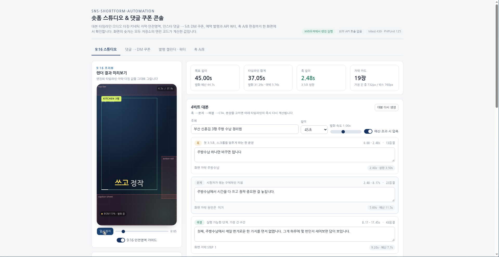</td>
    <td>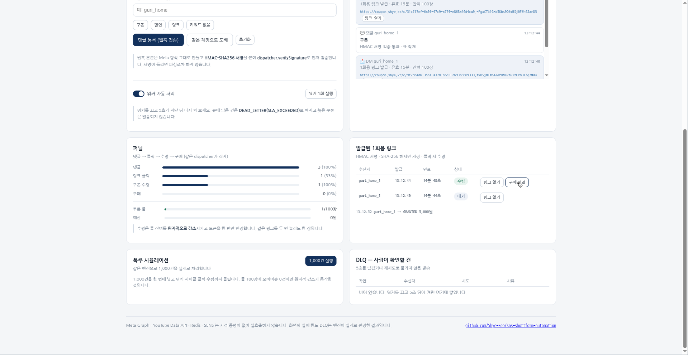</td>
  </tr>
  <tr>
    <td>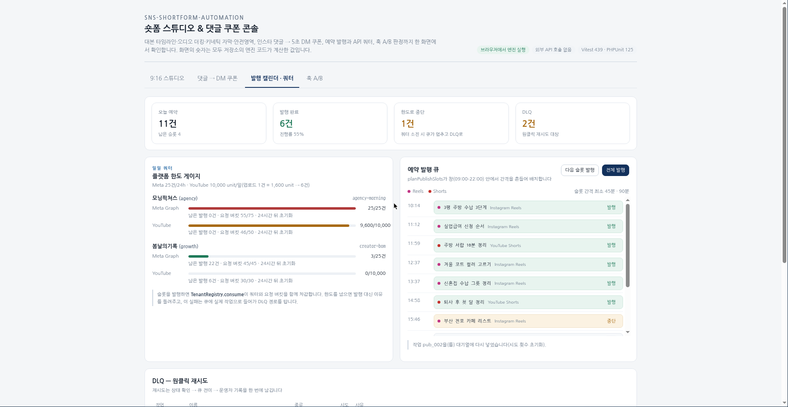</td>
    <td>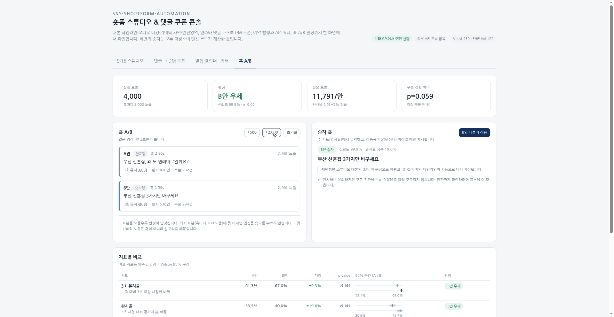</td>
  </tr>
</table>

### 18.1 같은 코드를 두 런타임에서 돌리는 방식

- `docs/app/app.js`는 `web/main.tsx`를 esbuild로 번들한 단일 파일입니다(런타임 의존성 없음).
  React는 이미 devDependency였고, 번들러는 esbuild 하나만 추가했습니다.
- 엔진 모듈은 수정 없이 가져옵니다. 화면과 테스트가 같은 함수를 보므로 프리뷰의 단어 위치와
  렌더 결과가 어긋날 수 없습니다. 자막 줄바꿈도 렌더러와 같은 캡션 박스 폭(`layout.caption.w`)으로
  계산합니다.
- Node 내장 모듈 4개(`node:fs/promises`·`node:path`·`node:child_process`·`node:crypto`)만
  `web/shims/`로 매핑했습니다. 데모가 부르지 않는 경로(파일 쓰기, ffmpeg 실행)는 호출되면
  명시적으로 실패합니다 — 조용히 성공한 척하지 않습니다.
- 해시는 `src/lib/hash.ts` 한 곳에 모았습니다. SHA-256·SHA-1·HMAC-SHA256을 의존성 없이 구현하고
  `tests/hash.test.ts`가 FIPS 180-4 벡터와 `node:crypto` 결과를 함께 대조합니다. 이 작업에서
  55바이트 경계의 패딩 오프바이원(길이가 55 mod 64일 때만 다이제스트가 달라지던 버그)을 찾아
  고쳤습니다. 토큰·서명이 걸린 코드라 테스트 없이 옮기지 않았습니다.

### 18.2 로컬 실행

```bash
npm install
npm run build:web     # docs/ 갱신 (docs/index.html + docs/app/app.js)
npm run dev:web       # http://127.0.0.1:4173 (의존성 없는 정적 서버)
npm run typecheck:web # 타입 검사 (src + web, DOM lib 포함)
```

### 18.3 테스트

| 파일 | 건수 | 내용 |
|------|------|------|
| `tests/hash.test.ts` | 9 | SHA-1/SHA-256/HMAC 벡터, `node:crypto` 대조, 55바이트 경계, `createHash` 표면 |
| `tests/webModels.test.ts` | 13 | 타임라인 합계·3.5초 훅·자막 폭·더킹 15/55%·편집 문장 보존·댓글 1건→DM 1건·도배 차단·5초 초과 DLQ·1,000건 오버이슈 0·쿼터 소진·DLQ 재시도·A/B 판정 |
| `tests/webConsole.test.tsx` | 4 | jsdom에서 실제 클릭: 스튜디오 렌더, 댓글→DM→수령, 쿼터 중단, A/B 표본 수집 |

### 18.4 정직한 경계

- Meta Graph API·YouTube Data API·Redis·SENS는 자격 증명이 없어 호출하지 않습니다. 데모의
  한도·거부·DLQ는 엔진이 내린 판정이고, 플랫폼의 응답이 아닙니다.
- 훅 A/B의 노출·시청 수는 시뮬레이션입니다. 검정·신뢰구간·승자 판정은 실제 통계 모듈이 계산합니다.
- 브라우저는 렌더하지 않습니다. 프리뷰는 타임라인·자막·더킹 값을 그리는 화면이고, 인코딩은
  워커의 ffmpeg가 `docs/demo.mp4`처럼 수행합니다.

---

## 작성자

**서승혜 (Seunghye Seo)** — Frontend & Fullstack Engineer (4년 차)  
GitHub [@Shye-Seo](https://github.com/Shye-Seo) · tjtmdgp95@gmail.com · 정보처리기사

### 주요 실무 경력 (주식회사 채티스 · 커머스 SaaS 셀링스톰)
이커머스 자동화 솔루션(SellingStorm) 기획·개발팀에서 프론트엔드(TypeScript, Tailwind)부터 백엔드(Modern PHP), DB 모델링(MySQL Workbench), 외부 연동까지 **서비스 1인 풀사이클을 주도 완주**했습니다.
- **아임웹 앱스토어 OAuth 2.0 온보딩**: 이커머스 입점 셀러의 무중단 계정 연동 및 웹훅 기반 구독·해지 라이프사이클 파이프라인 설계
- **상세페이지 임베디드 위젯 SDK**: 자사몰·스마트스토어 상세페이지용 초경량 반응형 위젯 SDK 개발 및 크롤러 방어(`X-Robots-Tag: noindex`) 최적화
- **멀티 테넌트 쿼터 관리 백오피스**: 테넌트별 API 호출량 및 플랜별 리소스 사용량을 격리 제어하는 쿼터(Quota) 관리 시스템 구축
- **대외 서비스 연동 & DB 설계**: 네이버클라우드 SENS 알림톡 및 인스타그램 Graph API 연동, MySQL 8.0 EER 스키마 설계 및 성능 튜닝

> 이 저장소의 질문은 "AI로 대본을 어떻게 뽑는가"가 아니라, **창작 이후의 60분과
> 운영 이후의 실패를 어떻게 결정론적으로 제거하는가**입니다. 남은 판단은 사람이
> 3분 안에 하고, 나머지는 큐가 책임집니다.

## License

MIT — `LICENSE` 참고. 폰트(Pretendard)와 BGM은 포함하지 않으며 각 라이선스를 따라
직접 준비해야 합니다.
