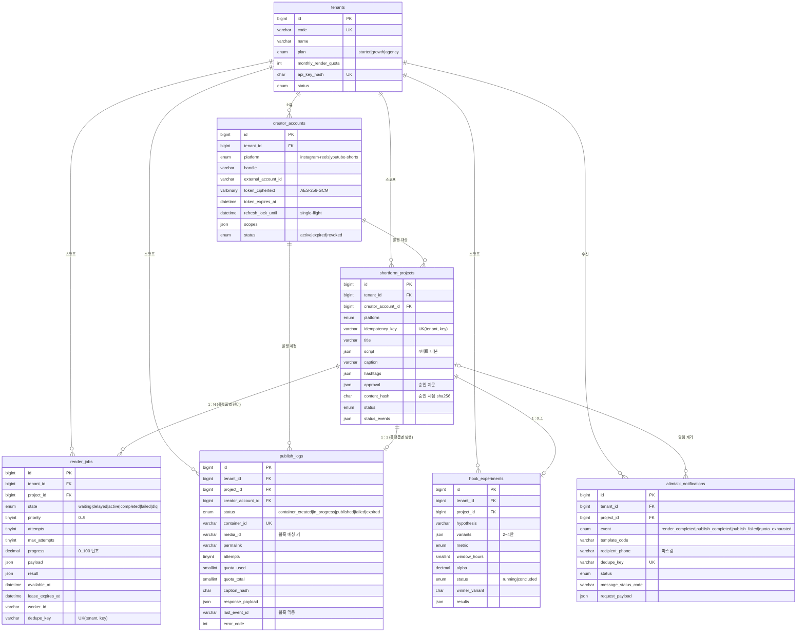
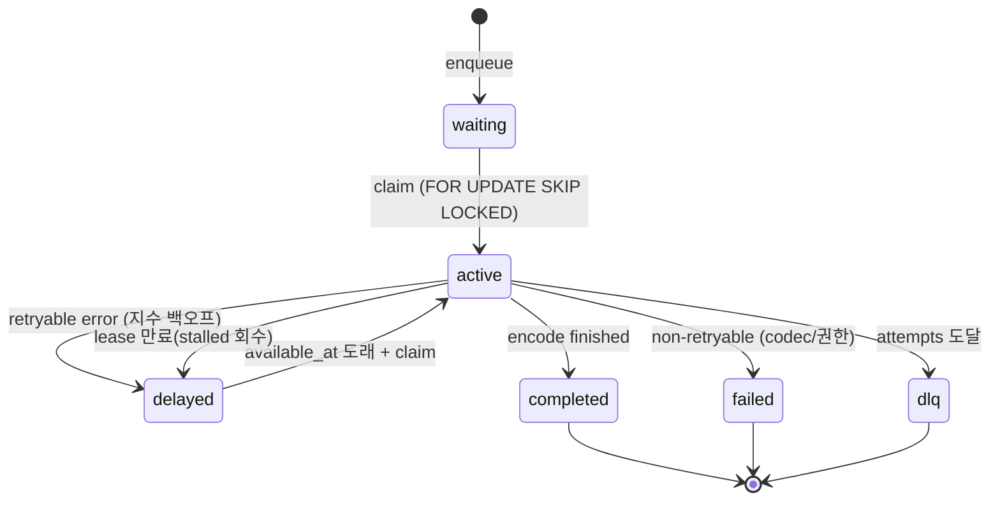
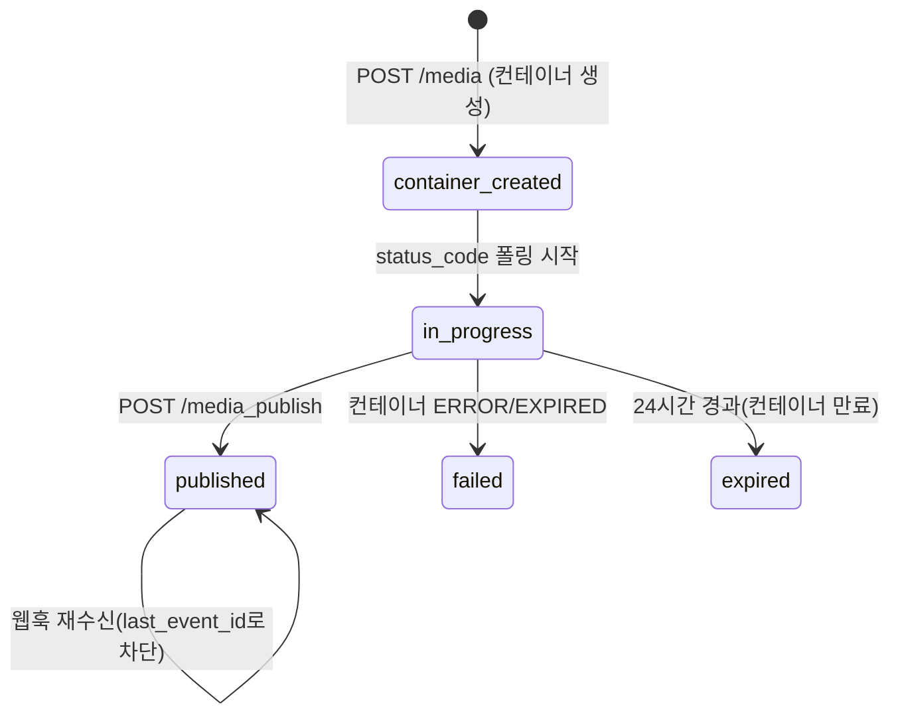

# shortform-engine · DB ERD 및 물리 모델 설계서

> 대상 DBMS: **MySQL 8.0.19+** (InnoDB, `utf8mb4_0900_ai_ci`)
> 모델링 도구: **MySQL Workbench 8.0** — `database/schema.sql`을 `Database > Reverse Engineer`로
> 읽으면 이 문서의 EER 다이어그램과 같은 구조가 나옵니다.

---

## 1. 무엇을 모델링했나

이 리포지토리의 1세대 파이프라인은 "영상 1편을 만드는 일"을 자동화합니다. 이 스키마는 그 다음
문제, 즉 **대행사가 30개 계정으로 하루 60편을 예약하는 상황**을 지탱하는 데이터를 담습니다.

| 요구 | 설계 답 | 테이블 |
| --- | --- | --- |
| 테넌트 격리(대행사 A의 폭주가 B의 예약을 밀지 않음) | 테넌트 + 플랜별 렌더 쿼터 | `tenants` |
| 계정별 장기 토큰과 갱신 상태 | 암호문 1컬럼 + 만료 시각 + single-flight lease | `creator_accounts` |
| 대본(4비트)·캡션·승인 지문 | JSON 대본 + `content_hash`(승인 이후 변경 감지) | `shortform_projects` |
| 재시작해도 살아남는 렌더 큐 | 상태·시도·lease·전이 이력이 모두 행에 있음 | `render_jobs` |
| 발행 3단계(컨테이너→준비→발행)와 쿼터 | 단계별 시각·컨테이너 id·쿼터 사용량·웹훅 멱등 키 | `publish_logs` |
| 훅 A/B와 판정 | 훅 3안(JSON) + 통계 판정 결과(JSON) | `hook_experiments` |
| 알림톡 발송·도달 | 이벤트별 템플릿 + dedupe 키 + 수신 코드 | `alimtalk_notifications` |

---

## 2. ERD



---

## 3. 테이블 요약

| 테이블 | 역할 | 유니크 키 | 증가 패턴 |
| --- | --- | --- | --- |
| `tenants` | 대행사·플랜·렌더 쿼터 | `code`, `api_key_hash` | 수십 행 |
| `creator_accounts` | 발행 계정·토큰 상태 | `(tenant_id, platform, external_account_id)` | 계정 연결 시 |
| `shortform_projects` | 대본·캡션·승인·상태 | `(tenant_id, idempotency_key)` | 콘텐츠 편수만큼 |
| `render_jobs` | 내구성 큐 | `(tenant_id, dedupe_key)` | 프로젝트 × 플랫폼 + 재시도 없음 |
| `publish_logs` | 발행 시도·쿼터·웹훅 | `(project_id, platform)`, `container_id` | 프로젝트 × 플랫폼 1행 |
| `hook_experiments` | 훅 A/B 판정 | `project_id` | 프로젝트당 1행 |
| `alimtalk_notifications` | 알림 이력 | `dedupe_key` | 이벤트성 |

**관계 설계에서 의도한 것**

- `render_jobs`를 프로젝트에 1:N으로 둔 이유: 같은 대본을 Reels와 Shorts로 각각 렌더해야 하고,
  렌더 규격(길이·비트레이트)이 다릅니다. 반대로 `publish_logs`는 `(project_id, platform)`이
  유니크이므로 "같은 영상을 두 번 발행"이 구조적으로 불가능합니다.
- `shortform_projects.creator_account_id`는 `ON DELETE RESTRICT`입니다. 계정을 지우면 그 계정의
  영상 이력이 고아가 되므로, 삭제 대신 `status='revoked'`로 닫습니다. 그래서 테스트/운영에서
  정리 순서는 **projects → accounts → tenants**입니다.
- `alimtalk_notifications.project_id`는 `ON DELETE SET NULL` — 프로젝트가 지워져도 "이 번호로
  무슨 알림이 나갔는지"는 남아야 CS가 됩니다.

---

## 4. 상태머신 (테이블이 곧 상태)

### 4.1 렌더 큐 (`render_jobs.state`)



재시도 판단은 **애플리케이션이 아니라 행**이 결정합니다: `attempts`와 `max_attempts`, 그리고
`retryable` 여부가 `state`를 정합니다. 워커가 죽어도 `lease_expires_at`만 보고 회수할 수 있습니다.

### 4.2 발행 (`publish_logs.status`)



---

## 5. 인덱싱 전략

### 5.1 `render_jobs (state, priority DESC, available_at, id)` — 큐의 유일한 핫 패스

```sql
KEY idx_jobs_queue (state, priority DESC, available_at, id)
```

스케줄러는 매 선점마다 "지금 실행 가능한 작업 중 우선순위가 가장 높고, 같은 우선순위면 가장 오래
기다린 작업"을 찾습니다. 이 인덱스는 그 정렬을 **인덱스 순서 그대로** 제공합니다.

- `priority DESC`: MySQL 8.0은 DESC 인덱스를 실제로 내림차순 저장합니다. `ORDER BY priority DESC`가
  filesort 없이 처리됩니다.
- `available_at`: 지연 재시도(`delayed`)의 도래 시각. 범위 조건이 됩니다.
- `id`: 동시 도래 시 삽입 순서를 고정(공정성). InnoDB 보조 인덱스는 PK를 암묵적으로 포함하지만,
  명시하면 정렬 의도가 인덱스 정의에 드러납니다.
- **`tenant_id`를 선두에 두지 않은 이유**: 전역 스케줄러는 테넌트 경계를 넘어 공정하게 분배해야
  합니다(한 테넌트의 1만 잡이 다른 테넌트의 예약을 굶기면 안 됨). 테넌트 단위 조회는
  `idx_jobs_tenant_state`가 담당합니다.

선점 쿼리는 `SELECT … ORDER BY … LIMIT 1 FOR UPDATE SKIP LOCKED`입니다. SKIP LOCKED가 없으면
워커 10개가 같은 행에 줄을 서고, 있으면 각자 다른 행을 집습니다. 이 한 줄이 "워커를 늘려도
처리량이 늘지 않는" 문제를 없앱니다.

### 5.2 `idx_jobs_lease (state, lease_expires_at)` — 죽은 워커 회수

`state='active' AND lease_expires_at < NOW()`만 스캔합니다. active 행은 소수이므로 인덱스가
작게 유지되고, 회수 배치는 밀리초 단위로 끝납니다.

### 5.3 `uq_publish_project_platform (project_id, platform)` — 발행 유일성

"같은 프로젝트를 두 번 발행"을 DB가 막습니다. 재시도는 새 행이 아니라 같은 행의 `attempts`를
올리므로, 발행 기록이 중복되지 않으면서 시도 횟수는 정확히 남습니다.

### 5.4 `idx_publish_media (media_id)` — 웹훅 진입점

Meta 웹훅은 `media_id`만 줍니다. 이 인덱스가 없으면 웹훅 1건마다 전체 스캔입니다.

### 5.5 `uq_notification_dedupe (dedupe_key)` — 알림 중복 차단

`INSERT IGNORE` 한 문장으로 "확인 + 적재"를 원자화합니다. 두 워커가 동시에 같은 이벤트를
처리해도 한 쪽만 성공합니다.

---

## 6. 타입 선택 근거

| 결정 | 선택 | 이유 |
| --- | --- | --- |
| 큐 상태 | `ENUM` | 상태 집합이 코드(TS `JobStateSchema`)와 1:1로 고정. 잘못된 상태는 INSERT에서 거부 |
| 우선순위 | `TINYINT UNSIGNED (0~9)` | 도메인이 0~9로 정의되어 있고, CHECK로 범위를 고정 |
| 진행률 | `DECIMAL(5,2)` | 0.00~100.00. 반올림 규칙이 명확하고 앱에서 표시하기 쉽다(단조 증가는 `GREATEST()`로 강제) |
| 대본/텔레메트리 | `JSON` | 4비트 구조·장면·압축 리포트는 형태가 자주 바뀐다. 조회에 쓰는 값(상태·기간·훅 유형)만 정규 컬럼으로 꺼냈다 |
| 토큰 | `VARBINARY(1024)` | 암호문(AES-256-GCM, nonce+tag 포함). 평문·JSON 저장 금지. 만료·갱신 상태는 조건 조회해야 하므로 별 컬럼 |
| 외부 계정 id | `VARCHAR(64)` | IG Business User ID(17자리)와 YouTube channel ID(24자)를 같은 컬럼에 담는다 |
| 시각 | `DATETIME(3)` | lease 만료·웹훅 순서를 밀리초로 비교한다 |
| 쿼터 | `SMALLINT UNSIGNED` | 25/6처럼 작은 값. CHECK로 `used <= total` 강제 |

---

## 7. 운영 쿼리

### 7.1 지금 실행 가능한 작업 1건 선점

```sql
SELECT * FROM render_jobs
WHERE state IN ('waiting','delayed') AND available_at <= ?
ORDER BY priority DESC, available_at ASC, id ASC
LIMIT 1
FOR UPDATE SKIP LOCKED;
```

### 7.2 테넌트별 큐 현황

```sql
SELECT state, COUNT(*) FROM render_jobs WHERE tenant_id = ? GROUP BY state;
```

### 7.3 마켓별 발행 현황(오늘 발행 수 = 쿼터 사용량)

```sql
SELECT status, COUNT(*) FROM publish_logs
WHERE tenant_id = ? AND created_at >= CURDATE()
GROUP BY status;
```

### 7.4 만료 임박 토큰(갱신 워커)

```sql
SELECT id, handle FROM creator_accounts
WHERE status = 'active' AND token_expires_at < DATE_ADD(NOW(), INTERVAL 24 HOUR)
  AND (refresh_lock_until IS NULL OR refresh_lock_until < NOW());
```

`refresh_lock_until`이 single-flight 장치입니다. 30개 예약이 동시에 만료 토큰을 만나도 한 워커만
갱신하고 나머지는 대기합니다. 동시 갱신은 이전 토큰을 무효화해 전부 실패시킵니다.

---

## 8. 규모·확장

| 상황 | 지금 | 다음 단계 |
| --- | --- | --- |
| 잡 수백만 | 인덱스 + 주기적 아카이브 | `completed`/`failed`를 월 단위 파티션으로 분리, 7일 후 아카이브 테이블로 이동 |
| 워커 50+ | SKIP LOCKED | 동일. 단 `ORDER BY`가 인덱스만 타는지 `EXPLAIN`으로 상시 확인 |
| 발행 이력 장기 보관 | publish_logs 단일 | 테넌트별 아카이브 + 웹훅 원문은 오브젝트 스토리지로 |
| 통계 조회 | JSON 결과 | 실험 판정 원자료(웹훅 샘플)를 별 테이블로 정규화 + 야간 집계 테이블 |
