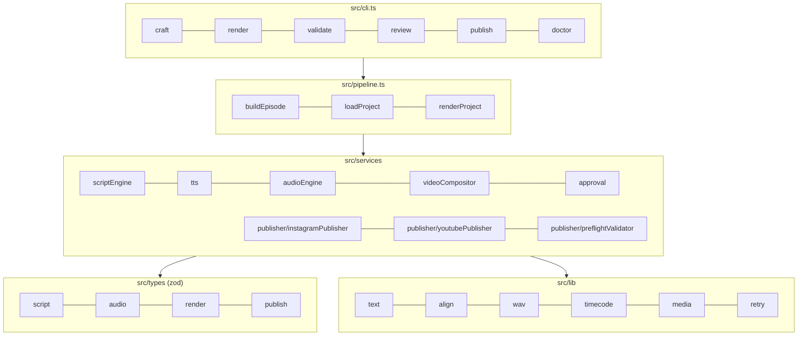
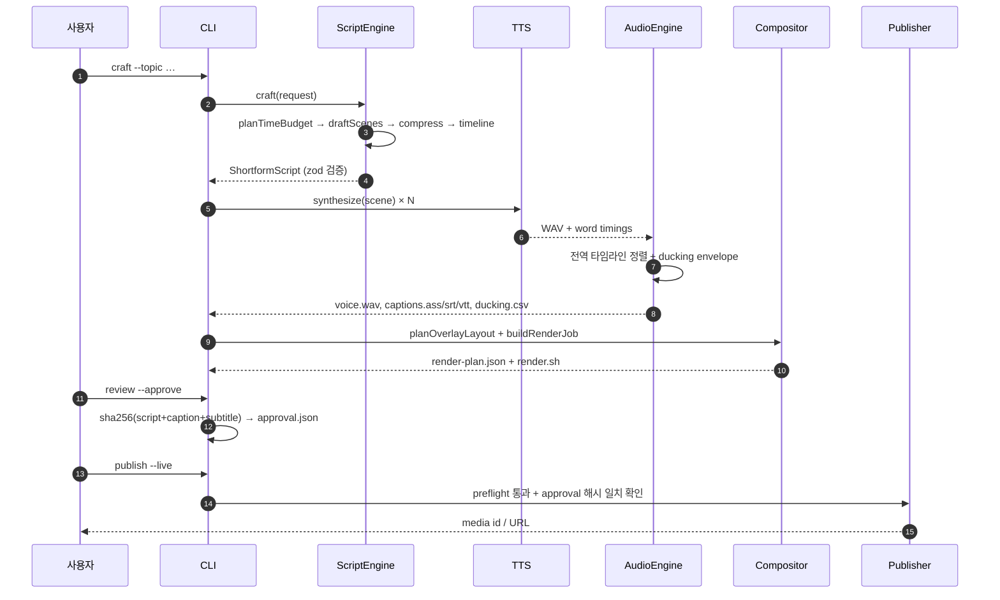
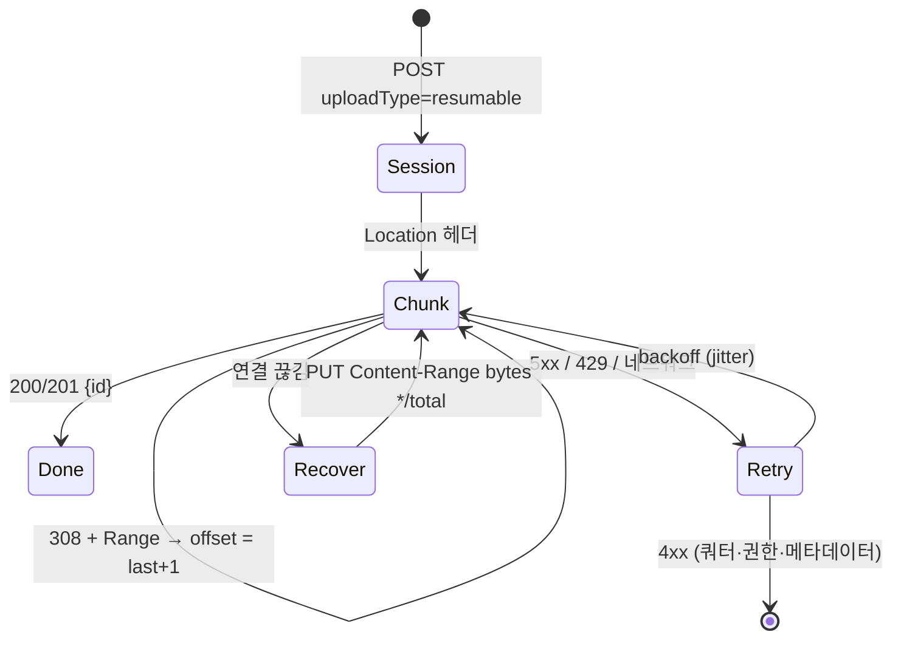
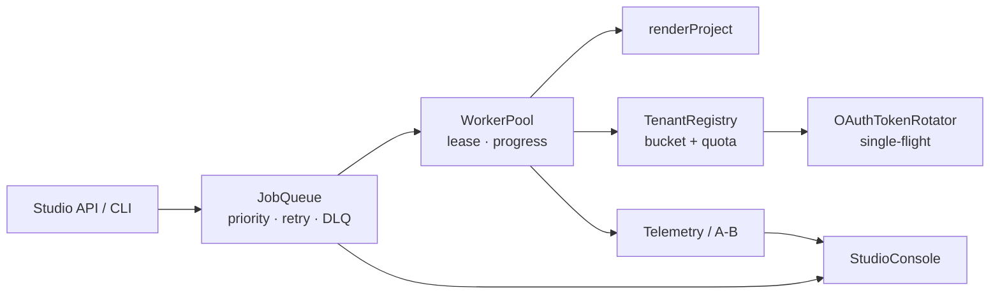

# Architecture

이 문서는 코드 구조와, 코드에 담긴 판단의 이유를 기록합니다.
README가 "무엇을 하는가"라면 여기는 "왜 이렇게 했는가"입니다.

## 1. 레이어



**원칙**

1. **경계는 스키마로** — `src/types/*`의 zod 스키마가 모듈 간 계약입니다. 잘못된 대본·페이로드는 경계에서 즉시 실패합니다.
2. **부수효과는 주입** — HTTP(`HttpClient`), TTS(`TtsProvider`), sleep, clock, ffprobe를 전부 주입 가능하게 했습니다. 그래야 CI에서 네트워크·바이너리 없이 전체 흐름을 돌릴 수 있습니다.
3. **계산과 실행의 분리** — 렌더는 항상 `RenderJob`(계획)을 먼저 만들고, `--execute`일 때만 ffmpeg를 호출합니다. 무엇이 실행될지 모르는 자동화를 만들지 않기 위해서입니다.

## 2. 데이터 흐름



## 3. 주요 설계 결정

### 3.1 대본을 음절로 예산화하는 이유

영어 WPM은 단어 기준이지만 한국어는 **음절**이 발화 시간과 직선에 가깝습니다.
`5.4음절/초`는 또박또박한 릴스 나레이션의 실측치로, 60초 기준 약 300음절입니다.

- 문장부호는 별도 쉼(쉼표 0.1s, 마침표 0.24s)으로 계산해 **말하는 시간 + 쉬는 시간**을 분리합니다.
- 속도 배율은 발화에만 적용하고 쉼에는 `1/√speed`로 완만하게 적용합니다(빨리 말해도 숨은 그대로 필요).
- 예산을 넘으면 압축 패스가 순서대로 작동하고, 그래도 안 되면 **해결책 장면을 통째로 삭제**합니다. 20초 브리프에 3단계를 우겨넣는 것보다 2단계가 낫기 때문입니다.

### 3.2 씬 단위 TTS

전체 대본을 한 번에 합성하면 한 문장 수정에도 전체를 다시 만들어야 하고, 문단 사이 쉼을 세밀하게 제어할 수 없습니다.
씬 단위로 합성하면:

- 한 씬만 재합성 (비용·시간 절감)
- 씬 경계에 정확한 무음(gap) 삽입
- 씬이 슬롯을 넘으면 **뒤 씬을 밀어서** 타임라인을 재배치 (말이 잘리지 않음)

WAV는 네이티브로 합성·믹스하고, mp3를 주는 provider는 ffmpeg로 48kHz 모노 WAV로 정규화한 뒤 같은 경로를 탑니다. 덕킹·자막 오프셋이 항상 같은 포맷 위에서 계산됩니다.

### 3.3 정렬 신뢰도 표기

| provider | 정렬 방식 | `alignmentSource` |
|----------|-----------|-------------------|
| ElevenLabs `/with-timestamps` | 문자별 시작·끝 → 단어 구간 | `provider` |
| OpenAI TTS | 오디오만 반환 → 음절 가중 분배 | `estimated` |
| Local 합성음 | 목표 길이에 맞춰 분배 | `estimated` |

`estimated`인 경우 자막이 0.1~0.2초 어긋날 수 있습니다. 이 사실을 산출물(`project.json`)에 남겨, 검수자가 자막을 더 꼼꼼히 보도록 유도합니다.

### 3.4 자막 줄바꿈 DP

목표는 두 가지입니다.

1. **줄 수 최소화** — 2줄에 들어갈 문장을 3줄로 쪼개지 않음
2. **줄 간 균형** — 마지막 줄에 한 단어만 남는 고아 줄 방지

그래서 "줄 수 1개부터 시도 → 각 줄이 폭을 넘지 않는 첫 해를 채택 → 그 안에서 여백 제곱합 최소화"로 풉니다.
DP 상태는 `(줄 번호, 단어 인덱스)`이고 비용은 `Σ(maxWidth - lineWidth)²`입니다.

```
for lineCount = 1..6:
    layout = solve(lineCount)   # 모든 줄이 maxWidth 이하일 때만 유효
    if layout: return layout
return hardSplit(text)          # 한 단어가 폭보다 클 때만
```

### 3.5 ASS 펄스 하이라이트

단어별로 이벤트를 만들면 텍스트가 이벤트마다 다시 그려집니다. 위치가 흔들리면 싸구려처럼 보이므로:

- 모든 이벤트에 동일한 `\pos(centerX, baselineY)` 적용
- 활성 단어만 `\c<hilite>\fscx104\fscy104`, 나머지는 원래 색·스케일
- 줄바꿈은 `\N`으로 고정 (렌더러의 자동 줄바꿈에 맡기지 않음)

`sweep` 모드는 이벤트 1개 + `\kf` 카라오케로, 자막 파일을 외부 편집기에서 열어야 할 때 유리합니다.

### 3.6 프로그레스 바는 왜 ASS인가

처음에는 `drawbox=w='(t/33)*760'`으로 만들었는데, 렌더 결과에서 바가 **항상 전체 폭**으로 나왔습니다.
원인은 `drawbox`가 `x/y/w/h`를 필터 초기화 시 한 번만 평가한다는 점입니다(타임라인 옵션이 아님). `t`가 있어도 매 프레임 갱신되지 않습니다.

그래서 프로그레스 바를 `overlay.ass`의 드로잉 이벤트로 옮겼습니다.

```
Dialogue: 4,...,Bar,,0,0,0,,{\an7\pos(60,1430)\p1\c&H00D4FF&\fscx1\t(0,33120,\fscx100)}m 0 0 l 760 0 ...
```

`\t` + `\fscx`는 libass가 매 프레임 보간하므로 정확히 재생 시간에 비례해 자랍니다.
검증은 실제 렌더에서 1.5s/12s/31s 프레임의 노란 픽셀 폭을 재서 확인했습니다(43px / 282px / 713px).

### 3.7 플랫폼 콘텐츠 박스

| 플랫폼 | 예약 영역 (1080×1920 기준) | 콘텐츠 박스 |
|--------|---------------------------|-------------|
| Instagram Reels | 상단 0–150, 하단 1500–1920, 우측 레일 x 880–1080 · y 980–1560 | x 60–820, y 186–1440 |
| YouTube Shorts | 상단 0–180, 하단 1580–1920, 우측 레일 x 900–1080 · y 1080–1620 | x 60–840, y 216–1520 |

캡션은 캔버스 중앙이 아니라 **콘텐츠 박스 중앙**에 놓입니다. 그래서 릴스 자막이 좌측으로 살짝 치우쳐 보이는데, 이는 우측 하트·댓글 버튼이 글자를 가리지 않게 하기 위한 의도된 배치입니다.

`checkLayoutCollisions`가 모든 레이어를 검사하고, 위반이 있으면 `craft` 단계에서 경고로 노출됩니다.

### 3.8 승인 해시

```ts
hash = sha256({
  scriptId,
  narrations: scenes.map(s => s.narration.trim()),
  caption: script.caption.trim(),
  subtitles: srt.replace(/\r\n/g, '\n').trim(),
})
```

- 줄바꿈 차이는 무시(Windows 체크아웃), 단어 하나 변경은 감지
- `approval.json`에 저장된 해시와 현재 파일 해시가 다르면 `publish`가 `APPROVAL` 오류로 중단
- 이 게이트는 "사람이 봤다"는 주장을 **검증 가능한 사실**로 바꿉니다

### 3.9 API 재시도



- `withRetry`는 `ShortformError.retryable`로만 재시도 여부를 판단 (문자열 매칭 없음)
- Meta의 9004(다운로드 실패)와 190(토큰 만료)은 재시도해도 결과가 같으므로 즉시 실패 + 힌트 반환
- Instagram은 게시 전 `content_publishing_limit`으로 24시간 쿼터(25건)를 확인

## 4. 실패 모드

| 상황 | 동작 |
|------|------|
| ffmpeg 없음 | `render`는 계획까지만, `--execute`는 `MEDIA` 오류로 명확히 중단 |
| TTS가 슬롯 초과 | 씬 시작점을 밀고 경고 기록 (말이 잘리지 않음) |
| 대본이 목표 초과 | 압축 → 장면 삭제 → 그래도 초과하면 `VALIDATION` 오류 |
| 모델 응답이 JSON 아님 | 휴리스틱 폴백 + 경고 (`generationSource: heuristic-fallback`) |
| 렌더물이 규격 미달 | `preflight` 실패 → `--live` 게시 차단 |
| 승인 후 수정 | `APPROVAL` 오류, 재검수 요구 |

## 5. 확장 지점

- 새 플랫폼(틱톡): `Platform` enum + `PLATFORM_RULES` + `PLATFORM_UI_ZONES` + publisher 클래스
- 새 TTS: `TtsProvider` 구현 후 `createTtsProvider`에 등록
- 새 대본 모델: `ScriptModel` 구현 (프롬프트는 `buildScriptPrompt`)
- 자동화: `buildEpisode` / `renderProject` / `publishPayload`를 스케줄러에서 직접 호출

## 6. 2세대: 분산 배포 계층

1세대는 한 편을 만드는 파이프라인이었습니다. 2세대는 그 작업을 **여러 테넌트·여러 편**으로
확장하기 위한 계층이고, 상세 명세는
[distributed-video-pipeline-spec.md](./distributed-video-pipeline-spec.md)에 있습니다.



| 모듈 | 책임 | 경계 |
|------|------|------|
| `lib/queue/jobQueue` | 상태머신·우선순위·백오프·lease·DLQ·멱등 | `QueueStore` 인터페이스 뒤에 저장소를 숨김 |
| `lib/queue/workerPool` | 고정 동시성·진행률·드레인/상시 | 큐 상태를 들고 있지 않음 |
| `lib/queue/renderJob` | 청크 계획·시뮬레이션 핸들러·실 렌더 브리지 | `renderProject`를 주입받아 ffmpeg 의존 없음 |
| `lib/rateLimit/*` | 버킷·일일 쿼터·테넌트 격리·OAuth·지터 슬롯 | 테넌트별 런타임, 전역 상태 없음 |
| `lib/telemetry/*` | 훅 생성·멱등 수집·집계·검정·피드백 | 통계는 순수 함수 |
| `services/studio/*` | 콘솔 스냅샷·HTML·Prometheus·읽기 API | 읽기 전용, 변경은 CLI |

이 계층을 추가하면서 1세대 코드는 바꾸지 않았습니다. `renderProject`와 `publishPayload`는
그대로이고, 큐의 핸들러가 그 함수를 호출할 뿐입니다. **교체 가능한 경계**를 지키는 것이
2세대 작업의 실제 내용이었습니다.
