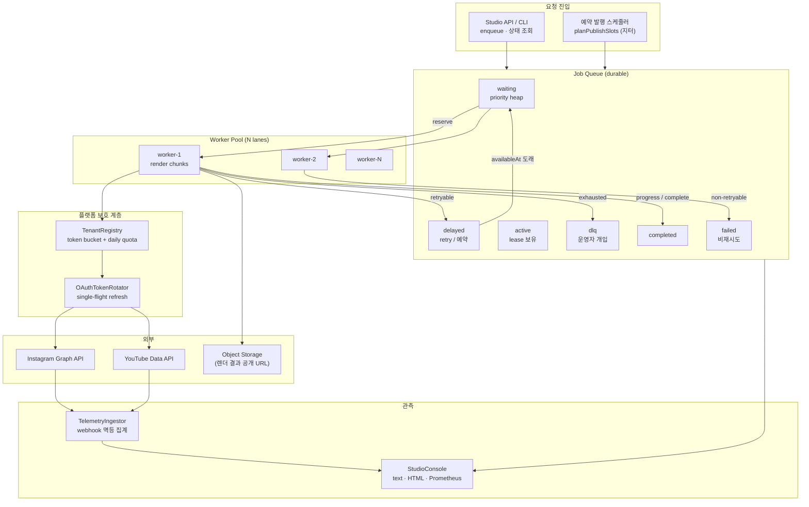
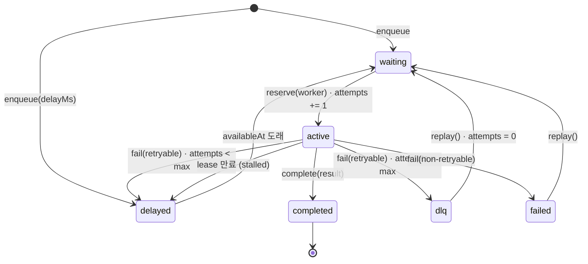
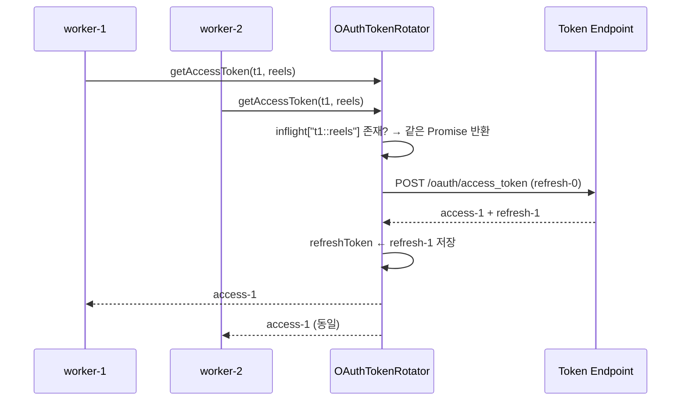
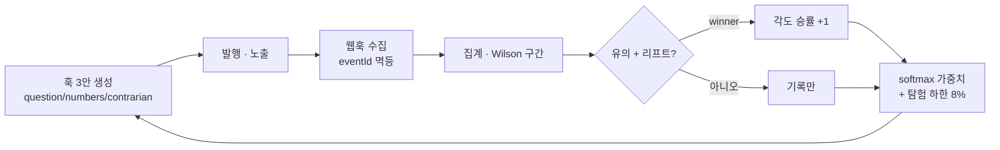

# Distributed Video Pipeline — Architecture Spec

> 이 문서는 `sns-shortform-automation`의 2세대 아키텍처(분산 렌더 큐 · 멀티테넌트 배포)의
> 설계 명세입니다. 코드가 "무엇을 하는가"는 README에, "왜 이렇게 했는가"와 "무엇을
> 보장하지 않는가"는 여기에 적습니다.
>
> 검증 기준: `npm run verify` (TypeScript strict + ESLint + Vitest 300건) · 2026-11-11

---

## 0. 한 장 요약

| 계층 | 구현 | 저장소 | 실패 시 |
|------|------|--------|---------|
| 작업 큐 | `JobQueue` — 우선순위 힙, 지연/재시도, 임차(lease), DLQ | `InMemoryQueueStore` / `FileQueueStore` (Redis·Postgres 어댑터는 같은 인터페이스) | 재시도 3회 → DLQ |
| 워커 | `WorkerPool` — N개 레인, 고정 동시성, 진행률 스트리밍 | 상태 없음 (큐가 진실) | lease 만료 → 다른 워커가 회수 |
| 레이트 리밋 | `RateLimitBucket` + `DailyQuota` + `TenantRegistry` | 테넌트별 메모리 | 429 → `penalize(retry-after)` |
| OAuth | `OAuthTokenRotator` — single-flight, 만료 전 갱신, refresh token 로테이션 | 테넌트×플랫폼 | `invalid_grant` → `needs-reauth` |
| 발행 스케줄 | `planPublishSlots` — 버킷 난수 + 분 경계 회피 | 없음 (계획만) | 창이 부족하면 계획 단계에서 거부 |
| 텔레메트리 | `TelemetryIngestor` → `evaluateExperiment` → `HookFeedbackLoop` | 이벤트 ID 멱등 | 표본 부족 → `insufficient-data` |
| 콘솔/API | `StudioConsole`, `StudioApi` | 읽기 전용 | DLQ ≥ 3 또는 재인증 필요 → critical |

한 문장으로: **"FFmpeg 한 번 호출"을 "실패해도 다시 돌아오는 작업"으로 바꾸고, 그 작업을
테넌트·플랫폼·일일 쿼터 단위로 공정하게 스케줄링하는 것**이 이 계층의 목적입니다.

---

## 1. 문제 정의 — 왜 로컬 CLI로는 안 되는가

초기 버전은 `craft → render → publish`를 한 프로세스에서 순서대로 실행했습니다. 편당
1편을 만드는 데는 충분했지만, 대행사가 크리에이터 30명의 릴스를 하루 60편 예약하는
순간 세 가지가 동시에 깨집니다.

1. **헤드오브라인 블로킹** — 8분짜리 4K 렌더 하나가 뒤의 59편을 막습니다. 렌더는 CPU
   바운드이고, ffmpeg는 프로세스 하나가 코어를 포화시킵니다.
2. **재시도의 비결정성** — 인코더 OOM, 소스 세그먼트 미도착, 업로드 5xx는 일시적입니다.
   반면 코덱 미지원, 토큰 폐기는 영구적입니다. 둘을 같은 `catch`로 처리하면 영구 실패가
   무한 재시도로, 일시 실패가 즉시 폐기로 흘러갑니다.
3. **플랫폼 쿼터** — Meta는 24시간 25건, YouTube Data API는 하루 10,000 unit에 업로드
   1건이 1,600 unit입니다. 즉 **하루 6편**이 상한입니다. 이건 코드가 느려서가 아니라
   계정이 막히기 때문이며, 큐가 쿼터를 알고 있어야 합니다.

여기에 B2B 요구가 하나 더 붙습니다. **한 테넌트의 폭주가 다른 테넌트를 지연시키면 안
된다**는 것. 전역 토큰 버킷 하나로는 이걸 만족할 수 없습니다.

---

## 2. 전체 구조



### 레이어 원칙

1. **큐가 유일한 진실** — 워커는 job 상태를 들고 있지 않습니다. 워커가 죽으면 lease가
   만료되고, 같은 job이 다른 워커에게 재할당됩니다.
2. **부수효과는 주입** — 시계(`now`), 난수(`random`), sleep, HTTP, 토큰 리프레셔가 전부
   주입 가능합니다. 그래서 CI에서 네트워크·ffmpeg·실제 대기 없이 재시도와 장애 복구를
   검증합니다.
3. **계산과 실행의 분리** — 렌더는 계획(`RenderJob`)을 먼저 만들고, 실행은 워커의
   핸들러에서만 일어납니다.

---

## 3. 작업 상태 머신



| 규칙 | 값 (기본) | 이유 |
|------|-----------|------|
| 우선순위 | 0–9, 높을수록 먼저 | 유료 테넌트의 예약 슬롯(9)이 야간 백필(0)보다 앞섬 |
| 동순위 순서 | `availableAt` → `createdAt` → id | FIFO 보장, 재시작해도 순서가 결정적 |
| 재시도 | 3회 (총 시도 3회) | 인코더 OOM·일시 5xx는 2회 안에 대부분 회복 |
| 백오프 | 1s → 2s → 4s, 상한 30s | 지수 + 지터. 호출 폭주 방지 |
| lease | 30s (워커가 heartbeat로 연장) | 워커 사망 감지 상한 |
| DLQ | 재시도 소진 시 | 자동 재시도로는 풀리지 않는 상태를 격리 |
| `failed` | 비재시도 오류 | 코덱 미지원·권한 없음은 replay해도 같은 결과 |
| 멱등 | `dedupeKey` | 웹훅 재전송이 같은 에피소드를 두 번 렌더하지 않게 |
| 진행률 | 0–100, 단조 증가 | 늦게 도착한 청크 이벤트가 바를 되감지 않게 |

### 3.1 lease와 stalled 복구

```ts
// 30초 동안 heartbeat가 없으면 active → delayed (또는 DLQ)
const stalled = jobs.filter(j => j.state === 'active' && j.leaseExpiresAt < now);
await queue.fail(job.id, new Error('lease expired: worker stopped responding'));
```

`attempts`는 **시작 시점에 증가**합니다. 그래서 죽는 워커에서 매번 시작만 하고 끝나지
못하는 job도 maxAttempts에 도달해 DLQ로 갑니다. 시도 횟수를 "성공/실패 시" 증가시키면
이런 job이 영원히 큐를 돕니다.

### 3.2 재시도 백오프의 두 가지 선택

| 방식 | 지연 | 장점 | 단점 |
|------|------|------|------|
| 고정 지연 | 1s, 1s, 1s | 예측 가능 | 동시 실패 시 thundering herd |
| full jitter | `random() * ceiling` | 폭주 분산 최대 | 0.1s 재시도가 429를 심화 |
| **상한 지터 (채택)** | `ceiling - spread + random()*spread` | 폭주 분산 + 최소 대기 보장 | 최악 지연이 상한 근처 |

`jitterRatio: 0.5`, `base 1s`이면 0.5–1.0s → 1.0–2.0s → 2.0–4.0s. 로그에는 항상 실제
지연을 남기므로 "왜 3초 걸렸나"를 사후에 설명할 수 있습니다.

---

## 4. 워커 풀

- **고정 동시성**: `size` 개의 레인이 `reserve()`를 경쟁합니다. 인코딩은 CPU 바운드라
  동시성을 코어 수 이상으로 올리면 p95만 나빠집니다.
- **우선순위 + 공정성**: 힙은 우선순위를 먼저 보지만, 같은 우선순위에서는 도래 시각과
  생성 시각으로 정렬합니다. 기아(starvation)를 막기 위해 `availableAt`을 우선순위보다
  앞세우지 **않습니다** — 대신 운영에서 백필은 낮은 우선순위로 넣습니다.
- **진행률 스트리밍**: 핸들러가 `reportProgress()`를 호출하면 큐 이벤트로 나가고,
  콘솔/API가 이를 구독합니다. 렌더는 마지막 청크가 가장 무겁기 때문에(flush + faststart)
  마지막 청크 가중치를 1.35로 둡니다.
- **드레인 모드**: 야간 배치는 `drain({ waitForDelayed: true })`로 백로그를 비우고 종료,
  상시 서비스는 `start()/stop({ drain })`로 폴링합니다.

실측 (데모 11건, 동시성 3): 최대 동시성 3, p95 133ms, 워커 활용률 98/74/73%.
`maxObservedConcurrency`가 `size`를 넘지 않는 것을 단위 테스트로 고정했습니다.

---

## 5. 레이트 리밋 — 두 개의 다이얼

```ts
const bucket = new RateLimitBucket({ capacity: 30, refillPerSec: 0.2 });
const quota = new DailyQuota({ limitUnits: 10_000, windowMs: 24 * 3600_000 });
```

| 다이얼 | 질문 | 실패 시 |
|--------|------|---------|
| 버킷 (`capacity`, `refillPerSec`) | "지금 이 순간 몇 건을 연속으로 보내도 되나" | 429 |
| 일일 쿼터 (`limitUnits`, `unitCost`) | "오늘 남은 예산이 이 작업을 감당하나" | 403 / quotaExceeded |

두 개를 분리한 이유는 **실패 모양이 다르기 때문**입니다. 버킷은 시간이 지나면 회복되지만,
YouTube 일일 쿼터는 Pacific 자정까지 회복되지 않습니다. 하나로 합치면 "5분 뒤 재시도"와
"내일 6시 이후"를 구분할 수 없습니다.

| 플랫폼 | 버스트 | 지속 | 일일 | 작업 단가 |
|--------|--------|------|------|-----------|
| Meta Graph | 30 | 0.2/s | 25건 | 1 |
| YouTube Data v3 | 20 | 0.1/s | 10,000 unit | 1,600 unit (업로드 6건) |

### 5.1 멀티테넌트 격리

버킷·쿼터·패널티는 **테넌트 런타임 안에** 있습니다. 전역 버킷을 두면 테넌트 A의 바이럴
대응이 테넌트 B의 예약 발행을 밀어냅니다. 격리는 관례가 아니라 자료구조로 보장합니다
(`테스트: exhausts one tenant's quota without touching another`).

### 5.2 429 처리

`penalize(retryAfterMs)`는 `Retry-After`를 하드 스톱으로 적용합니다. 토큰이 남아 있어도
그 시간까지는 아무 호출도 통과하지 않습니다. 재시도 횟수는 줄이지 않습니다 — 429는
"실패"가 아니라 "아직"이기 때문입니다.

---

## 6. OAuth 2.0 로테이션



| 상황 | 처리 | 다음 호출 |
|------|------|-----------|
| 만료 5분 전 | 선제 갱신 | 정상 |
| 동시 8건 | single-flight로 1회 호출 | 모두 같은 토큰 |
| `invalid_grant` (폐기) | `needs-reauth` 표시, 이후 호출 차단 | 운영자 재연결 |
| 5xx / 타임아웃 | 재시도 가능 오류로 전파, 상태 유지 | 다음 호출이 재시도 |
| 로테이션 | 새 refresh token을 즉시 저장 | 이전 토큰 재사용 금지 |

`refreshTokenFingerprint`조차 스냅샷에 넣지 않습니다. 콘솔은 "재인증 필요"라는 사실만
알면 되고, 비밀은 화면·로그·메트릭 어디에도 남기지 않습니다.

---

## 7. 지터 발행 스케줄러

플랫폼은 계정 행동을 패턴으로 평가합니다. 매일 09:00:00, 10:00:00, 11:00:00에 정확히
발행하는 계정은 사람이 아니라 스케줄러로 보입니다. 그렇다고 발행을 랜덤하게 흩뿌리면
운영자가 시간을 예측할 수 없습니다.

절충:

1. 최소 간격으로 모든 슬롯을 먼저 배치한다.
2. 남은 여유(slack)를 **지수 분포 가중치**로 나눠 간격에 더한다. 균등 난수는 정규화 후
   거의 일정한 간격으로 압축되어, 없애려던 규칙성이 다시 생긴다.
3. 첫 슬롯에 난수 오프셋, 마지막에 난수 꼬리를 둔다. 창의 양 끝에 고정되면 그것이
   새로운 지문이 된다.
4. 분 경계 15초 이내면 밀어낸다 (cron이 깨어나는 시각 회피).

측정 (14시간 창, 6건, 최소 60분, 3회): 간격 평균 146–152분, 표준편차 60–68분,
**규칙성 계수 0.40–0.47**. 간격이 일정한 스케줄(계수 0)과 명확히 구분됩니다.

트레이드오프: 이 방식은 "가장 이른 슬롯"을 보장하지 않습니다. 30건을 1시간 안에
몰아넣으려 하면 계획 단계에서 거부됩니다(`window cannot fit …`). 이건 의도된 실패입니다 —
불가능한 계획을 세우고 발행 시점에 429를 만나는 것보다 낫습니다.

---

## 8. 훅 A/B 테스트와 텔레메트리

### 8.1 지표 정의

| 지표 | 계산 | 의미 |
|------|------|------|
| `viewRate3s` | 3초 조회 / 노출 | 훅이 스크롤을 멈췄는가 |
| `retention` | 완청 / 3초 조회 (24h 또는 7d) | 끝까지 봤는가 |
| `avgWatchSec` | 시청시간 / 3초 조회 | 얼마나 오래 머물렀는가 |
| `commentRate` | 댓글 / 노출 | 반응을 만들었는가 |

### 8.2 판정 규칙 (보수적)

1. 변형별 표본이 `minSample`(기본 200) 미만이면 **insufficient-data**. 첫 100뷰는
   알고리즘의 셔플이지 훅의 성과가 아닙니다.
2. **리더 vs 2위**만 검정합니다. 3개를 전부 쌍비교해 가장 작은 p값을 고르는 것이
   다중비교로 가짜 승자를 만드는 전형입니다.
3. 통계적 유의성(p < 0.05) **그리고** 상대 리프트 ≥ 5%를 모두 요구합니다.
   n=200,000에서 0.4pp 차이는 유의하지만 쓸모없습니다.

필요 표본 (baseline 40%, α=0.05, power=0.8):

| 최소 감지 효과 | 변형당 필요 표본 |
|----------------|------------------|
| +20% (40%→48%) | 604 |
| +10% (40%→44%) | 2,389 |
| +5% (40%→42%) | 9,493 |

이 표를 README에 두는 이유는, "A/B 테스트 했습니다"보다 "이 정도 표본이 없으면 승자를
부르지 않습니다"가 엔지니어링 주장이기 때문입니다.

### 8.3 피드백 루프



가중치는 승률이 아니라 **대조군 대비 리프트**로 계산합니다. 승률로 하면 "실험에서 진
각도(0.4)"가 "아직 안 해본 각도(0.5)"보다 낮게 평가되어, 진 각도가 영원히 뒤로 밀립니다.
리프트는 승자 > 미실험 > 패자 순서를 유지합니다.

---

## 9. 콘솔과 API

`StudioConsole.snapshot()` 하나가 text/HTML/Prometheus/JSON의 공통 소스입니다.

| 경로 | 내용 |
|------|------|
| `GET /v1/health` | 상태 + 사유 |
| `GET /v1/queue` | 상태별 카운트, 성공률, p95 |
| `GET /v1/queue/dlq` | 격리된 작업 |
| `GET /v1/workers` | 워커별 처리량·활용률 |
| `GET /v1/tenants` · `/v1/tenants/:id/limits` | 테넌트별 버킷·쿼터 잔량 |
| `GET /v1/experiments` · `/v1/experiments/:id` | 훅 실험 판정 |
| `GET /v1/metrics` | Prometheus text |

**읽기 전용**입니다. DLQ replay 같은 변경은 CLI에만 있습니다 — GET으로 큐를 되돌릴 수
있는 대시보드는 언젠가 실수로 되돌립니다.

건강도 3단계: `ok` → `degraded`(DLQ 1건, 비재시도 실패, 쿼터 소진, 성공률 < 90%) →
`critical`(DLQ 3건 이상, 재인증 필요, 성공률 < 70% & 표본 5건 이상). DLQ 1건은 일상이고,
DLQ가 자라는 것이 사건입니다.

---

## 10. 검증

```bash
npm ci
npm run verify   # typecheck + lint + vitest
npm run coverage # 84.3% statements / 79.7% branches
```

| 영역 | 테스트 파일 | 건수 | 고정한 것 |
|------|-------------|------|-----------|
| 큐 | `queue.test.ts` | 36 | 우선순위, 지연, 백오프 1·2·4s, DLQ, replay, lease 만료, 멱등, 파일 저장소 |
| 워커 | `workerPool.test.ts` | 17 | 동시성 상한, 재시도, 진행률, 워커별 부하, 드레인 한도 |
| 레이트 리밋 | `rateLimit.test.ts` | 21 | 버스트/리필, 429 패널티, 테넌트 격리, YouTube unit 계산 |
| OAuth | `oauth.test.ts` | 14 | single-flight, 로테이션, 영구/일시 오류, 테넌트 격리 |
| 스케줄 | `publishSlots.test.ts` | 11 | 창·간격·분 경계·재현성·불가능한 창 거부 |
| 텔레메트리 | `telemetry.test.ts` | 35 | 훅 생성, 멱등 수집, 집계, Wilson·z검정, 표본 하한, 피드백 |
| 콘솔 | `studio.test.ts` | 19 | 스냅샷, HTML 이스케이프, Prometheus, API 라우팅 |
| 기존 파이프라인 | 8개 파일 | 147 | 대본·자막·더킹·렌더·프리플라이트·게시 |

300건 전부 통과. 네트워크·ffmpeg 없이 돕니다.

---

## 11. 정직한 경계

| 항목 | 상태 |
|------|------|
| 분산 큐 상태머신·재시도·DLQ·lease | ✅ 구현·테스트 (단일 프로세스) |
| Redis/Postgres 어댑터 | ⚠️ 인터페이스(`QueueStore`)만 정의. 실제 어댑터는 미구현 |
| 멀티 워커 노드 간 경쟁 | ⚠️ `reserve`는 프로세스 내 원자성만 보장. Redis 어댑터에는 `WATCH/MULTI` 또는 Lua가 필요 |
| 토큰 버킷·쿼터·패널티 | ✅ 구현·테스트 |
| 실제 Meta/YouTube 429 대응 | ⚠️ 프로토콜·헤더 파싱은 구현, 실계정 429 재현은 미실시 |
| OAuth single-flight·로테이션 | ✅ 구현·테스트 (리프레셔 주입, 실제 토큰 엔드포인트 호출은 미실시) |
| 지터 스케줄 | ✅ 계획·통계 검증. 실제 발행 결과와의 상관은 미측정 |
| A/B 통계 | ✅ 구현·테스트. 실제 플랫폼 웹훅 연동은 샘플 스키마 수신 단계 |
| 콘솔/API | ✅ text·HTML·Prometheus·JSON. 인증·권한 계층은 미구현(읽기 전용 전제) |
| 60초 렌더 파이프라인 | ✅ ffmpeg 6.0 실제 인코딩·프리플라이트 통과 (`docs/demo.mp4`) |

이 표를 줄이지 않는 이유: 면접에서 "다 됩니다"보다 "여기까지는 실측, 여기는 설계"를
구분해 말하는 쪽이 신뢰를 얻습니다.

---

## 12. 장애 시나리오 워크스루

**① 워커가 인코딩 중 OOM으로 죽었다**

1. 30초간 heartbeat 없음 → `recoverStalled()`가 `active → delayed` (attempts 유지).
2. 1s/2s/4s 백오프 후 다른 워커가 재할당.
3. 3번째 워커도 실패하면 DLQ. 콘솔은 `degraded`, DLQ 3건이면 `critical`.

**② YouTube 일일 쿼터(10,000 unit)를 다 썼다**

1. `TenantRegistry.check`가 `quota-exhausted` + `resetsInMs` 반환.
2. 발행 job은 `delayed`로 남고, 다음 날 리셋 후 재개.
3. 버킷은 그대로이므로 다른 테넌트·다른 플랫폼은 영향 없음.

**③ 크리에이터가 앱 연결을 해제했다**

1. 토큰 엔드포인트가 `invalid_grant` → `OAuthRefreshError(permanent)`.
2. 자격증명 `needs-reauth`, 이후 호출은 네트워크 없이 즉시 실패.
3. 콘솔 `critical`, 사유에 `needs re-auth`. 재연결 전까지 그 테넌트의 발행만 멈춤.

**④ 같은 웹훅이 24시간 동안 6번 재전송됐다**

1. `eventId` 기준 멱등 수집 → 1건만 집계.
2. `dedupeKey`로 같은 에피소드의 중복 렌더도 차단.
3. 실험 승자가 재전송 횟수만큼 부풀려지는 왜곡이 없음.

---

## 13. 다음 단계

1. `RedisQueueStore` — `ZADD ready`, `HSET job:{id}`, `reserve`는 Lua 스크립트로 원자화.
2. 워커 노드 분리 — 큐를 공유하고 ffmpeg 워커를 별도 컨테이너로. lease가 이미 그 전제.
3. 실계정 429/쿼터 리셋 관측 → 버킷 파라미터를 실측으로 보정.
4. 웹훅 수신 엔드포인트(서명 검증 포함)와 실험 대시보드의 시계열 그래프.
5. 발행 슬롯을 플랫폼별 최적 시간대(인스타 오전·저녁, 쇼츠 저녁)와 결합.
